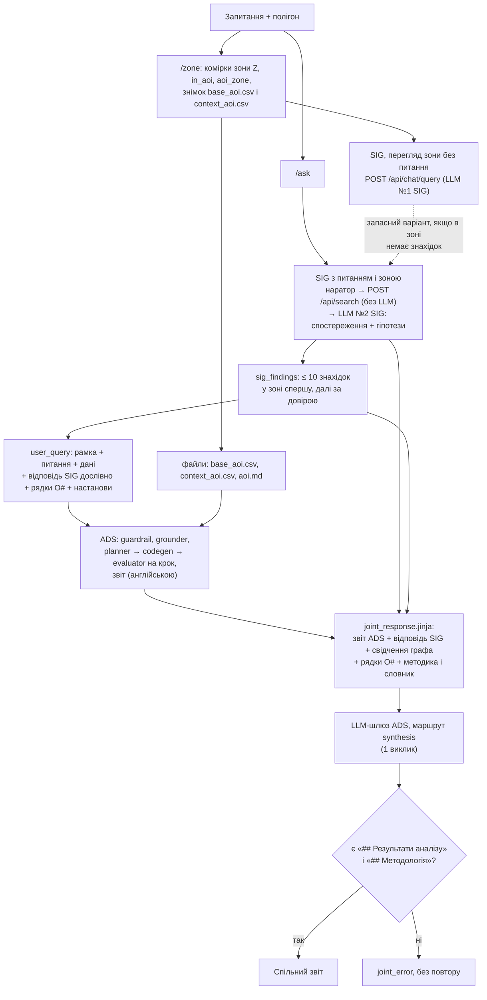

# Як знання SIG доходять до ADS: потік запиту

Опис потоку `aoi-demo` від запитання користувача до відповіді (сценарій A, `HANDOFF=A`). Посилання виду `app.py::name` — функції цієї теки. Порівняння сценаріїв передачі: `handoff_eval.md`.

## Схема

## Що береться з SIG

- `app.py::sig_chat` → `POST {SIG_CHAT_URL}/api/chat/query {question, cells, use_llm}`. Наратор SIG бере `EvidencePayload` з `POST /api/search` графового сервісу (ретривер, без LLM) і з `use_llm: true` робить один виклик LLM через брокер SIG: відповідь українською з двох частин, «Спостереження» і «Інтерпретація (гіпотези)», з посиланнями `[P#]`. З `use_llm: false` той самий маршрут повертає лише свідчення, без моделі.
- Виклик іде двічі на запитання: перегляд зони при замиканні полігона (`run_mine`, без питання) і запит із питанням (`run_ask`). Використовується одна відповідь: з питанням, або перегляд, якщо питання вивело знахідки із зони (`sig_entry`).
- `app.py::sig_findings` лишає до `MAX_INSIGHTS = 10` елементів `view.evidence.items`: у зоні спершу, далі за довірою (1, 2, 6, 5). Поля: заголовок, умова підгрупи (`scope_text`), зсуви (`shift_text`), перевірки, довіра, місце в зоні, позначка крос-шару; комірки й кільця знахідки — з `GET /api/geo/{dataset}/patterns/{pattern}`.
- Збережено також: відповідь SIG (`sig_answer`), текст свідчень, який читала модель SIG (`sig_evidence`), файли-джерела знахідок.

## Що йде в ADS

- Системного промпту демо не має: ADS працює на власних промптах.
- `user_query` (`app.py::ads_query_parts`), шість частин у сталому порядку:
  1. `frame`: «Analyse the area of interest (AOI): »;
  2. `user`: питання дослівно;
  3. `data`: `df_base_aoi`, `df_context_aoi`, контракт колонок H3, лічильники зони, пораховані типи;
  4. `sig_answer`: уся відповідь SIG дослівно;
  5. `observations`: рядки O# (`observation_lines`);
  6. `guidance`: порівняння inside / adjacent / far і перевірка на грубшій сітці; умови SIG як зрізи, гіпотези SIG як твердження для перевірки; відтворення крос-шарового зв'язку; зсуви, не причини.
- Файли сесії: `base_aoi.csv`, `context_aoi.csv` (сирі колонки, `h3_r*`, `in_aoi`, `aoi_zone`) і `aoi.md` (англійський словник колонок).
- В ADS не йдуть: текст свідчень графа і український словник — вони потрапляють лише у фінальний промпт.

## Де обрізається контекст

| Де | Що | Межа |
|---|---|---|
| SIG, ретривер | знахідки у свідченнях | близько десяти на відповідь |
| SIG, наратор | відповідь моделі | 1 200 токенів, ≈ 250 слів |
| demo | знахідки для ADS і мапи | `MAX_INSIGHTS = 10` |
| demo | `aoi.md` | ≤ 2 000 символів, без імперативів (`check`) |
| ADS | `.md`-файли сесії | 800 токенів для grounder, 2 000 для codegen; відмова guardrail скидає їх усі (`domain_knowledge_blocked`) |
| ADS | `user_query` | не обрізається і не сканується |
| demo | відповідь фінального виклику | `JOINT_MAX_TOKENS = 16384` |

Тому все, що є завданням, несе `user_query`, а `aoi.md` — лише словник.

## Як збирається фінальна відповідь

`app.py::joint_report` рендерить `prompts/joint_response.jinja` з блоками `<User_Query>`, `<User_Domain_Knowledge>` (методика зони і словник SIG), `<Analytical_Report>` (звіт ADS), `<Insight_Analysis>` (відповідь SIG), `<Insight_Observations>` (рядки O#), `<Insight_Evidence>` (свідчення графа). Розділ `<insight_integration>` вимагає зводити два джерела по частинах питання, позначати кожне твердження «(ADS)» або «(SIG [P#])» і закінчити підрозділом гіпотез. Один виклик `POST {LLM_URL}/v1/chat/completions`, маршрут `synthesis` шлюзу ADS, температура 0.2. Відповідь без двох обов'язкових заголовків відкидається (`joint_error`), повтору немає.

## Виклики LLM на одне запитання

| Етап | Виклики | Де видно |
|---|---|---|
| SIG, перегляд зони | 1 | `GET /state` → `zone.sig.trace` |
| SIG з питанням | 1 | `ask.trace.search.llm` (модель, час, токени) |
| ADS | 9–20: guardrail, grounder, далі planner, codegen і evaluator на кожен крок, synthesis | `ask.trace.ads.counters` (`total_llm_calls`, токени, кроки); покроково — `GET /trace/ads` і MLflow, http://localhost:5050 |
| Фінальний звіт | 1 | `ask.trace.joint.usage`, `GET /trace/prompt` |

MLflow отримує лише трасування ADS; виклики SIG і фінальний виклик у ньому не з'являються, їхні метрики є в стані демо.
