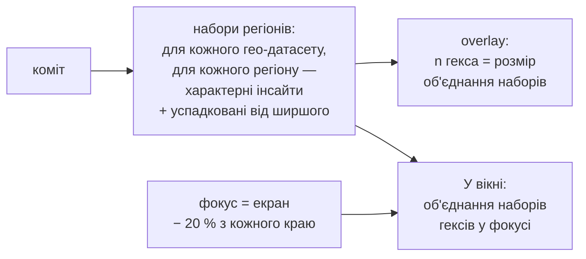

# ADR: гекси на мапі і список «У вікні» за одним правилом

## КОНТЕКСТ

На мапі людина читає дві речі разом: **гекси-регіони з числом** і **список «У вікні»** у правому верхньому куті. Обидві мали б відповідати на одне питання: «що цікавого тут?».

**Гекси** малює `geo_overlay` (`insight_graph_service/core/geo_views.py`). Малюються не всі регіони, а лише до 5 «найсильніших місць» кожного інсайту на кожному рівні плюс регіони його масштабного ланцюжка (`vertical.drawn_regions`). Це правило з'явилося в #93, коли числа були DOM-маркерами і тисяча маркерів вішала мапу на секунди, а #121 закріпив його умовою «регіон, який назвали ZONES, завжди на мапі». Число на гексі — `picture(region).patterns`: скільки інсайтів **будь-якого датасету** мають у цей регіон ребро `IN_REGION` з часткою від 0.2. Від того, що на екрані, воно не залежить.

**Список «У вікні»** рахує `geo_window`. Береться весь прямокутник екрана, разом із тим, що закрите панелями. Інсайт потрапляє до списку, якщо його подій тут не менше, ніж очікувано за його часткою на мапі: згладжений `lift ≥ 1` і щонайменше 5–30 подій (`link_min_events`). Рахуються лише інсайти файлу відкритого датасету.

**Фільтр «Усі датасети»** на вкладці «Мапа» нічого не об'єднує: мапа мовчки бере один датасет (`geo.js`, `refreshPass`).

Регіони H3 глобальні: гекс `R:5:…` біля Фресно — один вузол графа для всіх датасетів.

## ПРОБЛЕМА

Гекс і список суперечать один одному, і людина не може зрозуміти, чому. Виміряно на California (`@6,5`: 2 530 комірок r6, 22 інсайти), 2026-10-26:

- **Числа не збігаються.** Гекс біля Фресно показує 6, а список на тій самій ділянці — 5 із них. Шостий інсайт лежить у гексі за графом, але у вікні його подій замало. Число на гексі рахує й слабкі ребра (частка 0.2–0.5), й інсайти інших датасетів, а два рівні однієї знахідки — це два інсайти в гексі, але один рядок у списку.
- **Мапа виглядає дірявою.** На рівні r5 дані є в 888 регіонах, а намальовано 41; на r3 — 45 і 18. Порожнє місце означає «регіон не потрапив у чийсь топ-5», хоча людина читає його як «тут нічого немає».
- **Число нічого не підказує.** На r5 медіана 6, у 80 % гексів від 2 до 7, кореляція з кількістю даних −0.25. Широкий інсайт «лежить» у сотнях регіонів (один — у 636 гексах r5), тож майже кожен гекс показує приблизно те саме.
- **Список поводиться несподівано.** На огляді всього штату він повний рядків «×1.0», які нічого не кажуть. На порожній ділянці — 0, бо подій менше за поріг.
- **Рахується невидиме.** Комірки під лівою панеллю і під самим списком (≈ 40 % ширини типового екрана) впливають на список.
- **Кілька датасетів.** З кожним новим файлом на ту саму територію числа на гексах ростуть, а список показує лише один датасет. При 5–20 датасетах розбіжність стане ще більшою.
- **Зайва складність.** Вибір «топ-5 місць» для мапи (`drawn_regions` → `_places` → `shown_regions` → `_held`) і правило порядку `first` (`WINDOW_DETAIL_LEVEL`, `WINDOW_DETAIL_REGIONS`, `detail_area`) — механізми, яких людина не бачить, але які й породжують розбіжності вище.

## РОЗГЛЯНУТІ ВАРІАНТИ

### Варіант 1: залишити як є

Переваги:

- без роботи;
- число на гексі показує й інсайти інших датасетів.

Недоліки:

- гекс і список суперечать один одному в будь-якому режимі;
- мапа дірява, а число майже однакове скрізь;
- з кожним новим датасетом розбіжність росте.

### Варіант 2: список «усіх інсайтів у кадрі»

Список показує кожен інсайт, у якого в кадрі є хоч мінімум подій.

Переваги:

- просто пояснити.

Недоліки:

- на California аж до 1/16 площі мапи в кадрі лежать події всіх 22 інсайтів: широкі інсайти є скрізь, і список від положення не залежить;
- гекси й список однаково не узгоджуються.

### Варіант 3: лишити топ-5 регіонів, але рахувати число за правилом вікна

Переваги:

- гекс і список узгоджуються;
- overlay не росте.

Недоліки:

- мапа лишається дірявою;
- вибір топ-5 серед рівних кандидатів випадковий (за id).

### Варіант 4: одне правило «характерне для гекса», усі гекси, фокус із відступом

Переваги:

- гекс і список збігаються за побудовою, і для одного датасету, і для кількох;
- порожнє місце означає «немає даних»;
- знайома логіка кластерів на картах: число → наблизився → побачив;
- коду для мапи стає менше: вибір топ-5 і правило `first` зникають.

Недоліки:

- числа не складаються, як кластери: набір великого гекса не дорівнює сумі наборів малих, а малий гекс рідко набирає поріг подій (на California без успадкування 768 з 888 гексів r5 мали 0). Тому малий гекс успадковує від великого (рішення, п. 1);
- overlay росте до ~1 000 регіонів r5 на реальних мапах;
- на мапі одного датасету число більше не рахує інсайтів інших датасетів (вони видні в графі й у режимі «Усі датасети»).

| Критерій | Як є | Усе в кадрі | Топ-5 + правило | Одне правило, усі гекси |
|:--|:--|:--|:--|:--|
| Гекс і список збігаються | 🔴 Ні | 🔴 Ні | 🟢 Так | 🟢 Так |
| Мапа без «дірок» | 🔴 41 з 888 r5 | 🔴 41 з 888 r5 | 🔴 41 з 888 r5 | 🟢 Усі з даними |
| Число як підказка, де цікаво | 🔴 Майже скрізь 2–7 | 🔴 Майже скрізь 2–7 | 🟢 За даними | 🟢 За даними |
| Список залежить від місця | 🟡 Шум «×1.0» на огляді | 🔴 Усі 22 до 1/16 мапи | 🟡 Шум «×1.0» на огляді | 🟢 Огляд — топ і підказка |
| 5–20 датасетів | 🔴 Розбіжність росте | 🔴 Розбіжність росте | 🟡 Лише один датасет | 🟢 Об'єднання, те саме правило |
| Обсяг змін | 🟢 Немає | 🟡 Сервер і консоль | 🟡 Сервер | 🟡 Сервер і консоль, частина коду видаляється |

## РІШЕННЯ

Обираємо варіант 4: **число на гексі каже, скільки рядків покаже список «У вікні», якщо наблизитись до цього гекса.**

1. **Одне правило — «характерне для гекса».** Один раз на коміт для кожного гео-датасету і кожного регіону рівня, грубшого за його комірки, рахується набір інсайтів, характерних для комірок регіону. Правило те саме, що й зараз у вікні: `lift = (x + 30) / (E + 30) ≥ 1` і `x ≥ link_min_events`, відносно власних точок датасету. Рівні одного файлу згортаються в один рядок (`_fold_levels`), як зараз.
   **Малий гекс успадковує від великого.** До набору малого гекса додаються інсайти великого гекса, що його містить, у яких є хоч одна подія в малому, з lift великого гекса (у підказці рядка: «характерний для ширшої ділянки»). Без цього малий гекс рідко набирав поріг подій, і під гексом із числом 12 усі малі могли мати 0: на реальних даних так було в 7 з 34 гексів r3. З успадкуванням об'єднання малих гексів завжди містить увесь набір великого, тож наближення нічого не губить, а малий гекс може додати своє.
2. **Число на гексі** — розмір набору. Гекс із 0 не підписується, а приглушується.
3. **Гекси на всю територію.** Малюються всі регіони поточного рівня з даними. Рівень, як і зараз, обирається за зумом, одночасно видно один. Рівень, де жоден гекс не має характерних інсайтів, не малюється взагалі: він не дає підказок, тож зум переходить на найближчий рівень із даними. Так на дрібній мапі (r8) з рідкими інсайтами r7 порожній, і мапа одразу показує r5. Числа малюються шаром іконок, а не DOM, тож причина обмеження з #93 зникла.
4. **Список — унікальне об'єднання.** «У вікні» показує об'єднання наборів гексів поточного рівня, у яких є хоч одна комірка з центром у фокусі. Так наближення всередину великого гекса, чий центр уже за екраном, дає саме його набір. Наблизився до одного гекса з «4» — у списку ці 4. Охопив 2–3 гекси — їх унікальні інсайти, без повторів. Рівні згортаються вже над об'єднанням, щоб хост і згорнутий рівень із різних гексів не стали двома рядками.
5. **Фокус — екран мінус 20 % з кожного краю.** Панелі окремо не вирізаються: просто відступ 20 % зліва, справа, зверху й знизу, бо туди людина зазвичай не дивиться. На California списки з відступом збігаються з повним вікном на 0.74–0.94 (Жаккар), стабільність при панорамуванні 0.89–0.97. Панелі здебільшого лягають у ці 20 %. Рамку не малюємо: відступ зачіпає лише гекси, обрізані краєм; якщо щось зникло, людина природно трохи віддаляється. Сильний кроп (центр 50 %) міняв би 30–50 % рядків, і список ставав би стрибучим при панорамуванні (стабільність при зсуві на 10 % падає з 0.92 до 0.82).
6. **Огляд.** Сервер повертає весь впорядкований список: спершу інсайти, характерні для найбільшої кількості гексів у фокусі, далі за lift. Консоль показує перші 8 рядків (`ROWS_SHOWN`), а над ними — «показано 8 з N · наблизьтесь, щоб побачити особливості ділянок» і кнопку «показати всі», що розгортає весь список.
7. **Набір датасетів.** Сервер (`/overlay`, `/window`) приймає набір датасетів. Для кількох датасетів `n` гекса і список — об'єднання їхніх наборів, а кожен рядок несе `dataset_id`. Рівні різних файлів не згортаються: це різні дані. Консоль у #195 шле один датасет; режим «Усі датасети» на мапі (гекси й список з усіх гео-датасетів, комірки лише одного обраного) — окреме issue, що змінює лише консоль.
8. **Інсайт малюється там, де рахується.** Інсайт іншого рівня (табличний чи гео) малюється всіма комірками, де є його події, а не слідом із 80 % найзайнятіших комірок чи «комірками всередині». Інакше гекс рахував інсайт, а клік по ньому в списку не підсвічував нічого в цьому гексі: на реальних даних так було з 70–80 % успадкованих табличних інсайтів. Тепер кожен інсайт, який показує гекс, у ньому підсвічується (100 % на тих самих даних). Зона питання з картки інсайту — ті самі комірки.
9. **Попап комірки узгоджений з гексом:** «Регіон: 13 характерних інсайтів · з них у цій комірці: 4» і список саме цих 4. Числа вкладені одне в одне, тож не суперечать.

Що прибирається: вибір регіонів для мапи через `drawn_regions` / `shown_regions` (граф і ZONES лишають `places` для себе), малювання слідом 80 % і «комірками всередині», правило `first` з його константами, `picture` у властивостях регіону overlay, групування тем у списку (`group_themes`): при восьми видимих рядках тем не буває більше восьми, а розгорнутий список людина обирає сама. `picture` лишається в графі, у панелі вузла і в ZONES.

Наслідки:

- гекс і список кажуть одне й те саме за побудовою, для одного датасету і для 5–20;
- граф, ребра `IN_REGION`, ZONES, SCALE CHAIN і відповіді чату не змінюються: це зміна того, як мапа показує граф, а не математики графа;
- успадкований інсайт у малому гексі показується з lift великого гекса: для нього в малому гексі замало подій, щоб це перевірити, і підказка рядка так і каже;
- overlay більший: на California 937 регіонів, 0.39 МБ (0.07 МБ gzip), будується за 94 мс після коміту; `/window` відповідає за 0.6 мс (p50), 0.9 мс (p95);
- відступ невидимий: якщо заважатиме, його зменшуємо, а не малюємо рамку;
- документація: `docs/current_docs/08_interface.md` §8.7 і таблиця API, `07_question_answering.md` §7.2 (зона базового інсайту — комірки його подій), `09_operations.md` §9.1, `10_verification.md` (тести), `11_reference.md` (глосарій, константи, покажчик формул).

## Action Items/ To Do

- [x] Реалізувати рішення за #195 (сервер для набору датасетів, консоль для одного).
- [x] Обрати відступ фокусу замірами (0 / 10 / 15 / 20 %): обрано 20 %.
- [x] Переміряти overlay (регіонів, МБ, час побудови) і частку гексів із 0 (California, реальні дані агрегатами).
- [ ] Створити issue на режим «Усі датасети» на мапі.
- [ ] Після злиття PR перевести цей ADR у статус `accepted`.

## Посилання

- #195 — реалізація цього рішення
- #93 — регіони на мапі без DOM-маркерів, правило «топ-5»
- #121 — `shown_regions`: регіон із ZONES завжди на мапі
- #122, PR #144 — правило списку «У вікні»: lift із пріором, поріг подій, згортання рівнів
- [`docs/current_docs/08_interface.md` §8.7](../current_docs/08_interface.md#87-the-map) — мапа, регіони, «У вікні»
