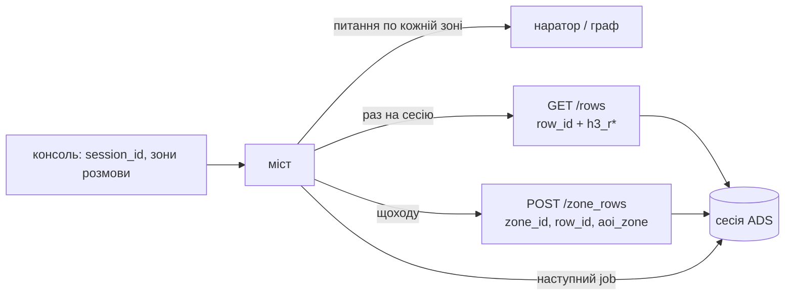

# ADR: розмова з ADS — одна сесія, таблиці раз на сесію, до 5 зон

## КОНТЕКСТ

SIG і ADS (агентний data-science сервіс) — два незалежні модулі. SIG працює без ADS (`compose.yaml`), ADS — без SIG.
Їх з'єднує лише міст `ads_bridge_service` (`compose.ads.yaml`). Він нічого не імпортує з репозиторію і говорить з обома
по HTTP. Питання до ADS задається про зону, намальовану на мапі, а знахідки SIG у ній ідуть в ADS як встановлені факти (#339).

Що вміє ADS (лише його публічний API, без змін у репозиторії ADS):

- сесія мультитурова: `thread_id = session_id`, чекпоінт LangGraph у Postgres, `analytical_memory` останніх job-ів іде в планер наступного;
- `/close` гасить ядро й, за кодом ADS, скасовує job, що виконується (його результат губиться); наступний job у тій самій сесії продовжить її;
- повторний upload з тим самим ім'ям замінює файл, а ADS перепрофілює тільки змінений;
- `GET /sessions/{id}/sources` показує файли сесії, `POST …/sources/delete` видаляє `.csv` (але не `.md`);
- один job на сесію одночасно (409).

## ПРОБЛЕМА

- **Нова сесія на кожне питання.** Міст на кожне питання проходив `POST /sessions → /datasets → /jobs → /status → /close`.
  Уточнити попередню відповідь чи порівняти з іншою зоною було неможливо: ADS не бачив попередніх питань.
- **Копія рядків на кожну зону.** Кожне питання клало в MinIO ADS повну копію таблиці з колонками `h3_r*`, `in_aoi`,
  `aoi_zone`. Ці колонки залежать від полігона, тож таблиця щоразу інша. У MinIO так лягала сесія з `base_aoi.csv`
  і `aoi.md` на кожне питання.
- **Одна зона.** На мапі могла бути лише одна зона.
- **Один потік чату.** Ходи графа й ADS змішувалися в одному потоці, хоча контекст ADS жив лише в ADS.

## РОЗГЛЯНУТІ ВАРІАНТИ

### Варіант 1: лишити сесію на питання

Переваги:

- без роботи.

Недоліки:

- немає уточнень і порівнянь;
- таблиця копіюється на кожне питання.

### Варіант 2: спільний `storage_prefix` між сесіями

Таблиці кладуться в MinIO один раз під спільний префікс, а сесії на нього посилаються.

Переваги:

- жодних копій між сесіями.

Недоліки:

- префікс фіксує перший job сесії;
- промоції ADS пишуть у спільний `inputs/`, тож одна сесія бачить файли іншої;
- міст мав би писати в MinIO напряму, в обхід API ADS, а це зв'язує модулі.

### Варіант 3: `in_aoi` з комірок замість точки в полігоні

Належність до зони виводиться з самих комірок `h3_r*`, без окремої таблиці.

Переваги:

- окремий файл зон не потрібен.

Недоліки:

- точки на межі полігона змінюють належність: це вже інша зона, ніж ту, що намалювала людина.

### Варіант 4: одна сесія на розмову, статичні таблиці + розріджена таблиця зон

Переваги:

- контекст розмови тримає сам ADS;
- таблиця йде один раз на розмову;
- зона займає лише свої рядки `inside`/`adjacent`.

Недоліки:

- ADS має з'єднати таблиці по `row_id`; рецепт з'єднання стоїть у запиті й у `zones.md`.

| Критерій | Сесія на питання | Спільний префікс | `in_aoi` з комірок | Сесія на розмову |
|:--|:--|:--|:--|:--|
| Уточнення й порівняння зон | 🔴 Ні | 🔴 Ні | 🔴 Ні | 🟢 Так |
| Копії таблиці | 🔴 На кожне питання | 🟢 Одна на всіх | 🟡 Одна на зону | 🟢 Одна на розмову |
| Незалежність модулів | 🟢 Публічний API | 🔴 Прямий запис у MinIO | 🟢 Публічний API | 🟢 Публічний API |
| Точність зони | 🟢 Точка в полігоні | 🟢 Точка в полігоні | 🔴 Межа за комірками | 🟢 Точка в полігоні |
| Обсяг змін | 🟢 Немає | 🟡 Міст і MinIO | 🟡 Сервер | 🟡 Сервер, міст і консоль |

## РІШЕННЯ

Обираємо варіант 4: **одна розмова з ADS — одна сесія ADS, кожна таблиця йде в неї один раз, а зони — окремим розрідженим файлом, що з'єднується з таблицями по `row_id`.**

1. **Незалежність.** Завантаження в SIG ніколи не йде в ADS. Рядки потрапляють у MinIO ADS лише з першим питанням
   розмови і лише позначені таблиці. Нові ендпоінти SIG — загальні гео-експорти (`GET /api/geo/{dataset}/rows`,
   `POST /api/geo/{dataset}/zone_rows`), без знання про ADS. Міст лишається єдиним адаптером і не тримає стану розмови.
2. **Розмова = сесія ADS.** Консоль тримає `session_id` і зони розмови та шле їх із кожним питанням. Вкладка *ADS*
   чату — одна розмова, а її поле вводу ставить уточнення з тими самими таблицями, зонами й періодом. Якщо відтоді
   змінилися період, зони на мапі, датасети чи їхні шари, поле вводу відкриває форму, як для першого питання.
3. **Кінець розмови.** *Нова розмова* видаляє CSV сесії через `/sources/delete` і закриває сесію. Питання, що ще
   виконується, скасовується (`POST /api/ads/jobs/{id}/cancel`): job зупиняється на наступному кроці й сам закриває свою сесію.
4. **Одне питання за раз.** Питання до сесії, що ще виконує job, отримує `ads_busy` до того, як міст спитає граф чи
   замінить файл сесії (409 від ADS — запасний захист). Job, який міст покидає з будь-якої причини, скасовується в ADS.
5. **Файли сесії.**
   - `<stem>_<dataset>_r<res>.csv` (`row_id`, рядки, `h3_r*`) — раз на сесію;
   - `zones.csv` (рядки `inside`/`adjacent` кожної зони розмови для таблиць цього питання; відсутній рядок із точкою =
     `far`, рядок без точки не належить жодній групі) — щоходу;
   - `zones.md` (словник таблиць і зон) — щоходу.

   `in_aoi` лишається точкою в полігоні; окрема колонка не потрібна, бо це `aoi_zone == inside`.
6. **До 5 зон на мапі.** Зони мають ідентифікатори `Z1…`, які на сторінці ніколи не повторюються. Зона зберігає свій
   колір, а нова бере перший колір, якого немає на мапі. Попап зони відкривається лише кліком.
7. **Порівнює зони лише ADS.** У формі ADS позначаються зони питання (`focus`, до 5). Граф питають про одну зону: ту,
   чий попап відкрито останнім, інакше останню намальовану.
8. **Дві розмови в чаті.** Вкладки *Граф* і *ADS*, у кожної свій потік. Чат графа лишається однотуровим. Людина
   (без режиму розробника) бачить один чат: *ADS*, а в стеку без ADS чи без гео-даних — *Граф*; «Запитати про цю зону» і вкладка *Час* —
   для розробника. Інсайт, обраний на мапі, людині описує шухляда, а не чат графа.

9. **Шари.** Шар прогону «злочини × бари» йде в ADS додатковою таблицею своїх точок (той самий експорт з `layer`),
   і запит пов'язує її з умовою `context_<шар>_band` знахідок. Без таблиці ADS шукав шар у своїх даних і не завершував
   питання.

Що прибирається: `POST /api/geo/{dataset}/aoi` (`aoi_rows`, `aoi_columns`), файли `base_aoi.csv` / `context*_aoi.csv`
і `aoi.md`, колонка `in_aoi`, код `empty_zone`, закриття сесії після кожного питання.

Наслідки:

- друге питання розмови не завантажує таблицю вдруге: у сесію йдуть лише `zones.csv` і `zones.md`;
- ADS бачить попередні відповіді розмови через свою `analytical_memory`, але повністю тримає лише останні job-и: довгу розмову він пам'ятає стисло;
- ADS через API не видаляє `.md`, звіти, чекпоінти й пам'ять сесії; прибирання сховища ADS — задача команди ADS;
- стан розмови живе в пам'яті сторінки: перезавантаження починає нову розмову, а попередня сесія лишається в ADS незакритою;
- граф читає зону комірками свого найдрібнішого гео-рівня, а таблиці — точками, тож на межі зони вони можуть розійтися; методика фінального звіту це називає;
- граф, його пошук і відповіді чату графа не змінюються: це зміна того, як дані йдуть в ADS, а не математики графа;
- документація: `docs/current_docs/08_interface.md` §8.7–8.8, `09_operations.md` §9.4 (`ads_busy`), `10_verification.md` (тести), `12_architecture.md` (контракти моста), `13_trust.md` (рядки, що йдуть в ADS).

## Action Items/ To Do

- [x] Реалізувати рішення за #356 (гео-експорти, міст, консоль, документація).
- [x] Прибрати порівняння зон у чаті графа: зони порівнює лише ADS.
- [x] Живий прогін у стеку `compose.ads.yaml` (17-Nov-2026, до виправлень за ревʼю): питання про зону → уточнення в тій самій сесії → порівняння трьох зон; у MinIO одна сесія на розмову, таблиця завантажена один раз, `zones.csv` і `zones.md` замінюються щоходу.
- [ ] Живий прогін виправлень за ревʼю: «Нова розмова» під час питання, `ads_busy` до запису в сесію, CSV у MinIO після закриття.
- [ ] Після злиття PR #357 перевести ADR у статус `accepted`.

## Посилання

- #356 — реалізація цього рішення, PR #357
- #339 — «Запитати про це ADS»: міст до ADS, форма запиту і статус у хеде
- #353 — період смуги в SIG і рядок «Період:» у питанні ADS
- #335 — спайк: як передавати знання SIG в ADS
- [`docs/current_docs/08_interface.md` §8.8](../current_docs/08_interface.md#88-a-zones-question-to-ads) — розмова з ADS
