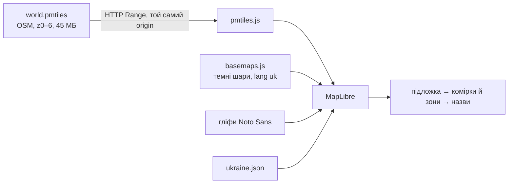

# ADR: офлайн-підложка мапи для всього світу

## КОНТЕКСТ

Мапа консолі (`sig_web_console/static/geo.js`) малює комірки H3 у MapLibre GL JS 4.7.1 поверх офлайн-підложки. Консоль нічого не бере з CDN чи тайл-сервера, бо кожен запит тайла показує сторонньому сервісу ділянку й зум, тобто де лежать дані користувача. Реальні дані не мають виходити назовні (AGENTS.md).

Досі підложкою був GeoJSON із Natural Earth 10m (`basemap.json` 1 МБ, `places.json` 147 КБ), вирізаний вручну для двох прямокутників: Україна з сусідами від Балтики до Кавказу і захід США навколо Каліфорнії (демо мапи).

## ПРОБЛЕМА

- **Порожня мапа поза двома прямокутниками.** Датасет в іншому місці (злочини в Чикаго) лежить на голій градусній сітці. Кожен новий регіон вимагає вирізати підложку вручну.
- **Назви налазять одна на одну.** У стилі немає гліфів, тому назви міст — DOM-маркери (до 40). MapLibre їх не розводить.
- **Мало деталей для міста.** Natural Earth 10m — це кордони, великі річки й озера, без доріг.

## РОЗГЛЯНУТІ ВАРІАНТИ

### Варіант 1: онлайн-тайли провайдера

MapTiler, Stadia, CARTO або OpenFreeMap — векторні тайли з їхнього сервера.

Переваги:

- повна детальність до вулиць без великих файлів у репозиторії.

Недоліки:

- без інтернету мапи немає;
- провайдер бачить ділянку й зум, тобто де лежать дані;
- ключі й ліміти, а в частини провайдерів — оплата.

### Варіант 2: онлайн, а без мережі — відкат на офлайн

Переваги:

- найкраща картинка, коли мережа є.

Недоліки:

- той самий витік ділянки, що й у варіанті 1;
- два джерела й два стилі, які треба тримати узгодженими.

### Варіант 3: Natural Earth для всього світу

Той самий GeoJSON, вирізаний для всієї планети.

Переваги:

- той самий код.

Недоліки:

- доріг немає, а без гліфів назви так само налазять;
- файли треба вирізати й спрощувати вручну.

### Варіант 4: Protomaps PMTiles для всього світу, у git

Векторні тайли OpenStreetMap одним файлом PMTiles. Консоль читає його HTTP-запитами Range зі свого origin, тайл-сервер не потрібен. Розміри зрізів збірки 2026-11-18, пораховані з каталогів архіву:

| зуми | розмір |
|---|---|
| 0–5 | 15 МБ |
| 0–6 | 45 МБ |
| 0–7 | 190 МБ |
| 0–8 | 561 МБ |
| уся планета, 0–15 | 139,6 ГБ |

Переваги:

- увесь світ: суша, вода, дороги, назви `name:uk`; MapLibre сам розводить назви;
- z0–6 менший за поріг попередження GitHub (50 МБ): файл лежить у git, колеги отримують його через `git pull`, а образ консолі — разом зі статикою.

Недоліки:

- репозиторій росте на 45 МБ (тайли вже стиснуті), і кожне оновлення файлу додає стільки ж;
- після зуму 6 тайли лише розтягуються: у місті видно магістралі й берег, але не вулиці;
- лінії кордонів треба налаштувати фільтром атрибутів тайлів.

| Критерій | Онлайн | Онлайн + офлайн | Natural Earth, світ | PMTiles z0–6 у git |
|:--|:--|:--|:--|:--|
| Працює без мережі | 🔴 Ні | 🟡 Гірша підложка | 🟢 Так | 🟢 Так |
| Ділянка даних не виходить назовні | 🔴 Ні | 🔴 Ні, коли мережа є | 🟢 Так | 🟢 Так |
| Покриття світу | 🟢 Так | 🟢 Так | 🟢 Так | 🟢 Так |
| Дороги й назви без накладань | 🟢 До вулиць | 🟢 До вулиць | 🔴 Ні | 🟡 Магістралі, до зуму 6 |
| Вартість і доставка | 🟡 Ключі, ліміти | 🟡 Ключі, ліміти | 🟢 Git | 🟢 Git, +45 МБ |

## РІШЕННЯ

Обираємо варіант 4: **уся планета до зуму 6 одним файлом PMTiles у git, який консоль читає зі свого origin; нічого не запитується назовні.**

1. **Один файл.** `sig_web_console/static/vendor/geo/world.pmtiles` — збірка Protomaps v4.15.2 від 2026-11-18, вирізана `pmtiles extract https://build.protomaps.com/20261118.pmtiles world.pmtiles --maxzoom=6`. Команда, sha256 і ліцензія (ODbL) записані в `sig_web_console/PROVENANCE.md`. Збірки Protomaps зберігаються кілька днів, тож для оновлення беруть свіжу дату з `https://build-metadata.protomaps.dev/builds.json`.
2. **Бібліотеки й гліфи.** Вендорено `pmtiles.js` 4.5.0 і `basemaps.js` 5.7.2 (BSD-3). Гліфи Noto Sans з `protomaps/basemaps-assets` (OFL) — лише ті діапазони, що трапляються в назвах тайлів: їх виміряно, розібравши всі тайли `world.pmtiles`. Це 26 діапазонів для Regular, Medium й Italic і 5 для Devanagari: 84 файли, 5,8 МБ замість 1025 файлів і 11,5 МБ. Лише латиниця й кирилиця давали б 404 на назвах іншими писемностями, а ієрогліфи й хангиль MapLibre малює локальним шрифтом. Файли Devanagari — копії, а не символьні посилання, бо на Windows git перетворює посилання на текстові файли.
3. **Стиль.** `basemapLayers` (`geo.js`) бере темні шари Protomaps у палітрі мапи, з назвами українською (`lang: "uk"`; назва, що різниться, іде другим рядком місцевою мовою). Шари, яким потрібен спрайт (POI, дорожні щити, стрілки одностороннього руху), прибрано. Точки міст — одна намальована в коді іконка.
4. **Порядок шарів.** Підложка → градусна сітка під водою → комірки, зони й точки → назви підложки над ними.
5. **Перемикачі.** *Кордони* вмикає й вимикає лінії кордонів, *Населені пункти* — лише назви місць. Атрибуція «© OpenStreetMap» — компактний блок у куті мапи.
6. **Git, а не Git LFS.** Безкоштовний LFS на GitHub дає 1 ГБ сховища й 1 ГБ трафіку на місяць, тобто ≈ 20 клонів із файлом 45 МБ, а збірка образу й CI мали б окремо тягнути LFS. У звичайному git кожне оновлення тайлів додає в історію ще 45 МБ, тому файл оновлюється рідко: лише коли змінюються кордони чи назви.

Що прибирається: `basemap.json`, `places.json`, DOM-маркери назв (`placeDensity`, `PLACES_MAX`) і їхні стилі `.place`.

Наслідки:

- мапа має підложку будь-де у світі без жодного запиту поза origin консолі; виміряно в Chromium: 37 запитів до `world.pmtiles`, усі 206, помилок мапи в консолі немає; `tests/test_ui_map.py` перевіряє, що запити йдуть лише на свій origin і тайли приходять відповіддю 206;
- репозиторій росте з ≈ 40 до ≈ 90 МБ (тайли 45 МБ, гліфи 5,8 МБ); нові тайли можуть принести нові діапазони гліфів, тож разом із файлом заново міряються й вони;
- після зуму 6 тайли розтягуються: на зумі 13 берег грубий, вулиць немає; детальніша підложка (z7, 190 МБ, або регіональна вставка) не вміщається в git і за потреби піде окремим файлом у GitHub Release;
- лічильники регіонів лишаються іконками на canvas, а комірки, зони, регіони й «У вікні» не змінюються: змінюється лише підложка;
- документація: `docs/current_docs/08_interface.md` §8.7, `sig_web_console/PROVENANCE.md`.

## Action Items/ To Do

- [x] Реалізувати рішення за #363 (тайли, бібліотеки, гліфи, `geo.js`, документація).
- [x] Перевірити Range через `scripts/dev.py` і через nginx у контейнері (`scripts/compose_check.py`).
- [ ] Після злиття PR #364 перевести ADR у статус `accepted`.

## Посилання

- #363 — реалізація цього рішення, PR #364
- ADR-195 — гекси на мапі і список «У вікні»
- [`docs/current_docs/08_interface.md` §8.7](../current_docs/08_interface.md#87-the-map) — мапа
- [`sig_web_console/PROVENANCE.md`](../../sig_web_console/PROVENANCE.md) — походження файлів підложки
