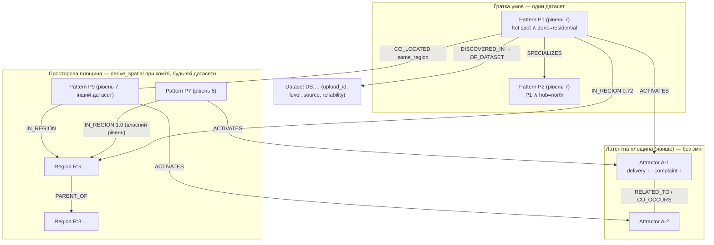
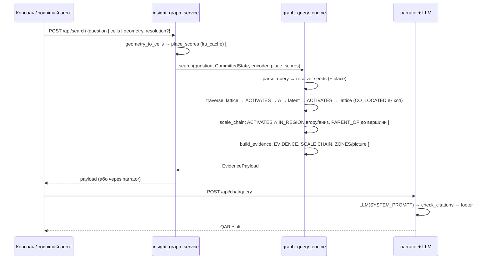
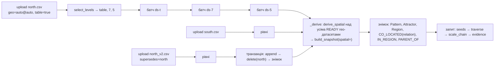

# Spatial Knowledge Graph над SIG: цільова архітектура (стан issues на 2026-10-15)

**Статус.** Опис системи, яку будує epic #2 (`woldemarg/proj_sig`, issues #3–#35), узгоджений з поточними тілами issues. Розділи `docs/01`–`docs/12` описують код; цей документ описує, що з коду вже є, що додають issues і як це складається в одну систему. Як ми прийшли до цього стану, які альтернативи відкинуто і які 23 питання закрито — у [`spatial_knowledge_graph_transition.md`](spatial_knowledge_graph_transition.md). Поведінку для нетехнічного читача на одному прикладі описує [`spatial_knowledge_graph_story.md`](spatial_knowledge_graph_story.md). Код: `master` після `75f3cd8`.

**Позначки.** **[реалізовано]** — є в коді, підтверджено читанням коду й тестів (посилання на файл і рядок); **[#N]** — рішення issue #N, коду ще немає; **[вимірюється]** — параметр або властивість, яку встановлює геобенчмарк (#3), а не обговорення.

---

## 1. Executive summary

**Що будуємо.** SIG (Statistical Insight Graph) перетворює таблицю на статистично перевірені **інсайти** (підгрупи з аномальними зсувами метрик), пов'язує їх точною **структурною ґраткою** умов і **латентними атракторами** (центроїди у векторному просторі, що збирають інсайти з однаковим *явищем* незалежно від того, де в даних вони трапилися) і відповідає на запитання обходом цього дуального графа з цитованою відповіддю LLM. Гео-режим (PR #1) додає третю вісь: точкові дані агрегуються в комірки H3, і той самий майнер шукає інсайти по комірках із виправленням статистики на просторову автокореляцію.

Epic #2 перетворює гео-режим на **Spatial Knowledge Graph** трьома доповненнями і одним паспортом:

1. **Кілька рівнів на одне завантаження** [#28, #29]: табличний рівень без географії і два-три гео-рівні з роздільностями, вибраними з даних; кожен рівень — звичайний датасет одного `upload_id`.
2. **Місце як вузол** [#32]: при коміті одна чиста функція `derive_spatial` будує регіони H3 на абсолютних рівнях `7,5,3,1`, ребра `IN_REGION` / `PARENT_OF` і ребра `CO_LOCATED` між інсайтами з `relation ∈ {overlaps, adjacent, same_region}` — між будь-якими датасетами. У журнал ця структура не пишеться.
3. **Автоматичний вертикальний зум** [#31]: після кожного пошуку кожен знайдений гео-інсайт сам продовжується вгору до вершини і вниз через одне правило — *той самий атрактор і регіон, що містить поточне місце*; зона з карти [#16] — те саме питання тим самим шляхом; нового типу ребра між рівнями **немає**.
4. **Паспорт довіри** з трьох рядків [#5, #6, #26, далі #7, #15, #8, #34]: джерело і його надійність, підтвердження незалежним джерелом або чесне «неможливо оцінити», цілісність запису — окремо від статистики.

**Ключовий принцип.** Інсайт (вузол `Pattern`) — єдина одиниця знання і перехрестя трьох осей: *що відбувається* (атрактор), *у якій підгрупі* (ґратка умов), *де* (регіони). Атрактори не мають географії, регіони не мають явищ; їх з'єднує тільки інсайт. **Атрактор зв'язує інсайти наскрізно за явищем, регіон розділяє їх за рівнями зуму** — тому «те саме крупнішим планом» не потребує окремого ребра: це перетин `ACTIVATES` і `IN_REGION`, який уже є в графі. Довіра — анотація інсайту і датасету, що не змінює жодного зв'язку.

**Дві операції замість п'яти механізмів.** Увесь просторовий шар — це `derive_spatial` при коміті (геометрія, без атракторів) і `scale_chain` при пошуку (атрактори + регіони, без геометрії). Вони не перетинаються, і кожна тестується окремо.

**Що вже є, а що додається.** Реалізовано: конвеєр інсайтів, атрактори, дуальний граф, семантичний вхід з багатомовним заземленням, гео-інгест на одному рівні, `CO_LOCATED overlaps` всередині датасету, карта. Додається: рівні, регіони, `CO_LOCATED` між датасетами, зум, зона як запит, `supersedes`, паспорт довіри, реєстр індикаторів. Не додається: ребра між рівнями, reannotate, окремий спайк по `PARENT_OF`, `SHARES_REGION`, словник RCC8 окремим типом, колекція частин, часова вісь (наступна ітерація продукту).

---

## 2. Проблема та цілі

**Головне питання розділу:** яку функціональність має дати система і чим вона відрізняється від того, що є.

### 2.1 Розриви, які закриває epic [реалізовано як «сьогодні»]

| Розрив | Суть | Підтверджено кодом | Закриває |
|---|---|---|---|
| одне завантаження — один рівень | гео-опція дає одну роздільність; кілька — лише кількома завантаженнями вручну, без зв'язку між ними | `subgroup_miner/ingestion.py:56-64,166` (роздільність у хеші `dataset_id`) | #28, #29 |
| місце не є сутністю графа | простір живе в `provenance.spatial` і `geo.npz`; H3-id комірок не записані навіть у запис інсайту (лише кількість `cells`) | `subgroup_miner/discovery.py:389-396`, `insight_graph_service/core/engine.py:456-470` | #32 |
| `CO_LOCATED` лише всередині датасету | обчислюється при завантаженні над прийнятими інсайтами одного датасету | `engine.py:317`, `subgroup_miner/spatial.py:407-426` | #32 |
| немає міждатасетних структурних зв'язків | `structural_edges` групує за `dataset_id`; між датасетами проходять лише латентні ребра | `subgroup_miner/lattice.py:46-52`, `tests/test_lattice.py:36-38` | #32 |
| зум — дія користувача, якої немає | у `search()` входить лише текст; `ParsedQuery` без просторових полів; ієрархії рівнів немає | `graph_query_engine/search.py:107`, `question.py:148-158` | #31 |
| зону не можна передати як запит | — | те саме | #16 |
| на «де?» приходять розрізнені факти | evidence — до 10 інсайтів у порядку рангу | `graph_query_engine/evidence.py:193-307` | #14 |
| новий файл тієї ж області дублює інсайти | той самий потік даних, завантажений двічі, — два незалежні датасети | `ingestion.py:56-64` | #27 |
| факт без оцінки довіри | заголовок і `SYSTEM_PROMPT` більше не кажуть «verified» (#26), але окремих осей довіри в evidence немає | `graph_query_engine/evidence.py:107` | #5–#8, #15, #34 |

### 2.2 Чотири властивості продукту

| | Властивість | Перевірюване твердження | Issues |
|---|---|---|---|
| П1 | кожне завантаження одразу дає кілька рівнів інсайтів — без географії і з географією на кількох роздільностях | одне `POST /api/upload` створює датасет-рівень `table` і 2–3 гео-рівні з роздільностями, вибраними з даних, усі з одним `upload_id` | #28, #29 |
| П2 | атрактори зв'язують інсайти наскрізно, географічна належність розділяє їх за рівнями; потрапивши на інсайт, система **сама** піднімається до вершини і спускається вниз | після транзверсального обходу кожен гео-інсайт продовжується ланцюгом «той самий атрактор + регіон, що містить місце» до вершини (далі — регіони) і вниз, без дії користувача; результат — у evidence | #32, #31 |
| П3 | граф будується частинами (одна область кількома файлами) і лишається сумісним | частини ділять регіони і атрактори; `CO_LOCATED same_region` між частинами; з інсайту частини A ланцюг веде в регіон, де видно інсайти B і C; повторний експорт частини заміняє стару версію | #32, #27 |
| П4 | зона з карти — те саме питання, що й текст, з тим самим ланцюгом | `cells` або контур → `place_scores` → ті самі seed-формула, обхід і `scale_chain` | #16, #14 |

### 2.3 Не-цілі цього epic

Часова вісь як окрема структура (реальний кейс наступної ітерації продукту; контракти `SpatialProvenance` і `derive_spatial` не припускають одного зрізу часу); лінії та полігони як *дані* на вході (`parse_points` приймає лише `Point`/`POINT`, `spatial.py:87-94`); сітка змінної роздільності в одному файлі (`n_eff`, лаги й LISA визначені на одній сітці); колекція частин (повторний майнінг об'єднання) — лише якщо зведення регіону не відповідає на «що загалом по області».

---

## 3. Поточна реалізація [реалізовано]

**Головне питання розділу:** на що саме нашаровується план — з посиланнями на код, щоб кожне твердження можна було перевірити.

### 3.1 Конвеєр

Вісім стадій (`docs/01` §1.2): завантаження → виявлення підгруп вендорованим EDA-рушієм → відбір і зважування інсайтів → канонічний текст і тричастинний вектор → латентні атрактори → дуальний граф у файловому workspace (+ дзеркало Neo4j) → відповідь обходом графа → консоль. Стадії 1–6 — один атомарний батч на файл (`Engine.process`, `engine.py:273-366`), стадія 7 — на запитання. Один писар на workspace (OS-lock, `workspace.py:69-121`), батчі послідовно на одному потоці (`server/app.py:44`).

### 3.2 Сутності графа

| Сутність | Id | Що зберігає | Код |
|---|---|---|---|
| `Dataset` | `ds-` + sha256(bytes ‖ bins ‖ categories ‖ geo)[:12] | `filename, rows, columns`, для гео — `glossary` | `ingestion.py:56-64`, `snapshot.py:68-79` |
| `Batch` | `B<utc>-<hex>` | стадії, профіль, метрики | `engine.py:485-490` |
| `Pattern` (інсайт) | `P-` + sha1(dataset_id, умови)[:12] | запис журналу без змін: умови, `target`, `shifts`, `support`, `effect_size`, `stability`, `p_adjusted`, `weight`, `provenance` | `insight_contracts/insight.py:112-114`, `docs/03` §3.1 |
| гео-інсайт | той самий `Pattern` | `provenance.spatial = {resolution, cells (кількість), moran_i, n_eff, p_adjusted_iid}` (`SpatialProvenance`); `compactness` на вузлі виводить коміт | `discovery.py:389-396`, `spatial.py:436` |
| `Attractor` | `A-<k>` | одиничний центроїд 1152-d, маса; текст і члени — похідні на кожному коміті | `attractor_topology/vendor/lac/storage.py:21-35`, `snapshot.py:227-265` |
| `Dimension`, `Metric` | `D:<ds>:<col>`, `M:<ds>:<col>` | схема датасету | `snapshot.py:89-113` |
| комірка H3 | поза графом | `geo.npz`: `cells`, `point_cell` (рядок → комірка), `lonlat`, сусідство CSR | `workspace.py:230-252` |
| екстент інсайту | похідне | позиції рядків у `covers.npz` → H3-id через `geo.npz["cells"]` | `workspace.py:216-221`, `engine.py:456-470` |

Ребра: структурні всередині датасету (`SPECIALIZES` — покривальне відношення множин умов, обхід іде ним в обидва боки, `SIBLING`, `CONTRASTS`; `lattice.py`), просторова площина з коміту (`CO_LOCATED` з `relation` `overlaps`/`adjacent`/`same_region` між інсайтами однієї роздільності будь-яких датасетів, `IN_REGION` і `PARENT_OF` до вузлів `Region`; `spatial.py:436`), міст `ACTIVATES` (інсайт → атрактор, вага = вирівнювання, прапорець `weak`), латентні `RELATED_TO` (взаємні kNN центроїдів) і `CO_OCCURS` (спільні члени), схема `HAS_SCOPE`, `TARGETS`, провенанс `DISCOVERED_IN`, `OF_DATASET` (`insight_contracts/graph.py:28-59`).

### 3.3 Атрактори: механіка, яка не змінюється

Це єдина частина системи, якої жоден issue не торкається, і на яку спирається вертикальний зум, тому вона описана повністю.

**Що представляє атрактор.** Один одиничний вектор у просторі інсайт-векторів: 1152 = 3 × 384 — блоки *scope*, *target*, *signed phenomenon* (`encoder.py:176-202`). Косинус двох інсайт-векторів розкладається як `0.135·s·s′ + 0.201·t·t′ + 0.664·p·p′` (`docs/04` §4.3): дві третини подібності дає знаковий блок явища — сума ембедингів назв метрик, помножених на знакові robust-z. Тому атрактор — напрямок «що саме зсувається і в який бік» (`discount ↑ · margin ↓`), майже байдужий до умов підгрупи і повністю байдужий до місця. «X ↑» і «X ↓» — різні атрактори (`tests/test_canonical_embedding.py:112-113`). Атрактор не зберігає ні тексту, ні списку членів, ні блочних векторів; усе читабельне обчислюється зі списку членів на кожному коміті.

**Як створюється і оновлюється** (`ontology.py:199-299`, `ontology_engine.py:46-177`):

1. Перший батч у порожньому workspace — словникове навчання OMP над векторами інсайтів із знаковим ремонтом (переворот антивирівняних атомів, злиття атомів з cos > 0.95, підлога вирівнювання 0.20).
2. Кожен наступний батч: інсайт із `max_j cos ≥ τ` (τ = 0.88, адаптивно до 0.92 при ≥ 10 атракторах) приєднується до 1–2 найкращих атракторів (другий — у межах 0.8 від першого) і зсуває їхні центроїди EMA-кроком, що зменшується з масою. Інсайт нижче τ — сирота.
3. Сироти батчу: ≥ 2 → OMP лише над ними → нові атоми; атом із cos > 0.95 до наявного атрактора поглинається, решта стають новими атракторами. 1 сирота → до найближчого.
4. Запобіжники: демпфування хаба, довірча область (центроїд не зміщується більше ніж на 0.10 за батч), інваріанти (кожен інсайт має ≥ 1 активацію).

Отже атрактор утворюється з усіх інсайтів, що на нього вказують, незалежно від датасету і рівня: «перевикористання атракторів новим датасетом» — не окремий механізм, а звичайна робота кроку 2. Злиття двох *наявних* атракторів, розділення і вихід з ужитку за віком **не існують** (межа, успадкована від lac); при видаленні датасету маса перераховується, зсуваються лише атрактори, що втратили члена, зникають лише без членів *і* без `RELATED_TO` (`ontology.py:178-197`).

**Чому саме атрактор — наскрізний зв'язок для зуму.** Інсайти одного механізму на рівнях 7 і 5 одного завантаження мають майже однакові блоки явища і дуже схожі блоки target, отже потрапляють в один атрактор за наявним правилом; те саме для інсайтів різних датасетів, якщо назви метрик збігаються (саме тому міжджерельна достовірність потребує реєстру індикаторів, #34). Що атрактор *не* знає — де і на якому рівні знайдено інсайт; це знає регіон. Два ребра разом — `ACTIVATES` і `IN_REGION` — і є «те саме крупнішим планом».

У `graph_query_engine` центроїди (`LatentFrame.attractors`) **не використовуються**: атрактор діє лише як вузол, через який проходить обхід (`traversal.py:108-212`); seed-ами бувають лише інсайти (`seeds.py:71-97`). На бенчмарку з закладеними механізмами обхід над живими атракторами на рівні зі статичним k-means і +0.21 над векторними сусідами (`docs/10` §10.3).

### 3.4 Гео-інгест на одному рівні

Опція `geo=auto|<col>|<lat>,<lon>[@res]` (`spatial.py:75-132`): лише точки (GeoJSON `Point`, WKT `POINT`, пара lat/lon), одна комірка на точку (`h3.latlng_to_cell`, `spatial.py:239`), роздільність за замовчуванням 7, опція входить у `dataset_id` дослівно. Таблиця комірок: `points`, `<col>_active_days`, `<col>_late_share`, `<col>_median`, `<col>_mode`, `share_<col>_<level>` — ролі лише за dtype; лаги `neighbours_<counter>_band` і `lisa_points` (локальний Моран з аналітичним нулем і FDR 0.05) як звичайні категоріальні виміри; інтенсивні колонки NaN нижче `MIN_CELL_POINTS` (5) (`spatial.py:225-348`). Майнер той самий; для гео: правило тавтології (сусідська умова не пояснює метрику, з якої обчислена), `n_eff = n(1−ρ)/(1+ρ)` з ρ = Moran I підгрупи (однопараметрична апроксимація Clifford–Richardson–Hémon 1989, `spatial.py:435-440`), блоковий бутстрап по батьківських комірках `r−1` (`spatial.py:306`; не зберігаються). Комірки й екстенти лишаються в `geo.npz` і `covers.npz`; `compactness` і просторову площину виводить `derive_spatial` при кожному коміті (`engine.py:236`), у журнал нічого не пишеться.

### 3.5 Запит

`search(question, CommittedState, encoder, config)` (`search.py:107`): `parse_query` (метрики за назвами `Metric`, умови за значеннями, напрямок за лексиконами, багатомовне заземлення літералів; `question.py:297-343`) → `score_pattern` для кожного інсайту (`0.35·target + 0.25·scope + 0.15·direction + 0.15·semantic + 0.10·w`, до 3 seed-ів; `seeds.py:26-97`) → best-first обхід за граматикою `P0 (lattice){0,1} —ACTIVATES→ A (RELATED_TO|CO_OCCURS){0,1} ←ACTIVATES— P1 (lattice){0,1}` з множниками ≤ 1 і бюджетами (1 + 1 хоп, глибина 5, 12 результатів; `traversal.py:108-212`; `CO_LOCATED` уже в списку обхідних ребер, `config.py:25`) → `build_evidence` (перші 10, ключі `P1..Pn`, `PLAIN LANGUAGE` для гео, `place:` з `provenance.spatial`; `evidence.py:193-307`) → наратор (`SYSTEM_PROMPT`, перевірка цитат, `narration.py:18-66`). Просторового наміру, геометрії, регіонів і вертикалі в запиті **немає**.

### 3.6 Інкрементальність

Новий файл = батч: майнінг, вектори, атрактори старих датасетів не перераховуються; журнал — append; знімок, `RELATED_TO`, ко-членства, `CO_OCCURS`, матриця векторів і Neo4j перебудовуються цілком на кожному коміті (`snapshot.py:265-296`, `chunk_journal.py:68-82`, `neo4j_mirror.py:96-141`). Той самий файл з тими самими опціями → `SKIPPED`; видалення датасету точкове з правилом сиріт (`engine.py:538-575`); оновлення датасету немає. Транзакція з checkpoint, точка коміту — запис `READY` (`workspace.py:358-432`).

### 3.7 Компоненти

| Пакет | Відповідальність сьогодні | Що додають issues |
|---|---|---|
| `insight_contracts` (лише stdlib) | `Insight`, словник графа, `EvidencePayload` | `SpatialProvenance` з п'яти полів (#25); `Region`, `IN_REGION`, `PARENT_OF`, площина `spatial`, без `GENERALIZES` (#32); `record_digest` (#5) |
| `subgroup_miner` (єдиний з `h3`) | інгест, комірки, ознаки, LISA, майнінг, відбір, ґратка, `derive_spatial` (#32), парсинг `indicators` (#34) | `select_levels` (#29), `geometry_to_cells` (#16) |
| `attractor_topology` | вектори, живі атрактори | **нічого** |
| `insight_graph_service/core` | батч, workspace, компілятор знімка, Neo4j | fan-out рівнів і `upload_id` (#28), `_derive` з `derive_spatial` (#32), `supersedes` (#27), `PATCH` метаданих (#6, #34), `integrity` (#5), `credibility` (#7, #15), `verify` (#9), прибирання (#33) |
| `graph_query_engine` (без H3) | парсинг, seed-и, обхід, evidence | `scale_chain` + `SCALE CHAIN` + згортання (#31), `ZONES`/`picture` (#14), `place_scores` у seed-формулі (#16), `trust:` (#8), заголовок (#26) |
| `evidence_narrator_service` | промпт, LLM, цитати | правило 9 (#8) |
| `sig_web_console` | граф, сфера, таблиця, карта, чат | виділення/контур (#16), ланцюг рівнів, бейджі довіри, шар регіонів (#17) |

Межі (DoD epic): `h3` — лише `subgroup_miner`; `graph_query_engine` не знає H3 і не читає атракторів у просторову функцію; компілятор знімка файлів не читає; нові пороги — константи модуля, єдине нове поле `Settings` — `GEO_REGION_LEVELS`; файли діляться за обов'язком, коли перетнуть 1000 рядків, не заздалегідь.

---

## 4. Цільова модель

**Головне питання розділу:** які сутності й зв'язки з'являються, де вони народжуються (при інгесті, при коміті, при пошуку) і чому саме так.

### 4.1 Три моменти народження структури

| Момент | Що народжується | Хто | Issues |
|---|---|---|---|
| **інгест** (батч) | інсайти рівня, вектори, членства в атракторах, п'ять полів `provenance.spatial` | майнер, онтологія | як сьогодні; #28, #29, #25 |
| **коміт** (знімок) | ґратка умов; регіони, `IN_REGION`, `PARENT_OF`, `CO_LOCATED` з `relation`, `compactness`; `ACTIVATES` з поточним вирівнюванням; `credibility`, `integrity` | `derive_spatial` + компілятор | #32, #5, #7, #15 |
| **пошук** (запитання) | seed-и, транзверсальний обхід, `scale_chain`, мітка `scale`, `ZONES`/`picture`, `trust:` | `graph_query_engine` | #31, #14, #16, #8 |

Правило, яке з цього випливає: **журнал — лише для того, чого не можна перерахувати** (статистика, вектори, членства); усе просторове — похідне при коміті; усе, що потребує атракторів *і* регіонів разом, — при пошуку.

### 4.2 Сутності й ребра після плану

| Поняття | У графі | Створення | Issue |
|---|---|---|---|
| `Upload` | **не вузол**: `upload_id = sha256(bytes)` як властивість `Dataset` і батчу | при завантаженні | #28 |
| `Dataset` | вузол; + `upload_id`, `level ∈ {table, <res>}`, `source`, `reliability`, `supersedes`, реєстр індикаторів на `Metric` | батч; метадані редагуються `PATCH` без майнінгу | #28, #6, #27, #34 |
| `Pattern` | вузол; `provenance.spatial` = `{resolution, cells, moran_i, n_eff, p_adjusted_iid}`; + `integrity`, `credibility`, `credibility_basis` | інгест; довіра — коміт | #25, #5, #7, #15 |
| `Region` | **новий вузол** `R:<res>:<h3>`, глобальний id; props `resolution`, `cells_covered`, `patterns`; лише регіони, які покриває хоча б один інсайт | коміт, `derive_spatial` | #32 |
| `IN_REGION` | `Pattern → Region` до **кожного** рівня `GEO_REGION_LEVELS` (`7,5,3,1`) з `level ≤ r`, **включно з власним**; вага = частка комірок екстенту в регіоні, ребро при частці ≥ 0.2; обхід не ходить | коміт | #32 |
| `PARENT_OF` | `Region → Region` між сусідніми рівнями списку; обхід не ходить | коміт | #32 |
| `CO_LOCATED` | `Pattern — Pattern` одного рівня, **будь-яких датасетів**; `relation ∈ {overlaps, adjacent, same_region}`, вага, одне ребро на пару, cap 3 за вагою; пари, вже зв'язані ґраткою, пропускаються; обхід ходить як сьогодні | коміт | #32 |
| площина `spatial` | `IN_REGION`, `PARENT_OF`, `CO_LOCATED` | схема | #32 |
| `GENERALIZES` | **видаляється** (дзеркало `SPECIALIZES`, яке обхід відфільтровував; `incident()` дає обидва напрямки) | bump M2 | #32 |
| `Attractor`, `ACTIVATES`, `RELATED_TO`, `CO_OCCURS` | без змін | — | — |
| комірка H3 | поза графом; `geo.npz` звужується до `cells`, `point_cell`, `lonlat`, `nbr_ptr`, `nbr_idx` | інгест | #33 |
| ребро між рівнями | **немає**: `AT_SCALE`, `CORRESPONDS_TO_SCALE`, `SHARES_REGION` не створюються | — | #31, #32 |



Вертикальний крок на цій діаграмі — не ребро: `P1 → P7` існує, бо `P1` і `P7` разом мають `ACTIVATES → A-1` **і** `IN_REGION → R:5` (`scale_chain`, #31).

### 4.3 Рівні як датасети одного завантаження [#28, #29]

- `POST /api/upload` з `geo=<loc>@<r1>,<r2>` або `geo=<loc>@auto` і необов'язковим `table=true` створює кілька звичайних датасетів: `dataset_id` кожного — як при окремому завантаженні з тією самою опцією (хеш уже містить роздільність), усі з `upload_id = sha256(bytes)` і `level`. N батчів у черзі того самого потоку, послідовно; `process` без змін; N компіляцій знімка прийнято [вимірюється на S-size].
- Рівень `table` — звичайний датасет без гео; просторової структури на ньому немає; з гео-рівнями його зв'язують лише атрактори. Окремого ребра `table ↔ geo` немає.
- `select_levels` (`@auto`): кандидати 3…10 (константи); `latlng_to_cell` на кожній роздільності, як у `build_cells` (діти H3 не покривають батька точно), дає `cells(r)`, `dense_share(r)`, `median_points(r)`; `r_fine = max{r : cells ≥ MIN_ROWS ∧ dense_share ≥ GEO_DENSE_SHARE_MIN (0.3)}`; грубші рівні — **лише з `GEO_REGION_LEVELS`**, не дрібніші за `r_fine` щонайменше на один крок списку, доки `cells ≥ MIN_ROWS`, не більше `GEO_LEVELS_MAX` (3). Підгонки до вже наявного рівня немає: сумісність регіонів дає спільний список. `profile.geo.levels = {chosen, candidates, reasons}`.
- Чому грубі рівні — з того самого списку, що й регіони: екстент грубого інсайту тоді дорівнює множині регіонів його рівня (`IN_REGION` з власним рівнем, частка 1.0), і вертикальний крок стає чистою операцією над ребрами, однаковою для рівнів одного завантаження і для різних датасетів.
- Статус рівнів — `GET /api/batches?upload_id=`; `DELETE /api/uploads/{id}` — усі рівні в одній транзакції.

### 4.4 `derive_spatial` при коміті [#32]

Одна чиста функція в `subgroup_miner` (єдине місце з `h3`), яку `Engine._derive` (`engine.py:202-220`) викликає над усіма `READY` гео-датасетами й передає результат у `build_snapshot(spatial=)`. Компілятор файлів, як і раніше, не читає.

- *Вхід на датасет:* `dataset_id`, `resolution`, `cells`, `point_cell`, `nbr_ptr`, `nbr_idx`, `covers` (рядки кожного інсайту). Без `upload_id` і без атракторів.
- *Вихід:* регіони й `IN_REGION`, `PARENT_OF`, `CO_LOCATED` з `relation` (`overlaps` — перекриття дилатованих екстентів ≥ 0.3, як сьогодні; `adjacent` — порожній перетин, але перетинає сусіда; `same_region` — спільний регіон найближчого рівня з відступом ≥ 2 від `r`), `compactness`.
- *Вартість:* O(Σ патернів²) всередині рівня і O(патерни × рівні) для регіонів — того самого порядку, що глобальна компіляція знімка, яка й так виконується [вимірюється на S-size]; кеш лише за результатом.
- *Наслідки:* `annotate_extents` і запис `colocated`/`compactness` у журнал — видаляються; bump `SNAPSHOT_VERSION` показує структуру для датасетів, завантажених раніше, без повторного завантаження і без reannotate; дайджест цілісності (#5) покриває лише п'ять інгест-полів.

### 4.5 `scale_chain` при пошуку [#31]

Після транзверсального обходу, для кожного знайденого гео-інсайту `P`, автоматично, для будь-якого входу:

```text
вгору: Q грубший за P
       обидва IN_REGION той самий регіон рівня Q, share(P) ≥ 0.5
       спільний не-weak атрактор (ACTIVATES обох)
       corresponds — знак спільної цільової метрики збігається; contrasts — протилежний
       повторити від Q; коли інсайтів вище немає — самі регіони: PARENT_OF до вершини
вниз:  симетрично
кандидати: спершу того самого upload_id, далі найближчий рівень, далі найближчий скоуп (Жаккар умов),
       далі alignment(P)·alignment(Q)·share; бюджети — константи: 3 вгору, 3 вниз, 10 різних інсайтів усього
```

- Мітка `scale` — результат цієї функції в рядку evidence, не поле журналу: `regional` — перший крок угору (найближчий грубший рівень того самого `upload_id` з тим самим явищем) `corresponds`; `scale-dependent` — `contrasts` (розворот знаку при укрупненні, парадокс Сімпсона); `not_found_coarser` — грубший рівень є, відповідного інсайту не знайдено (нестача доказу, не доказ локальності; у простій мові «на рівні району окремо не підтверджено»); `insufficient` — грубшого рівня в завантаженні немає (`upload_levels` вузла `Dataset` — рівні всіх записів батчів цього `upload_id`: повторне завантаження файлу додає свої рівні, видалений рівень випадає; для `@auto` — бо на ньому менше `MIN_ROWS` комірок).
- Згортання: група одного `upload_id` з `corresponds` дає один інсайт у evidence (рівень, найближчий до запитаного, інакше найважчий); решта — `also at res 5: +1.1 sd [P7]`; інший рівень того самого завантаження не є «іншим сегментом» для `transversal_only`.
- Секція `SCALE CHAIN:` — рядок на рівень: `res 7: P1 +1.6 sd → res 5: P7 +1.1 sd → region R:3:… (12 patterns, 3 themes) → region R:1:…`. `picture(Region)` — члени `IN_REGION` з усіх датасетів, згруповані за атракторами, частка подій, гарячі точки, найслабша достовірність (коли є); ту саму функцію викликає `ZONES` (#14). Вертикальні інсайти входять у evidence з `role=vertical_up|vertical_down` і цитуються.
- Між датасетами (частини області, інші джерела) — те саме правило: атрактори спільні, регіони глобальні.
- Кнопки ↑/↓ у консолі лише гортають зібраний ланцюг; окремого ендпоінта немає.
- Запасний варіант: якщо S-regional позначить закладений районний ефект як `not_found_coarser`, у ту саму функцію додається друга умова явища — перекриття рядків того самого `upload_id` ≥ 0.5 (через `point_cell`, `spatial.py:58`). Не раніше [вимірюється].

### 4.6 Чому саме так, а не ребром між рівнями

Альтернативи, які були в плані й відкинуті (докладно — у `transition`): окрема перевірка того самого субгрупу на `r−1`, `r−2` з полем `scales` у журналі; ребра `CORRESPONDS_TO_SCALE`/`CONTRASTS_SCALE` з точного перекриття рядків і косинусу явища; ребро `AT_SCALE` у `derive_spatial`. Усі три дублюють інформацію, яка вже є у двох наявних ребрах (`ACTIVATES` і `IN_REGION`), і вимагають або запису похідного в журнал, або читання атракторів у геометричну функцію. Одна функція при пошуку дає ту саму поведінку з нульовою зміною схеми і одним місцем для порогів.

---

## 5. Два входи в граф і один вертикальний крок

**Головне питання розділу:** чи семантичний вхід і зона з карти — два механізми над однією структурою, і де в них працює вертикаль.

### 5.1 Семантичний вхід [реалізовано] + вертикаль [#31]

| Крок | Операція | Статус |
|---|---|---|
| 1 | `parse_query`: метрики, умови, напрямок, багатомовне заземлення | реалізовано |
| 2 | seed-и: `score_pattern` над усіма інсайтами, до 3 | реалізовано |
| 3 | транзверсальний обхід: ґратка {0,1} → `ACTIVATES` → атрактор → (`RELATED_TO`\|`CO_OCCURS`){0,1} → `ACTIVATES` → ґратка {0,1}; `CO_LOCATED` — зважений хоп (тепер і між датасетами) | реалізовано; між датасетами — #32 |
| 4 | **`scale_chain`** для кожного гео-інсайту: вгору до вершини, вниз; мітка `scale`; згортання | #31 |
| 5 | evidence: `EVIDENCE` (перші 10 + вертикальні), `SCALE CHAIN`, `ZONES` (без scope ∧ є гео-інсайт), `trust:` | #31, #14, #8 |
| 6 | наратор: LLM або детермінований підсумок, перевірка цитат | реалізовано; правило 9 — #8 |

### 5.2 Зона з карти = те саме питання [#16]

| Крок | Операція | Де | Статус |
|---|---|---|---|
| 1 | `cells` або `geometry` (GeoJSON, center+radius, bbox) у `POST /api/search` / `/api/chat/query`; `geometry_to_cells` у `subgroup_miner` | API, міner | #16 |
| 2 | `place_scores = {pattern_id: частка екстенту в зоні}` для рівень-датасетів з `resolution ≤ requested` (зона дрібніша за датасет → батьки комірок); `functools.lru_cache` за `(cells, snapshot_id)` | сервіс | #16 |
| 3 | seed = наявна формула + `SEED_PLACE_WEIGHT · place` (константа, [вимірюється на S-regional]); без тексту seed = `w + place` | `graph_query_engine` (без H3) | #16 |
| 4–6 | **ті самі**, що в 5.1: обхід, `scale_chain`, evidence | — | #31 |

Просторові умови, які система реально вміє: належність до зони (перетин множин комірок), перекриття й суміжність екстентів (`CO_LOCATED overlaps/adjacent`), належність до регіону (`cell_to_parent`), контур/коло/bbox → комірки. Відстані «у радіусі N км» — немає (еквівалент `grid_disk` не планується); газетир назв місць — не робимо. Зона зважує, а не обмежує: шлях через атрактор вільно виводить на інсайти поза зоною — «схожа картина в інших зонах» — і `zone_only` не робиться.

### 5.3 Порівняння

| | Семантичний вхід | Зона з карти |
|---|---|---|
| точка входу | текст | комірки або контур (+ необов'язковий текст, `resolution`) |
| стартові вузли | `score_pattern` | та сама функція + доданок `place` |
| роль атракторів | хаб явища в обході **і** наскрізний зв'язок у `scale_chain` | та сама |
| роль регіонів | `CO_LOCATED same_region` у обході; `IN_REGION` у `scale_chain`; `ZONES` | та сама + перетворення зони в регіони |
| індекси | вектори інсайтів, каталог літералів | + обернений індекс комірка → інсайт з `covers.npz` на запит |
| спільне | обхід, `scale_chain`, evidence, наратор, карта | |

Відповідь на головне питання: **два механізми вибору seed-ів над одним графом, одним обходом, однією вертикаллю.** Окремого алгоритму для карти немає.



---

## 6. Наскрізний приклад (технічний зріз)

Поведінковий приклад для нетехнічного читача — у `story`. Тут — той самий ланцюг у термінах графа; дані умовні.

1. **Завантаження** `incidents.csv` з `geo=auto@auto, table=true, source=police, reliability=B` → `select_levels` обирає `r_fine = 7` і грубший 5 → три батчі з одним `upload_id`: `ds-t` (table), `ds-7`, `ds-5`.
2. **Інгест** кожного рівня як сьогодні: на `ds-7` інсайт `P1 = lisa_points=hot spot ∧ zone_mode=residential: delivery_minutes_median +1.6 sd`, `provenance.spatial = {7, 46, 0.42, 19, …}`; на `ds-5` — `P7` з тим самим явищем у районі; на `ds-t` — `T3: weather=rain: complaint_share +0.9 sd`. Усі три активують атрактор `A-1 delivery ↑ · complaint ↑` за наявним правилом.
3. **Коміт** → `derive_spatial`: `R:5:…` (містить комірки `P1` на 72 %), `R:3:…`, `R:1:…`; `IN_REGION(P1→R:5, 0.72)`, `IN_REGION(P7→R:5, 1.0)`; `PARENT_OF(R:5→R:3→R:1)`; `CO_LOCATED(P1, P9, same_region)` з інсайтом іншого датасету в тому самому регіоні; `integrity: ok` на всіх.
4. **Питання** «Чому скарг більше в житлових зонах?» → seed `P1` → обхід: `A-1` → `P5` (інша частина області, `transversal_only`), `CO_LOCATED → P9`; → `scale_chain(P1)`: вгору `P7` (`A-1` спільний, `R:5` спільний, знак збігається → `corresponds`, `scale: regional`), далі `R:3`, `R:1` з `picture`; вниз — нічого (рівень 7 найдрібніший). Згортання: `P7` у evidence як `vertical_up`, рядок `also at res 5`.
5. **Evidence**: `[P1] … scale: regional (res 5: P7, +1.1 sd) | trust: source B | credibility 6 (no independent source) | integrity ok`; `SCALE CHAIN: res 7: P1 → res 5: P7 → R:3 (12 patterns, 3 themes) → R:1`.
6. **Зона з карти** навколо тих самих комірок → `place_scores{P1: 0.6, P9: 0.9, …}` → seed-и `P9`, `P1` → той самий `SCALE CHAIN`.
7. **Друга частина області** завтра (`south.csv`, той самий `source`) → спільні `R:3`, `R:1`; `P1`'s `picture(R:3)` тепер показує інсайти півдня; якщо `south_v2.csv` приходить із `supersedes=<upload_id south>`, стара частина зникає в тій самій транзакції. Друге **джерело** (`insurance.csv`, `source=insurer`, реєстр `indicators=claims:complaint_share`) у тому самому регіоні з тим самим атрактором і знаком → `credibility 1` для `P1` з `credibility_basis = {rule: place, …}` (#15, #34).

---

## 7. Інкрементальність після плану

**Головне питання розділу:** що перевикористовується, що перераховується і як поводиться граф, коли дані приходять частинами.

| Етап | Обсяг на кожен коміт | Чому |
|---|---|---|
| майнінг, вектори, членства старих датасетів | **ніколи** не перераховуються | як сьогодні (`engine.py:283-336`) |
| журнал | append | як сьогодні |
| `derive_spatial` | усі READY гео-датасети | структура глобальна за природою: `same_region` між датасетами і регіони спільні |
| знімок, `RELATED_TO`, ко-членства, `CO_OCCURS`, Neo4j | глобально | як сьогодні; O(графу) |
| `scale_chain`, `place_scores` | на запит, з кешем на знімок | нічого не зберігається |

**Частини області (П3).** Кожна частина — своє завантаження зі своїми рівнями і своєю базовою лінією зсувів (медіана частини). Їх з'єднують: глобальні регіони (однакові `R:<res>:<h3>` на межі), атрактори (той самий механізм → той самий `A-k`), `CO_LOCATED same_region` між частинами, `scale_chain` через спільний регіон. Інсайтів, змайнених над об'єднанням частин, немає (не-ціль); «картина» надрайону — зведення інсайтів частин. Статистика не композиційна між датасетами — це задекларована межа, а не помилка.

**Версії (`supersedes`, #27).** `supersedes: dataset_id | upload_id` — метадані поза хешем; після `READY` нового датасету старий зникає в тій самій транзакції через наявний `delete_dataset`; атрактори живуть за правилом сиріт; для `upload_id` зникають усі рівні. Критерій: граф «нова версія через `supersedes`» ≡ «нова версія одразу» за множиною `pattern_id`.

**Версії знімка.** Bump `SNAPSHOT_VERSION` перебудовує знімок із журналу; просторова структура — похідна, тож з'являється сама; повторне завантаження і reannotate не потрібні ніколи. Один bump на milestone.



---

## 8. Стандарти та підходи: що використано і в якому статусі

**Головне питання розділу:** який принцип кожен стандарт або підхід формалізує, чи використовує його проєкт, і що з цього є *відповідністю*, *подібністю* або *власним рішенням*. Усі зовнішні твердження перевірено за першоджерелами (розділ 13).

| Підхід / стандарт | Що формалізує | У проєкті | Статус |
|---|---|---|---|
| **H3 / DGGS** | ієрархічний глобальний ключ місця; H3: «geographic containment is approximate, logical containment in the index is exact» | `latlng_to_cell`, `grid_ring`, `cell_to_parent`, `cells_to_h3shape` лише в `subgroup_miner`; регіони = комірки рівнів `7,5,3,1` | власне використання бібліотеки; «відповідності DGGS-стандарту» не заявляємо (OGC Topic 21 — абстрактна специфікація) |
| **OGC GeoSPARQL 1.1** (22-047r1) | модель Feature/Geometry, родини відношень sf*/Egenhofer/RCC8 через DE-9IM, літерали WKT/GML/GeoJSON/KML/DGGS (DGGS — плейсхолдер) | значення `relation` ребра `CO_LOCATED` (`overlaps`, `adjacent`, `same_region`) — на множинах комірок через кільце-1, не DE-9IM; експорт (#20): `geo:Feature`, `geo:asWKT` + `sig:h3Cells`, відношення як `sig:rcc8OnCells`, SHACL-тест шейпами | словник і експорт; відповідність стандарту **не заявляється** |
| **KnowWhereGraph** (arXiv 2502.13874) | DGGS (S2) як інтегратор джерел; комірки — вузли; матеріалізовані `sfWithin`/`sfContains` з інверсіями; запит «спостереження-до-спостереження через спільні комірки» | регіон як глобальний ключ між датасетами (`same_region`, `IN_REGION`) | концептуальна подібність; відмінність — комірки поза графом, вузли лише для регіонів з інсайтами |
| **Spatial-RAG** (arXiv 2502.18470) | розріджений просторовий + щільний семантичний пошук, зважена сума | доданок `place` у seed-формулі (#16) | подібність напрямку; вага [вимірюється] |
| **GraphRAG communities (Leiden)** | ієрархічні спільноти → багатомасштабні звіти; інкрементальне оновлення спільнот — відома проблема | замінено ієрархією H3: детермінована, не змінюється від нових даних; `picture(Region)`/`ZONES` без LLM | власне рішення; Leiden не потрібен |
| **Admiralty / STANAG 2511** | дві незалежні шкали: надійність джерела A–F, достовірність 1–6 (1 Confirmed … 4 Doubtful … 6 Cannot be judged) | `reliability` (#6), `credibility ∈ {1,2,5,6}` з власними правилами (#7 через якорі, #15 через місце), 3–4 — під ручну оцінку | операціоналізація шкали, не її визначення (ADR #23) |
| **W3C PROV-O, SHACL** | стандартне походження; валідація RDF | власна модель походження (`provenance`, `Batch`/`Dataset`, сирий файл) і власні інваріанти; PROV-O і SHACL — лише в експорті (#20) | не проблема, що не всередині |
| **MAUP, екологічна хиба, Clifford–Richardson–Hémon 1989** | агрегація в одиниці площі змінює висновки; ефективний розмір вибірки під автокореляцією | `n_eff` (однопараметрична CRH), блоковий бутстрап, мітка `scale` з `scale_chain`, `contrasts` як сигнал Сімпсона | власне рішення на основі літератури |
| **SUFF** (CEUR 3743/4) | невизначеність положення в RDF; **не** стандарт OGC | мотивація #18/#19; обидва — лише за реальних колонок похибки | не застосовано |
| **JC3IEDM / APP-6** | модель обстановки / символіка; назви атрибутів REPORTING-DATA щодо надійності не підтверджені | профілі поза ядром (#21), лише за реальних колонок | не застосовано |
| **Oracle Poisoning** (arXiv 2605.09822) | модифікація властивостей вузла → 96–100 % сліпої довіри; посилення промпту — 0; cross-verification 100 % → 0–25 % | дайджест (#5), чесний заголовок (#26), структурне підтвердження другим джерелом (#7, #15), токен запису (#10) | обґрунтування моделі довіри |
| **UrbanKGent, CARAG** | побудова KG агентом з тексту/POI; LLM-навігація концептуальним графом | не застосовано (повний текст CARAG недоступний) | — |

---

## 9. Модель довіри

**Головне питання розділу:** що саме означає довіра в проєкті і чому її можна будувати окремо від графа.

### 9.1 Сім характеристик, одна модель

| Характеристика | Є сьогодні | Додає план | Поле |
|---|---|---|---|
| походження | так: `provenance`, `Batch`/`Dataset`, сирий файл до видалення | `prov:wasDerivedFrom` в експорті | — |
| якість джерела | ні | `source`, `reliability A–F`, редаговані `PATCH`, не в хеші | `Dataset` (#6) |
| достовірність факту | ні (оцінки немає) | фаза A через спільний якір між задекларованими джерелами (#7); фаза B через місце: той самий регіон + спільний атрактор + той самий `indicator` + знак (#15); `credibility_basis.rule ∈ {anchor, place}` | `Pattern` |
| впевненість в обчисленні | так: `p_adjusted`, `stability`, `n_eff`, `weight` | + мітка `scale` (#31), `integrity` (#5), `verify` з сирих даних (#9) | `Pattern`, evidence |
| відповідність інсайту атрактору | так: `alignment`, `weak` | — | `ACTIVATES` |
| впевненість у зв'язку | так: ваги ребер | + `relation` і вага `CO_LOCATED`, частка `IN_REGION` | ребра |
| релевантність результату | так: seed score, rank | + `place`, `role=vertical_*` | evidence |
| порівнянність індикаторів | ні | реєстр `indicators` (#34): без спільного `indicator` рівень 1 не видається, `comparability: nominal` | `Metric` |

Жодне рішення побудови графа від довіри не залежить: атрактори, ґратка, `derive_spatial`, `scale_chain` її не читають; довіра обчислюється в компіляторі й читається в evidence (`trust:`), промпті (правило 9) і консолі. Єдиний випадок зміни вмісту evidence — `integrity: mismatch` виключає інсайт. Рівень `credibility` змінюється від завантаження іншого датасету — за дизайном; `credibility_basis` пояснює чому; журнал змін не ведеться. Інший рівень того самого `upload_id` — не незалежне джерело.

### 9.2 Поетапність (рішення)

M1 — походження і чесність: `record_digest` + `integrity` (#5; без hash-ланцюжка; дайджест лише над п'ятьма інгест-полями `provenance.spatial`), `source`/`reliability` (#6; без `source_declared` — це `source is not None`), заголовок без «verified» (#26). M4 — обчислювана достовірність (#34, #35, #15, #7, #8, #22), після просторового ядра, бо без другого джерела вона перевіряється лише на синтетиці; друге реальне джерело є, золоті патерни для нього записує спайк #35, який не блокує алгоритм. Поля довіри з'являються в props, коли є значення, не порожніми заздалегідь (#25).

---

## 10. Оцінка архітектури

### 10.1 Сильні сторони

1. Одна одиниця знання, три незалежні осі; вертикаль — перетин двох наявних ребер, а не нова сутність.
2. Журнал тримає лише неперераховуване; усе просторове похідне → bump без міграцій, без reannotate, без повторних завантажень.
3. Детерміновані id (`dataset_id`, `pattern_id`, `upload_id`, `R:<res>:<h3>`), golden-тест (#4), геобенчмарк із закладеною істиною (#3).
4. Чесна просторова статистика: `n_eff`, блоковий бутстрап, FDR на LISA, мітка масштабу, `contrasts` як сигнал Сімпсона.
5. Регіон як глобальний ключ між датасетами (прецедент KnowWhereGraph); частини області сумісні без злиття файлів.
6. Доменна незалежність: жодної назви колонки в ядрі; реєстр індикаторів — метадані, не правила.
7. Малі прирости: один новий вузол, два ребра, одна функція при коміті, одна при пошуку; `attractor_topology` без змін.

### 10.2 Обмеження за дизайном

Лише точкові геометрії; аналітичні рівні — лише зі списку регіонів, окрім `r_fine`; просторові відношення на множинах комірок, не на геометріях; зона — комірки або контур, без відстаней; одна роздільність на файл; статистика не композиційна між датасетами (частини області — окремі базові лінії); один писар, повна компіляція знімка і повна публікація Neo4j на коміт; атрактори не зливаються і не діляться; пороги калібровані під один embedder.

### 10.3 Ризики і як вони закриті

| Ризик | Закриття |
|---|---|
| дублювання інсайтів між версіями файлу | `supersedes` (#27), критерій S-parts-v2 |
| екологічна хиба через `same_region` (різні явища в одному районі подаються як пов'язані) | позначка `reached by location only` в evidence і правило промпту «в одному районі не означає пов'язані» (#32); мітка `scale` (#31) стосується вертикалі одного явища і цей випадок не покриває |
| вибух `CO_LOCATED` у щільних регіонах, особливо між датасетами | cap 3 на інсайт за вагою (#32); S-size |
| `scale_chain` пропускає закладений районний ефект (`not_found_coarser`) | запасна умова перекриття рядків у тій самій функції; не раніше вимірювання |
| інфляція маси атрактора від рівнів одного завантаження | `attractor_benchmark` з 1 і 3 рівнями; `strength = alignment·w/levels` лише за зсуву ранжування |
| вартість `derive_spatial` і N компіляцій на N рівнів | S-size; кеш у профілі / одна компіляція після останнього рівня — лише за результатом |
| `ZONES` на рівні 3 надто груба для `@5` | S-two-res; парні рівні — зміна конфігурації `GEO_REGION_LEVELS` |
| номінальний збіг назв метрик дає хибне підтвердження | реєстр індикаторів (#34), `comparability: nominal` |
| довжина промпту з `SCALE CHAIN` і вертикальними інсайтами | бюджети 3/3/10 (#31); S-size |
| нашарування плану на зайві шари коду | #33 до ядра: реєстр батчів у пам'яті, каталог при коміті, пороги-константи, `geo.npz` без колонок |

---

## 11. План реалізації

| Milestone | Issues | Що доводить |
|---|---|---|
| M0 Фундамент | #4 golden; #3 геобенчмарк: S-regional, S-local, S-control, S-levels, S-parts, S-size (решта сценаріїв — у PR тієї фічі, що їх читає) | мірило |
| M1 Довіра: основа | #5, #6, #26 | паспорт: цілісність, джерело, слово «verified» зникає |
| M2 Просторове ядро | #33 прибирання, #25 `SpatialProvenance`, #32 `derive_spatial` (регіони, `CO_LOCATED` з `relation`, без `GENERALIZES`) | місце є вузлом; частини області ділять регіони |
| M2b Рівні і вертикаль | #28 `upload_id` і рівні, #29 `@auto`, #31 `scale_chain` | одне завантаження — кілька рівнів; пошук сам піднімається і спускається |
| M3 Простір як запит | #16 зона/контур, #14 `ZONES`, #27 `supersedes` | зона = те саме питання; заміна версії файлу |
| M4 Між джерелами | #34 реєстр, #35 спайк (не блокує), #15, #7, #8, #22 | підтвердження другим джерелом |
| далі | #17 консоль, #9 перерахунок, #23 ADR і `docs/13_trust.md`, #20 експорт | — |
| за умови | #10 перед зовнішньою демонстрацією; #18, #19, #21 — лише з реальними колонками | — |

Закрито і не реалізовувати: #11 (RCC8 окремим типом), #12 (перевірка масштабу в журналі), #13 (увійшло в #32), #24 (reannotate), #30 (ребра між рівнями). Один bump `SNAPSHOT_VERSION` на milestone. Кожен PR: `scripts/check.py`, golden, метрика #3 до і після; наприкінці milestone — `scripts/compose_check.py --tests`.

---

## 12. Що лишається відкритим (лише вимірювання)

Усі архітектурні питання закрито (23 рішення — у `transition`). Відкриті — значення, які встановлює бенчмарк, і рішення, умовою яких є дані:

1. `GEO_REGION_LEVELS = 7,5,3,1`: чи `ZONES` на рівні 3 дає 3–5 змістовних зон для датасету `@5` (S-two-res, S-size); парні рівні — конфігурація.
2. Пороги `scale_chain` (частка ≥ 0.5) і чи потрібна запасна умова перекриття рядків (S-regional, S-local).
3. Бюджети 3/3/10 і довжина промпту (S-size).
4. Інфляція маси атрактора від рівнів (`attractor_benchmark`).
5. Вартість `derive_spatial` і N компіляцій (S-size).
6. `SEED_PLACE_WEIGHT` (S-regional).
7. Золоті патерни другого реального джерела (#35) — чи достатньо їх, щоб приймати M4 не лише на синтетиці.
8. Колекція частин — лише якщо `picture(Region)` не відповідає на «що загалом по області».

---

## 13. Додаток А. Простежуваність

| Вимога | Issue | Статус |
|---|---|---|
| golden без нових опцій | #4 | реалізовано (`tests/test_golden.py`, `tests/golden/`) |
| геобенчмарк із закладеною істиною | #3 | реалізовано (`scripts/geo_benchmark.py`, базові числа в `docs/10` §10.3) |
| цілісність запису | #5 | реалізовано (`record_digest`, `integrity` на вузлі Pattern, виключення з evidence) |
| джерело і надійність | #6 | реалізовано (опції upload, `PATCH /api/datasets/{id}`, props Dataset, рядок `DATASETS:`) |
| заголовок без «verified» | #26 | реалізовано (`graph_query_engine/evidence.py`, `SYSTEM_PROMPT`; фраза «trust is given per item» — з рядками `trust:` у #8) |
| `SpatialProvenance` з п'яти полів | #25 | реалізовано (`insight_contracts`; пише discovery, читає evidence, задає поля дайджесту) |
| прибирання перед ядром | #33 | реалізовано (реєстр у пам'яті, каталог при коміті, пороги-константи, `geo.npz` з п'яти масивів) |
| регіони, `IN_REGION`, `PARENT_OF`, `CO_LOCATED` з `relation` між датасетами, площина `spatial`, без `GENERALIZES` | #32 | реалізовано (`derive_spatial`, `SNAPSHOT_VERSION` 5) |
| `upload_id`, рівні як датасети, `table` | #28 | реалізовано (`resolve_levels`, `Engine.delete_upload`) |
| вибір роздільностей з даних | #29 | реалізовано (`select_levels`, `@auto`) |
| автоматичний вертикальний зум, мітка `scale`, згортання, `SCALE CHAIN`, `picture` | #31 | реалізовано (`graph_query_engine/vertical.py`) |
| зона/контур як запит, `place_scores`, `resolution` | #16 | реалізовано (`geometry_to_cells`, `zone_overlap`, `Engine.place_scores`, `SEED_PLACE_WEIGHT` 0.35, виділення на карті) |
| `ZONES` | #14 | реалізовано (`vertical.rank_zones`) |
| `supersedes` | #27 | реалізовано (опція upload і `PATCH`, видалення старої версії в коміті нової, `Engine._remove`) |
| реєстр індикаторів | #34 | реалізовано як метадані (опція `indicators`, `PATCH`, props `Metric`, рядок `METRIC BASELINES`); правило рівня 1 — у #15 |
| достовірність фаза A (якорі) | #7 | реалізовано (`snapshot.credibility`, `SNAPSHOT_VERSION` 7; суперечність — та сама метрика в тій самій підгрупі) |
| достовірність фаза B (місце) | #15 | реалізовано (`snapshot.credibility`, `rule: place`; підтвердження — місце одного переважно всередині іншого, суперечність — сумірні місця; покриття — `occupied` з `derive_spatial`; комірки на найдрібнішій спільній роздільності; `SNAPSHOT_VERSION` 8) |
| рядок `trust:`, правило 9 | #8 | план |
| спайк золотих патернів другого джерела | #35 | зроблено (`docs/10` §10.3: метод і рішення; факти локально в `data/second_source/`) |
| червона команда | #22 | реалізовано (`scripts/poisoning_eval.py`, `test_poisoning_eval_apparatus`; підробку метаданих ловить #71) |
| цілісність метаданих датасету (дайджест запису батча) | #71 | реалізовано (`metadata_digest`, `integrity` на Dataset, `SNAPSHOT_VERSION` 9) |
| ADR і `docs/13_trust.md` | #23 | реалізовано (`docs/13_trust.md`: рішення в §13.1, окремого каталогу `adr/` немає; аудит P1–P5 у §13.6; H3 проти Leiden і час — у docs/02 §2.9) |
| перерахунок із сирих | #9 | реалізовано (`Engine.verify_pattern`, `POST /api/patterns/{id}/verify`, `recompute_statistics`, кнопка в панелі інсайту) |
| консоль: довіра, регіони, масштаб | #17 | реалізовано (бейджі довіри на картках і в панелі, картка датасету з вузла Dataset, Region-вузли і шар регіонів на карті, `GET /api/geo/{id}/overlay`, ланцюг масштабу у відповіді й панелі) |
| експорт GeoSPARQL | #20 | далі |
| токен запису; похибка положення; SUFF; профілі | #10, #18, #19, #21 | за умови |
| семантичний вхід, багатомовне заземлення, атрактори, ґратка, `CO_LOCATED overlaps`, гео-інгест, карта, транзакції, видалення | — | реалізовано (`docs/01`–`docs/12`) |
| табличні дані без географії працюють як раніше | DoD 1, #4 | реалізовано (гілка `if geo`, `ingestion.py:139-151`) |

## 14. Додаток Б. Джерела

**Внутрішні:** issues `woldemarg/proj_sig` #2–#35; `docs/01`–`docs/12`, `AGENTS.md`; код, на який посилаються розділи 3–4 (`subgroup_miner/spatial.py`, `ingestion.py`, `discovery.py`, `lattice.py`; `attractor_topology/ontology.py`, `encoder.py`, `vendor/lac/ontology_engine.py`, `storage.py`; `graph_query_engine/question.py`, `seeds.py`, `traversal.py`, `evidence.py`, `search.py`, `config.py`; `insight_graph_service/core/engine.py`, `snapshot.py`, `workspace.py`, `chunk_journal.py`, `neo4j_mirror.py`; `insight_contracts/graph.py`, `insight.py`; тести `test_architecture.py`, `test_spatial.py`, `test_lattice.py`, `test_persistence.py`, `test_traversal.py`, `test_ontology.py`); попередня реалізація `proj_ontology` (https://github.com/woldemarg/proj_ontology, `docs/`); теорія `docs/init_concepts/architecture_hierarchical_multi_resolution_geograph.md`.

**Зовнішні (перевірені 2026-10-13):** OGC GeoSPARQL 1.1 https://docs.ogc.org/is/22-047r1/22-047r1.html і шейпи https://github.com/opengeospatial/ogc-geosparql-shapes; H3 https://h3geo.org/docs/highlights/indexing, https://h3geo.org/docs/core-library/restable; OGC Topic 21 https://docs.ogc.org/as/15-104r5/15-104r5.html; KnowWhereGraph https://arxiv.org/abs/2502.13874, https://arxiv.org/abs/2410.13948; Spatial-RAG https://arxiv.org/abs/2502.18470; UrbanKGent https://arxiv.org/abs/2402.06861; CARAG DOI 10.3390/ijgi15020078 (лише метадані); SUFF https://ceur-ws.org/Vol-3743/paper4.pdf; JC3IEDM Overview Ed. 3.1a, STANAG 5525 https://nisp.nw3.dk/standard/nato-jc3iedm-3.1.4.html; Admiralty/STANAG 2511 за Blasch et al. 2013 і Kelly et al. 2025; W3C PROV-O https://www.w3.org/TR/prov-o/, SHACL https://www.w3.org/TR/shacl/; Oracle Poisoning https://arxiv.org/abs/2605.09822; GraphRAG https://microsoft.github.io/graphrag/index/default_dataflow/, https://arxiv.org/abs/2404.16130; MAUP (Openshaw 1984), Robinson 1950 DOI 10.2307/2087176, Clifford–Richardson–Hémon 1989 DOI 10.2307/2532039; HIT-Leiden https://arxiv.org/abs/2601.08554, LD-Leiden https://arxiv.org/abs/2502.18497.
