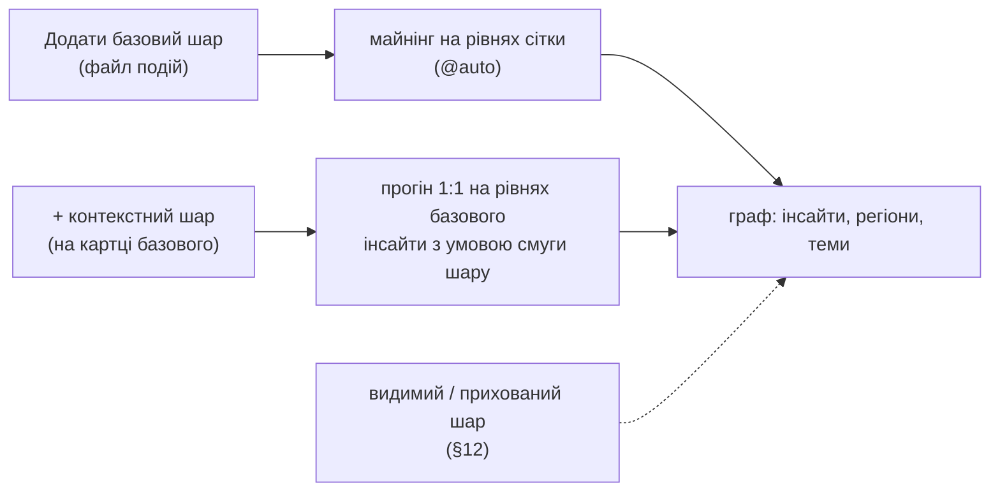

# Крос-шаровий аналіз: математика, термінологія, інтерфейс

Статус: концепт M19 (епік #275, задачі #276–#290); рішення 2026-11-02…04 записані датованими абзацами. Факти — за кодом `develop-crosstype` після PR #272.

## 0. Про що це й головне

Це концепт-документ M19. Він відповідає на чотири запитання від 2026-11-02: що саме рахує зв'язок шарів, чи враховуємо кількість точок, як це узгоджується з класикою і як спростити слова й екрани. Факти — за кодом `develop-crosstype` після PR #272 і за спеками M17–M18; оцінки й пропозиції позначені як такі.

Головне в п'яти реченнях:

1. Сьогодні SIG уміє відповісти «біля барів **інший набір** подій» (скажімо, більша частка шахрайства), але не вміє відповісти «біля барів **більше** подій». Кількість подій у комірці система рахує (метрика `points`), та порівнює комірки, а не події, і не має, «відносно чого» більше, — експозиції (§3).
2. «Чи впливає шар» — це два різні запитання. Перше: чи **більше подій** поруч із шаром (більше на км² або на людину — це й називають експозицією). Друге: чи **інший склад** подій поруч (яка частка — шахрайство, грабежі, крадіжки). Класичні дослідження барів і станцій відповідають на перше; SIG сьогодні — лише на друге (§4, рисунок).
3. Нуль шару — перевірка «а що, як бари тут ні до чого, а річ у фоні зони?» — зроблена правильно і стоїть у родині класичних перевірок; але вона відповідає лише на «бари чи фон зони», а не на «чи більше подій» (§2, §5).

   *Простими словами:* нуль шару — це перевірка «а що, як бари тут ні до чого?». Бари стоять не випадково, а там, де зона й так насичена подіями й об'єктами — щільна забудова, трафік, а в мілітарному домені, скажімо, зона активних бойових дій. Ця загальна насиченість зони, хоч би що її спричиняло, і є «фон зони». Тож ефект «біля барів більше шахрайства» може бути просто фоном зони. Ми 199+ разів перемішуємо бари лише всередині кожної батьківської комірки (≈ 0.7 км²): барів у ній стільки ж, вони лише стоять в інших із семи дрібних комірок, — і щоразу заново шукаємо той самий інсайт. Якщо на перемішаних мапах ефект такий самий, його дає фон зони, а не бари (`context_confounded`); якщо справжня мапа помітно сильніша за майже всі перемішані — важить саме розташування барів. Аналогія: пересаджувати учнів у межах того самого класу, щоб зрозуміти, чи шум залежить від місця, а не від класу. Чого нуль не бачить: «більше подій на одиницю експозиції» і ефекти, ширші за батьківську комірку.
4. Мінімальний крок у ядрі, щоб відповідати й на «чи більше подій»: лічильник подій кожного типу на комірку (на одному рівні сітки це і є «на км²») та, для складу, медіана, зважена кількістю подій; усі захисти від хибних знахідок лишаються як є (§4, §8, §9).

   *Простими словами:* сьогодні майнер відповідає на «чи інша **типова комірка** біля барів». Щоб відповісти на «чи **більше подій** біля барів», у ядро треба дві малі зміни: (1) лічильник `count_<тип>` — подій цього типу в комірці; на одному рівні сітки комірки майже однакові за площею, тож це і є «подій на км²», без нового входу; (2) для запитання про склад — опція зважувати медіану часток кількістю подій, щоб комірка з 500 подіями важила більше, ніж із 5, і висновок був про події, а не про комірки. Захисти від хибних знахідок — нуль шару, правило тавтології (метрику не можна пояснювати ознакою, порахованою з неї ж) і поправка Бонферроні — лишаються як є. Формули й місця в коді — §9.
5. Слова й екрани: «базовий шар» (чиї події аналізуємо) і «контекстний шар» (що стоїть поруч); відповіді «більше подій / інший склад»; користувачеві — завантаження, чат і мапа, розробникові — граф і сфера (§6, §7). Сценарій «базовий шар → граф → контекстні шари», кілька шарів разом і вимикання шару — §10–§12.

## 1. Що вже працює для одного шару

Один файл точок проходить повний цикл без прогалин: точки → комірки H3 → метрики комірки → підгрупи → відбір → граф → консоль. Нижче — факт за кодом гілки `develop-crosstype` на 2026-11-02, без оцінок.

| Етап | Що рахується | Де в коді |
| --- | --- | --- |
| Завантаження | опція `geo` (auto / колонка / lat,lon @r). `@auto` бере найдрібніший рівень r10…r3 з ≥ 50 щільних комірок (≥ 5 точок), ≥ 50 % точок у щільних і ≤ 5 000 комірок; грубші рівні — 7/5/3/1 | `spatial.select_levels`, `ingestion` |
| Комірка | один рядок на зайняту комірку: лічильник `points`; у щільних комірках — медіани числових колонок, частки рівнів категоріальних (`share_<колонка>_<рівень>`), мода; з колонкою часу — `active_days`, `late_share` | `spatial.build_cells` |
| Сусідство | примусові смуги: `neighbours_points_band` (квартилі суми по 6 сусідах) і `lisa_points` (локальний Моран на log(1+points): hot spot / cold spot / outlier / no cluster) | `spatial.build_cells`, `spatial_plane` |
| Майнінг | вендорний EDA: профіль (step1), сила групувань ε² (step2), простір кон'юнкцій до 3 умов у бюджеті 5 000 (step3), перший прохід — сито розміру, робастний z медіан, EMM-зміна кореляцій (step4), блоковий бутстреп стабільності (step4b) | `vendor/eda/main_upd.py`, `discovery.run_discovery` |
| Правило тавтології | когорта на смузі сусідства не може пояснювати лічильник, з якого ту смугу пораховано (`derived_from`); такі зсуви позначені `restated` і не стають інсайтом | `discovery.merge_identical_extents`, `step4(forbidden)` |
| Відбір | R1 support ≥ 30; R2 медіанний тест із n_eff за Мораном когорти, Бонферроні по родині; | z |
| Час | траєкторія інсайту по календарній сітці, події, ланцюжок WITHIN, зріз as_of | `temporal.py` (M13–M16) |
| Граф | Dataset → Insight → Region / Temporal / Anchor; CO_LOCATED між інсайтами з перетином комірок ≥ 0.3 | `insight_graph_service` |
| Консоль | форма завантаження, картки завантажень, вкладки Граф / 3D-сфера / Інсайти / Мапа / Час, панель деталей інсайту, чат | `sig_web_console` |

Для цього документа важливі два факти з таблиці. Перше: кількість точок у комірці (`points`) **є метрикою** і майнер шукає її зсуви так само, як зсуви медіан. Друге: смуги сусідства (`neighbours_points_band`, `lisa_points`) **не можуть** пояснювати `points` — це заборонено правилом тавтології, бо їх із `points` і пораховано.

## 2. Що саме рахує крос-шаровий прогін сьогодні

Прогін відповідає на одне запитання: чи відрізняється *типова комірка цілі* з певною кількістю точок шару поруч від типової комірки всієї мапи — і чи не пояснює цю відмінність сам розклад шару в межах більшої комірки. Покроково, за кодом `context.py`, `discovery.py`, `selection.py`:

*Простими словами, на прикладі.* Місто вкривається сіткою шестикутних комірок (на рівні r9 — близько 0,1 км² кожна). У кожній комірці рахуємо події базового шару (злочини) і точки контекстного шару (бари) — у ній самій та в шести сусідніх. За кількістю барів комірки діляться на п'ять груп: «немає поруч», «мало», «менше середнього», «більше середнього», «найбільше». Далі питаємо: чи в групі «найбільше барів» типова комірка має іншу частку, скажімо, шахрайства, ніж типова комірка міста? Якщо так — перевіряємо, чи не пояснюється це просто фоном зони: 199 разів переставляємо бари між сусідніми комірками тієї самої зони (батьківської комірки) й дивимося, чи ефект тримається. Насамкінець робимо поправку на те, що таких запитань поставлено багато. У вимірі M17 (злочини 2025 × бари, r9) тест типової комірки пропустив 11 знахідок, а перевірка на фон зони — жодної; зі станціями «L» лишилась одна (шахрайство біля станцій), і вона повторилася на даних 2024. Нижче — те саме формулами, крок за кроком.

1. **Лічильник шару на сітці цілі.** Для шару L і роздільності r цілі n_L(c) — кількість точок шару в комірці c, по всіх комірках, і порожніх для цілі теж. Для комірки i цілі — сума по диску радіуса k (0, 1 або 2 кільця; типово 1 = комірка й шість сусідніх):

```latex
s_L(i) = \sum_{c \in \mathrm{disk}_k(i)} n_L(c)
```

2. **Смуга.** s_L(i) = 0 дає «none nearby»; додатні суми ріжуться на квартилі q1…q4 за спостереженими межами. Сире s_L у таблицю не потрапляє, інакше стало б метрикою. Смуга — одна примусова категоріальна колонка `context_<шар>_band`: вона входить у кожну кон'юнкцію пошуку і за правилом тавтології не переказує жодної метрики цілі, тож може пояснювати й `points`.
3. **Майнінг як завжди.** Когорта S — набір комірок за умовами (смуга шару ∧ інші умови: район, LISA, сусіди). Для кожної метрики m рахується робастний z медіани когорти проти медіани всієї мапи:

```latex
z_m(S) = \frac{\operatorname{med}_{i\in S} m_i - \operatorname{med}_{\text{всі}} m}{1.4826 \cdot \mathrm{MAD}(m)}
```

Метрики тут: `points` (кількість подій цілі в комірці), медіани числових колонок, частки типів (`share_crime_robbery` тощо), часові лічильники.

4. **Тест медіани з n_eff.** p первинної метрики за асимптотикою медіани; вибірка стиснута за Мораном когорти, n_eff = n·(1−ρ)/(1+ρ); Бонферроні по родині «когорти × метрики» завантаження.
5. **Нуль шару: перестановки в батьківських комірках.** Гіпотеза: за фіксованої суми шару в кожній батьківській комірці (роздільність r−1, на r9 це ≈ 0.7 км²) розклад між її сімома дітьми не пов'язаний із метрикою цілі. D разів (199 або більше) лічильники шару переставляються серед усіх дітей кожного батька, s_L і смуга перераховуються за спостереженими межами, когорта S_d збирається з тими самими іншими умовами, і рахується |z_d|:

```latex
p_{\mathrm{context}} = \frac{1 + \#\{d : |z_d| \ge |z_0|\}}{D' + 1}, \qquad \text{ворота: } \min(1,\ p_{\mathrm{context}} \cdot m) \le 0.05
```

Тут m — кількість валідованих когорт завантаження з умовою шару (Бонферроні`; відома до тяг), D' — тяги з ≥ 30 комірками. Тяг планується max(199, ⌈2m/α⌉), тож найменше скориговане p = m/(D+1) ≤ α/2 завжди може пройти планку (discovery.py, _context_evidence); 199 — лише нижня межа. Зупинка — тільки коли відмова вже неминуча (решта тяг і всі «мимо» не опустять p·m під α); допущений інсайт тягне всі заплановані. Відмова — context_confounded. Тяга з когортою < 30 комірок не рахується — це умова на підтримку; її частку міряє eval (§15, п. 10)`.

6. **Що допускається.** Лише інсайти з умовою на смузі шару (решта — `outside_cross_type`); умова шару не допускається на зміні кореляцій, бо нуль її не перевіряє. Прогін — окремий датасет цілі з позначкою `cross`, його картки стають поруч із картками цілі.

**Що цей апарат перевіряє, а чого ні.** Він перевіряє *умовний рівень і склад*: «серед комірок із багатьма барами поруч типова комірка має іншу частку шахрайства або іншу кількість подій, і цього не дає випадковий розклад барів у межах батьківської комірки». Він не перевіряє: (а) чи більше подій *на одиницю експозиції* (населення, загальна активність), бо експозиції в моделі немає; (б) зв'язок дрібніший за комірку (≈ 0.1 км² на r9) або грубший за батька, який нуль поглинає разом зі щільністю; (в) частоту одного типу подій, поки файл не відфільтровано до цього типу (`where`, M18 P1).

## 3. Де в майнері сидить кількість точок

Коротка відповідь: кількість точок **є** в системі як метрика комірки (`points`), але **не є** вагою: майнер групує комірки, а не події, і комірка з 5 подіями важить стільки ж, скільки комірка з 500. Звідси й відчуття, що «аналітики за кількістю немає». Аудит вендорного EDA (`subgroup_miner/vendor/eda/main_upd.py`, копія з 13 задокументованими правками, `PROVENANCE.md`) і адаптера навколо нього:

| Місце | Як кількість входить | Наслідок |
| --- | --- | --- |
| Таблиця комірок (`spatial.build_cells`) | один рядок = одна комірка; `points` — лічильник подій цілі; частки (`share_*`) і медіани — лише в комірках із ≥ 5 подіями, інакше NaN | кількість існує як окрема колонка-метрика; експозиції (населення, площа, загальна активність) немає |
| Сито розміру (step4: `min_sg_size = max(5·k, 0.5 % рядків)`) | розмір підгрупи = кількість **комірок**, не подій | 30 тихих околиць проходять сито так само, як 30 центрів міста |
| Зсув (`robust_z_score`, `_median_z`) | медіана метрики по комірках когорти проти медіани по всіх комірках, без ваг | частка в комірці з 6 подій (крок 0.17) і в комірці з 600 подій важать однаково; тест — про «типову комірку», не про «типову подію» |
| Вага інсайту (`support` = `volume_utility`) | частка **комірок** у когорті | теж комірки, не події |
| Примусові смуги `neighbours_points_band`, `lisa_points` | пораховані з `points` | правило тавтології забороняє їм пояснювати `points` — це правильно |
| Замикання когорти (`closed_intent`) | якщо до когорти «бари q4» замикання додає `lisa_points = hot spot`, `points` стає `restated` і зсув кількості зникає з інсайту | частотна гіпотеза губиться саме там, де шар збігається з гарячими точками, а саме там вона й цікава (спека M17 §14.5) |
| Нуль шару (`_context_evidence`) | перестановка зберігає **суму шару** в батьку, комірки цілі не зважені | нуль контролює грубу щільність *шару*, а не експозицію *цілі* |
| Бутстреп стабільності (step4b) | блоки = батьківські комірки, без ваг | стабільність теж про комірки |

Що це означає для задачі. «Кількість» і «склад» у коді вже два різні вимірювання — метрика `points` і метрики `share_*`. Бракує трьох речей: (1) експозиції для частоти — знаменника, відносно якого «більше»; (2) ваги за кількістю подій там, де висновок має бути про події, а не про комірки; (3) лічильника на тип події без ручного фільтра. Чи доцільно враховувати кількість — залежить від запитання, і саме це розводить §4.

## 4. Два запитання: частота і склад

Запитання «чи впливає шар B на події A» насправді два, і їх треба ставити окремо, бо вони мають різні знаменники. Це не недолік реалізації, а властивість задачі: класика про бари й станції ставить переважно перше, SIG сьогодні відповідає на друге.

**Запитання F (частота).** Чи більше подій A там, де поруч B, ніж очікувано за експозицією? Для комірки c з лічильником N_A(c) і експозицією E(c):

```latex
N_A(c) \sim \mathrm{NegBin}\big(\mu(c)\big), \qquad \log \mu(c) = \log E(c) + \beta\, s_B(c) + \gamma^{\top} x(c)
```

Так ставлять питання Bernasco і Block (2011): регресія кількості вуличних грабежів на ≈ 25 000 кварталів Чикаго з барами, школами, станціями та їхніми сусідніми кварталами як регресорами. Так само Risk Terrain Modeling: кожен фактор як близькість або щільність, покроково в регресії лічильника. Експозиція E — населення, площа, всі події або сума іншого шару. H0: β = 0, «не більше, ніж дає експозиція».

**Запитання C (склад).** Серед подій A в комірці c, чи більша частка типу k там, де поруч B?

```latex
\pi_k(c) = \frac{N_{A,k}(c)}{N_A(c)}, \qquad H_0:\ \pi_k \perp s_B
```

Знаменник тут — самі події A, експозиція скорочується. Саме це рахує SIG через `share_<колонка>_<k>`. Склад відповідає на «атрактор» Брантінгемів: місце тягне *певний* тип подій, а не всіх.

**Чому одне не зводиться до іншого.** Якщо біля барів удвічі більше всіх злочинів і вдвічі більше грабежів, F каже «так» (генератор: насичена зона), а C каже «ні» (та сама частка). Якщо біля барів стільки ж злочинів, але грабежів удвічі більше, F для грабежів каже «так», для всіх злочинів — «ні», C каже «так» (атрактор). Сценарій із запитання власника — «більшість точок одного типу пов'язана з концентрацією інших» — це правий нижній квадрант: і тут єдиний спосіб його відрізнити від атрактора — поставити обидва запитання.

| | склад той самий (C: ні) | склад інший (C: так) |
|---|---|---|
| **більше подій (F: так)** | генератор: насичена зона — більше всього, пропорції ті самі | обидва: більше подій і інший склад |
| **стільки ж подій (F: ні)** | нейтрально: шар ні до чого | атрактор: місце тягне певний тип, загальна кількість та сама |

**Чи можна звести квадрант в один інсайт.** На екрані — так, у тесті — ні. Рахуються два окремі тести: «більше подій» (знаменник — експозиція) і «інший склад» (знаменник — самі події). Якщо злити їх в одне число (грабежі / експозиція = частота × частка), воно скаже «біля барів більше грабежів», але не скаже чому — генератор, атрактор чи обидва. Тому користувач бачить одну картку з вердиктом-квадрантом (напр. «Генератор + атрактор») і двома рядками під ним — «більше подій: так / ні», «інший склад: так / ні»; квадрант ставиться, лише коли обидва тести пройшли нуль і Бонферроні (картка — у §8). Поки в моделі немає експозиції, рядок «більше подій» чесно не заповнити.

Вертикальну вісь SIG уже читає й захищає нулем шару; горизонтальна потребує експозиції, якої в моделі немає.

**Як розвести їх у SIG: мінімальний апарат.**

1. **Лічильник на тип.** Сьогодні — читання `where=crime=robbery` (M18 P1): `points` стає N_{A,k}, і це вже F зі знаменником-площею, але окремим прогоном на кожен тип. Лічильник `count_<тип>` у таблиці комірок дає те саме в одному прогоні поруч із частками (§9).
2. **Експозиція для F.** Один знаменник на прогін. За замовчуванням — площа комірки: на одному рівні H3 вона практично стала, тож N_k / E ∝ N_k і новий вхід не потрібен. «Усі події цілі» як знаменник дає частку — це вже C, а не F. Населення чи сума іншого шару — лише якщо домен цього попросить (§9.1).
3. **Ваги.** Тест медіани по комірках читати з вагою w(c) = N_A(c) (зважена медіана) там, де питання про події; це один параметр у `_median_z`. Без нього висновок — про «типову комірку».
4. **Нуль шару лишається.** Він перевіряє, що шар не просто «живе в насичених зонах» на масштабі батька; для F це непараметричний аналог члена γ x(c) на грубому масштабі. Експозицію він не заміняє.
5. **Масштаб.** Класика працює на кварталі ≈ 100 м; r9 має сторону ≈ 200 м (h3 4.x) і площу ≈ 0,105 км², а диск із шести сусідів ≈ 0,74 км² розмиває локальний зв'язок. Для F — диск 0 на r10 за достатнього обсягу (§12a спеки: r10, диск 0, бари — одна знахідка на `points`).

Чи доцільно враховувати кількість? Для F — без неї запитання не існує. Для C — як вагу: інакше комірка з 5 подіями шумить так само голосно, як центр міста, і єдиний захист — поріг 5 подій на комірку, за якого частка має крок 0.2.

## 5. Класика й схожі системи: що лягає на наш апарат

Класичні методи «впливу одного типу точок на інший» майже всі відповідають на запитання F (частота), а те, що найближче до SIG за нулем, — методи з нулем «за фіксованого розташування всього» (випадкове маркування, перестановка міток). Джерела перечитано 2026-11-02, посилання нижче.

| Метод / праця | Одиниця | Запитання | Нуль | Що з цього в SIG |
| --- | --- | --- | --- | --- |
| Cross-K Ріплі K_ij(r) ([spatstat Kcross](https://search.r-project.org/CRAN/refmans/spatstat.explore/html/Kcross.html)) | точки | F: чи більше точок B у радіусі r від точки A, ніж πr² | незалежність (Пуассон) або випадкове маркування ([ecespa K1K2](https://www.rdocumentation.org/packages/ecespa/versions/1.1-18/topics/K1K2)); вибір нуля — окреме рішення | точкового рівня немає; аналог — сума шару по диску, але агрегована до комірки |
| Co-location quotient, CLQ ([ArcGIS Colocation Analysis](https://pro.arcgis.com/en/pro-app/3.4/tool-reference/spatial-statistics/colocationanalysis.htm), [як працює](https://doc.arcgis.com/en/allsource/1.5/analysis/geoprocessing-tools/spatial-statistics/learnmorecolocationanalysis.htm)) | точки, k найближчих сусідів | F, спрямоване: A→B ≠ B→A | перестановка міток категорій між точками — умовний на розташуванні всіх | найближчий родич: спрямованість ціль→шар й нуль «за фіксованого розташування»; відмінність — SIG тасує лічильники шару в батьках, CLQ — мітки точок |
| Двовимірний локальний Моран ([GeoDa, Anselin](https://geodacenter.github.io/workbook/6c_local_multi/lab6c.html)) | комірки | x у комірці проти y у сусідів | умовна перестановка | свідомо не взято (спека M17 §6.2): сам Анселін попереджає, що статистика не контролює кореляцію x і y в одній комірці й поза простором-часом читається з обережністю |
| Risk Terrain Modeling, RTMDx ([систематичний огляд 2021](https://doi.org/10.1186/s40163-021-00149-6), [NIJ, 5 міст](https://www.icpsr.umich.edu/web/NACJD/studies/36369)) | растр | F: регресія лічильника на близькість або щільність кожного фактора, покроковий відбір, відносний ризик на фактор | параметричний (Пуассон / NB) | смуга шару = «щільність у диску», але без регресії, без експозиції і без кількох факторів разом (межа 2 шари) |
| [Bernasco і Block 2011](https://journals.sagepub.com/doi/10.1177/0022427810384135) | ≈ 25 000 кварталів Чикаго | F: кількість вуличних грабежів проти генераторів, атракторів і якорів правопорушників, з сусідніми кварталами | регресія лічильника | це хрестоматійний позитивний контроль для нашого демо, і він — F |
| [Roncek і Maier 1991](https://scite.ai/authors/dennis-w-roncek-8J1M) | квартали Клівленда | F: більше барів на кварталі — більше злочинів | регресія | F |
| [Block і Davis 1996](https://ojp.gov/ncjrs/virtual-library/abstracts/environs-rapid-transit-stations-focus-street-crime-or-just-another), станції Чикаго | райони й околиці станцій | F: у спокійних районах грабежі купчаться біля станцій, у небезпечних — на головних вулицях | описовий | ефект залежить від району — це саме кон'юнкція «станція ∧ район», яку майнер уміє будувати |
| Подвійна KDE, CrimeStat ([Levine, розділ 10](https://Nij.ojp.gov/sites/g/files/xyckuh171/files/media/document/CrimeStat%2520IV%2520Chapter%252010.pdf)) | растр | F з експозицією: щільність подій / щільність населення = відносний ризик | — | найближчий класичний аналог того, чого бракує: знаменника |
| [Brantingham 1995](https://www.ojp.gov/ncjrs/virtual-library/abstracts/criminality-place-crime-generators-and-crime-attractors): генератори й атрактори | концепт | генератор — місце, що збирає багато подій усіх типів (у класиці — людне місце, де нагоду помічають); атрактор — місце, куди йдуть по певний тип злочину | — | це рівно осі F і C з §4 |

**Висновок.** Метод SIG — «склад типової комірки за умови грубої щільності шару» — не має точного відповідника в класиці, і це не вада: його нуль стоїть у тій самій родині, що й випадкове маркування й CLQ (умовний на тому, де все стоїть), а субгруповий пошук дає кон'юнкції («станція ∧ спокійний район»), яких класичні тести не шукають. Але хрестоматійні результати про бари й станції — це F з експозицією на масштабі кварталу. Поки в SIG немає знаменника і лічильника на тип без ручного фільтра, ці результати не можуть ні підтвердитися, ні спростуватися — вони просто не поставлені. Це й показала друга серія валідації M17 (§14.3): насильницькі злочини × бари — 0 допущено, хоч Спірмен у межах батька між кількістю грабежів і сумою барів поруч був +0.135.

## 6. Термінологія: шари замість типів

Пропоную одну пару слів на весь продукт: **базовий шар** (чиї події аналізуємо й чиї метрики пояснюємо) і **контекстний шар** (чия присутність поруч — умова; його ніколи не майнимо). Роль — властивість прогону, а не файлу: той самий файл буває базовим у одному прогоні й контекстним у іншому (так код уже й працює). Слово «тип» лишається лише для класів усередині колонки (тип злочину), інакше «крос-типовий» і «тип події» плутаються.

| Поняття | Зараз у коді й API | Зараз в інтерфейсі | Пропоную |
| --- | --- | --- | --- |
| шар, який аналізуємо | `target`, `dataset`, `upload` | «Ціль — датасет, чиї метрики шукаємо», «датасет», «завантаження» | **базовий шар** |
| шар-умова | `context`, `layer`, запис `LAYER` | «Контекстний шар — точки іншого типу», «Лише шар», «Шари — точки іншого типу як умова» | **контекстний шар**; прапорець «Лише шар» → «Зберегти як контекстний шар» |
| аналіз одного шару | upload, batch, levels | «Аналізувати», «рівні H3» | **аналіз шару** → внутрішньошарові інсайти |
| аналіз двох шарів | `crosstype`, `cross`, run | «Крос-типовий аналіз», «прогін» | **зв'язок шарів** → міжшарові інсайти |
| смуга шару | `context_<шар>_band`: none nearby, q1…q4 | «смуга контексту», «найменше барів серед тих, що їх мають» | **скільки «барів» поруч**: немає / мало / нижче середнього / вище середнього / найбільше |
| нуль шару | `p_context`, `context_family`, `context_confounded` | «нуль шар», «відтворює розклад шару: N» | **перевірка на фон зони**: «пояснюється фоном зони — бари стоять там, де подій і так багато: N»; технічне p — лише в режимі розробника |
| диск | `ring` 0 / 1 / 2 | «Що рахувати поруч: комірку й шість сусідніх / лише саму комірку / у межах двох кілець» | **«поруч» — це**: своя комірка / найближче оточення / ширше оточення; під назвою — радіус, перерахований з поточного рівня H3: ≈ √3 · ребро · (k + ½), тобто на r9 ≈ 0,15 / 0,45 / 0,75 км, на r7 ≈ 1 / 3 / 5 км, на r5 ≈ 7 / 22 / 37 км. Назви не залежать від домену й масштабу, число змінюється разом із сіткою |
| два запитання з §4 | `points` / `share_*` | — (не розрізняються) | **більше подій** / **інший склад подій** — два рядки на картці результату |
| читання одного класу | `where=колонка=значення` | «Лише рядки», «Лише рядки шару» | **лише події типу …** (вибір зі списку значень, не вільний текст) |

Словник має жити в одному місці (`insight_contracts/wording.py` уже є таким для текстів інсайтів) і звідти йти в консоль, документи й спеки. Сьогодні одне й те саме називається «ціль», «датасет» і «завантаження» в одному екрані, а «шар» означає то файл, то роль, то смугу.

## 7. Інтерфейс: два користувачі, два набори екранів

Консоль сьогодні — одна сторінка, де продуктові екрани й інструменти розробника стоять поруч, а форма завантаження має 19 полів і дві згорнуті панелі. Пропоную розвести явно: три екрани для користувача, решта — за перемикачем «режим розробника».

| Екран | Для кого | Що з ним зробити |
| --- | --- | --- |
| Завантаження | користувач | три кроки (нижче); решта полів — у згорнутому «Додатково» з типовими значеннями, як уже робить маніфест демо |
| Чат | користувач | головний вхід до відповідей; питання про шари словами §6: «що біля барів інакше?» |
| Мапа | користувач | показувати смуги контекстного шару й знахідки зв'язку; картка знахідки — два рядки «більше подій / інший склад» |
| Інсайти (список) | обидва | лишити як стрічку з простими формулюваннями; технічні поля сховати |
| Граф, 3D-сфера | розробник | лише в режимі розробника |
| Панель деталей інсайту: p_context, n_eff, Моран, пороги | розробник | у режимі розробника; користувачеві — одне речення вердикту |
| Панель «Крос-типовий аналіз» | — | прибрати: запуск — дія «+ контекстний шар» на картці базового шару, результат — підсвітка в наявних блоках (таблиця, мапа, граф, панель деталей, чат) |

**Завантаження в три кроки.** Сьогодні форма питає: готовий набір, «Лише рядки», категорії, смуги, просторовий аналіз, контекстний шар (файл, готові шари, колонки точок, що рахувати поруч), колонка часу, часовий пояс, сітка часу, що вимірюють метрики, що означають колонки, документ метаданих, джерело, надійність, «Лише шар», «+ базовий рівень» — і окремо панель із ціллю, шарами, радіусом і фільтром. Пропоную:

1. **Файл** або готовий набір.
2. **Що це** — три картки, одна активна за автовизначенням: *події з координатами* (є точки), *таблиця* (точок немає), *контекстний шар* (точки без власних чисел, або користувач так каже). Підтвердити одним кліком.
3. **Аналізувати.** Усе інше — під «Додатково»: колонки точок, рівні, смуги, категорії, час, пояс, сітка, метадані, надійність.

**Зв'язок шарів однією дією.** На картці базового шару — кнопка «+ контекстний шар»: вибрати збережений шар або файл, натиснути. Типові налаштування: рівень базового шару, «поруч» = найближче оточення; під «Додатково» — своя комірка і ширше оточення, «лише події типу…», «і навпаки». Картка результату читається так:

> **Біля барів.** Більше подій — ні: пояснюється фоном зони (17 збігів). Інший склад — так: частка шахрайства вища там, де барів найменше.

Ці два рядки — рівно F і C з §4. Перший стане чесним лише після експозиції з §4, тому порядок у §8 — спочатку математика, потім слова, потім екрани.

## 8. Що пропоную і в якому порядку

Спочатку математика (без неї картка результату бреше), потім слова, потім екрани. Кожен пункт — окремий PR у `develop-crosstype`, без злиття без дозволу власника; нічого прив'язаного до назв наборів.

1. **Ядро: частота з експозицією.** Лічильник `count_<тип>` = подій типу на комірку (на одному рівні H3 ≈ на км²: знаменник — площа, нових входів немає) поруч із наявним `share_<тип>`; зважена за подіями медіана в `_median_z` як опція для складу. Пре-реєстрований прогін: бари й станції, 2025 → 2024, r10 диск 0 і r9 диск 1, плюс дві випадкові половини. Нуль шару, правило тавтології, Бонферроні — без змін. Формули й місця в коді — §9.
2. **Ядро: лічильник на тип без ручного фільтра.** Для категоріальної колонки з 2–40 рівнями — вибір значення зі списку замість вільного тексту `where` (сервер уже повертає значення з лічильниками при відмові); поріг — ≥ MIN_ROWS · MIN_CELL_POINTS рядків, без зниження порогів.
3. **Словник §6** як єдине джерело: `wording.py` → консоль, docs 08/10, спеки; «крос-типовий» → «зв'язок шарів».
4. **Картка результату зв'язку**: два рядки «більше подій / інший склад» із вердиктом нуля словами; технічне — в режимі розробника.

   Зверху — вердикт-квадрант із §4 (генератор / атрактор / обидва / нейтрально); він ставиться, лише коли кожен із двох рядків пройшов свій тест і нуль шару; тести не зливаються в одне число.
5. **Режим розробника**: граф, сфера, технічні поля панелі деталей, панель прогону — за перемикачем у консолі, без змін на сервері.
6. **Форма в три кроки** з автовизначенням ролі файлу; «Додатково» згорнуте. Роль — лише пропозиція: користувач підтверджує або змінює її, і вона належить прогону, а не файлу (аудит, §15).
7. **Дія «+ контекстний шар»** на картці базового шару замість панелі.
8. **Валідація**: хрестоматійні контролі як F (Bernasco і Block: бари → вуличні грабежі) на 2024 як відкладеному році; результат — у спеку, яким би він не був.

**Відкриті питання** — прошу коментарі просто тут:

- [x] Знаменник частоти за замовчуванням: усі події базового шару (тоді частота типу = частка, що вже є) чи площа комірки / населення (новий вхід)?

  *Рішення з обговорення 2026-11-02 (з коментаря):* населення не потрібне; для «більше подій» знаменник — площа комірки (на одному рівні H3 стала, тож це лічильник подій), для «інший склад» — усі події комірки (наявна частка); рівень і межі смуг фіксуються за повним набором; критерій відтворення — дві випадкові половини. Деталі — §9.1 і §9.3. Комплексний аудит 2026-11-03 (§15): площа — так, але лічильник на комірку є «подій на площу» лише тому, що в межах міста площі комірок одного рівня різняться менше ніж на 1 % (виміряно для Chicago: 0,83 % на r9 і на r10); площу рівня (км²) і назву знаменника записувати в прогін, словами казати «на комірку ≈ 0,1 км²», ніколи «на людину»; вікно спостереження одне на весь базовий шар, тож у контрасті скорочується.

  *Рішення 2026-11-04 (за аудитом і заміром, закрито):* для «більше подій» метрика — сирий лічильник `count_<тип>` на комірку, **без ділення на площу**: розкид площ 0,83 % (Chicago, r9 і r10) не змінює ні медіан, ні порядку комірок, тож площа кожної комірки не рахується. Для «інший склад» — наявна частка `share_*`. Лічильник рахується в тому самому групуванні, що й частка (частка = лічильник / `points`), тож додаткового проходу по даних немає, і лише для обраних типів. В запис прогону — одне поле `exposure: area` із середньою площею рівня для слів картки («на комірку ≈ 0,1 км²»). Не робимо: населення, фактичну площу комірки, дільник-шар (P2). Запобіжник: замір зроблено лише для міста; для наборів на сотні кілометрів розкид більший, тому прогон один раз перевіряє max/min площі зайнятих комірок і пише попередження, якщо він більший за 5 % (не виміряно для таких наборів).
- [x] Зважувати медіану подіями завжди чи лише для запитання про склад?

  *Варіанти й наслідки.* **А. Завжди, для всіх метрик** — відкинути: для лічильників (F) вага подіями рахує кількість двічі, і F-інсайти роздуваються в насичених зонах. **Б. Лише для складу, типово ввімкнено.** За: висновок про події, а не про «типову комірку»; дрібні шумні комірки не перекошують частки; ближче до класичного RR. Проти: змінює вже наявні інсайти на `share_*` (M17 треба перерахувати); n_eff Кіша менший за n, тож проходить менше інсайтів; кілька дуже насичених комірок можуть визначати результат цілої когорти. **В. Лише для складу, опція `weight_by_events`, типово вимкнена до прогону на демо (рекомендую).** За: нічого наявного не змінюється; на демо видно обидва режими поруч, і рішення ухвалюється за даними. Проти: два режими треба пояснити на картці («про комірки» / «про події»); до перемикання типово лишається слабше читання. *Вплив на систему:* у всіх варіантах зміна лише в `_median_z`, config і словах картки (§9.4); нуль, Бонферроні, граф і API не змінюються. Від В до Б — одна зміна типового значення, якщо на двох половинах зважений режим відтворюється не гірше.

  *Рішення 2026-11-03:* Б — зважена медіана для складу типово ввімкнена: висновок про події, а не про комірки, шум рідких комірок із 5 подіями гаситься. Наявні інсайти на `share_*` перераховуються на демо; вимкнути можна опцією.
- [x] Диски 0/1/2 лишаються видимими, чи типово «своя комірка» для «більше подій» і «найближче оточення» для «інший склад», решта під «Додатково»?

  *Рішення 2026-11-03 (аудит):* для «більше подій» — лише своя комірка (диск 0) на найдрібнішому рівні (r10, якщо `@auto` дозволяє): на грубіших сітках диск із шести сусідів розмиває локальний зв'язок. Для «інший склад» — найближче оточення (диск 1) на r9. Решта — під «Додатково».
- [x] «Режим розробника» — перемикач у консолі чи окрема адреса?

  *Рішення 2026-11-03 (з коментаря):* перемикач у консолі.
- [x] Панель «Крос-типовий аналіз» зникає повністю чи лишається в режимі розробника?

  *Рішення 2026-11-04:* панель прибирається повністю, з режиму розробника теж. Запуск — одна дія «+ контекстний шар» на картці базового шару. Інсайти на перетині базового й контекстного шарів підсвічуються в наявних блоках з даних, що вже є в записі прогону (`cross`, `cross_layers`), без нових розрахунків: таблиця інсайтів — чип «контекстний шар: бари» і фільтр за шаром; мапа — комірки інсайту обведені кольором шару, точки шару вмикаються поверх; граф — вузли прогону з кільцем кольору шару; панель деталей — рядок «зв'язок із шаром: бари» і вердикт нуля словами; чат — позначка шару біля інсайту у відповіді. Технічні параметри прогону (рівень, оточення, тяги) — у панелі деталей в режимі розробника.
- [x] Чи потрібен точковий тест (cross-K або CLQ) як друга перевірка поруч із комірками, чи це поза продуктом?

  *Варіанти й наслідки.* **А. Без точкового тесту.** За: нуль роботи, усе в одній системі комірок. Проти: висновки залежать від сітки (розмір і межі комірок), і немає незалежної перевірки, що інсайт — не артефакт сітки; немає прямого зв'язку з класичними числами для звітів. **Б. CLQ / cross-K у eval-скрипті, не в продукті (рекомендую).** За: перевіряє методику на пере-реєстрованих прогонах і ловить артефакти сітки; продукт, інтерфейс, граф і API без змін; один скрипт. Проти: користувач цієї перевірки не бачить; вона захищає метод загалом, а не кожен інсайт. **В. Точковий тест у продукті для кожного інсайту.** За: незалежна від сітки друга думка на картці. Проти: потрібні сирі точки обох шарів — якщо шар задано агрегатами (кількість подій на область), тест некоректний; перестановки на точках — секунди–хвилини на кожен інсайт на великих наборах (оцінка); ще одна родина множинних тестів; вердикти «комірки так, точки ні» треба пояснювати в інтерфейсі; нові поля в графі й API. *Наслідки відсутності (А):* ризик, що частина інсайтів — артефакт рівня сітки; частково його знімають перевірка на кількох рівнях і оточеннях та критерій двох половин (§9.3).

  *Рішення 2026-11-03:* Б — CLQ / cross-K лише в eval-скриптах. У ядро не інтегрується: порушило б парадигму дискретної агрегації H3 і радикально сповільнило б роботу.

## 9. Обидва запитання в поточній архітектурі

Коротко: так, обидва запитання — «чи більше подій» (F) і «чи інший склад» (C) — вкладаються в наявний конвеєр без нового механізму й без нових входів. F і C — це дві родини метрик на тій самій таблиці комірок; субгруповий пошук, нуль шару, правило тавтології й Бонферроні працюють для них однаково. У коді — три малі правки (§9.4).

### 9.1 Експозиція: відносно чого «більше»

Умови з обговорення: домен — фізичні події в просторі й точки розміщення об'єктів; дані про населення нерелевантні; висновок має відтворюватися на випадковій підвибірці набору.

| Знаменник E | На що відповідає | Чи є в системі | Поведінка на підвибірці |
| --- | --- | --- | --- |
| Площа комірки | подій на км² — «більше подій» (F) | так: на одному рівні H3 комірки одного міста практично однакові за площею, тож «на км²» ∝ «у комірці» | кількість масштабується на частку вибірки f; z проти медіани мапи цей множник скорочує |
| Усі події базового шару в комірці | частка типу — «інший склад» (C) | так: `share_<колонка>_<значення>` | частка не зміщується, лише шумніша в рідких комірках |
| Населення, денне населення | подій на людину | ні — зовнішній вхід | для домену не потрібен |

Рішення, яке пропоную зафіксувати: для F знаменник — площа, тобто метрика = кількість подій типу в комірці; для C — усі події комірки, тобто наявна частка. Нових входів немає. Якщо колись знадобиться інша експозиція (площа з полігонів, сума іншого шару), вона стає одним дільником на прогін — формули нижче не змінюються. Що записується разом із прогоном (аудит 2026-11-03): знаменник названо явно — exposure: area з площею комірки рівня (h3.average_hexagon_area; у межах міста розкид площ < 1 %, пентагонів у міській сітці немає), вікно спостереження — спан базового шару. Це одне поле на запису прогону, не нова модель. Інші експозиції (населення, довжина доріг, час роботи сенсора) — лише як окремий шар-дільник, коли домен їх дасть (P2 за аудитом).

**Неоднорідний фон: приклад бойових дій.** Якщо події базового шару зосереджені на фронті, комірки діляться на два різні світи: багато тихих тилових і менше насичених фронтових. Що це означає для кожного тесту:

- **F (кількість).** Медіана мапи — це типова тилова комірка, тож будь-яка когорта на фронті виглядає як «більше подій», і контекстний шар, що сам тягнеться до фронту, дасть F-інсайт без власного внеску. Від цього захищає нуль шару, але лише коли фронтова смуга ширша за зону (батьківську комірку): на r8–r10 зона від часток до кількох км², і фон фронту поглинається; на r5–r6 зона — сотні км², фронт і тил потрапляють в одну зону, і нуль уже не відрізнить шар від фону.
- **C (склад).** Стійкіший: частки скорочують загальну кількість. Але суміш подій на фронті й у тилу різна, тож на грубих рівнях «інший склад біля шару» може бути просто «фронт проти тилу».

Чи можна поки не зважати: **так, за двох умов** — працюємо на рівнях, де зона дрібніша за ширину фронту (r8 і дрібніше), а F-інсайти на грубих рівнях читаємо як оцінку. Наступний крок, якщо домен це підтвердить: (а) порівнювати когорту не з медіаною всієї мапи, а з медіаною її власних зон (локальна база; оцінка — один параметр у `_median_z`), або (б) додати «фронт / тил» як категоріальну умову, яку майнер уже вміє ставити в кон'юнкцію. (а) універсальніший і не потребує розмітки; (б) прозоріший для користувача, але потребує лінії фронту як входу.

*Рішення за аудитом 2026-11-03.* Неоднорідний фон не відкладається, два захисти входять у перший крок ядра. (1) Зв'язок шарів іде лише на дрібних рівнях: частота — на найдрібнішому рівні з диском 0 (r10, якщо `@auto` дозволяє, інакше r9), склад — на r9 з найближчим оточенням; на r7 і грубіше прогін не пропонується, бо зона вже вміщує різні світи. (2) Опція «базова лінія: зона» — варіант (а) вище: метрика читається відносно медіани своєї зони, а не всієї мапи: *Зроблено в #280: зона — батьківська комірка на рівень грубше, та сама, що в нулі шару; колонки замінюються.*

```latex
\tilde m(c) = m(c) - \operatorname{med}_{c' \in \mathrm{zone}(c)} m(c'), \qquad m = \log(1 + N_k) \ \text{для лічильників}, \quad m = \pi_k \ \text{для часток}
```

Тест і нуль не змінюються: z рахується на m̃ (медіана мапи для m̃ близька до 0), перестановки ті самі, правило тавтології те саме, бо m̃ лічильника лишається лічильником. Це ≈ 10 рядків у `build_cells` і одна опція. Що знімає: відмінності між зонами в самій оцінці ефекту (фронт проти тилу, центр проти передмістя). Чого не знімає: неоднорідність усередині зони — її знімає лише дрібніший рівень, звідси пункт (1). Варіант (б) із розміткою «фронт / тил» лишається можливим доповненням. Застереження комплексного аудиту (§15, п. 6): віднімання медіани зони прибирає лише різницю медіан між зонами, не невизначеність самої базової медіани; p для m̃ не переноситься зі старої метрики, а рахується наново всім конвеєром — m̃ є звичайною колонкою, по якій ідуть і нуль, і Бонферроні. Ієрархічна модель із фіксованими ефектами зон у ядро не йде (інша парадигма); в eval вона може бути еталоном для цієї опції.

### 9.2 Формули

Позначення: c — комірка рівня r; N(c) — усі події базового шару в ній (сьогодні `points`); N_k(c) — події типу k; π_k(c) = N_k(c) / N(c) — частка (сьогодні `share_*`); S — підгрупа комірок, яку описує умова (наприклад «барів поруч: найбільше»).

Розклад, який розводить два запитання:

```latex
\log N_k(c) = \underbrace{\log N(c)}_{\text{частота: генератор}} + \underbrace{\log \pi_k(c)}_{\text{склад: атрактор}}
```

«Біля барів більше грабежів» може бути правдою з двох різних причин: там більше всього (перший доданок) або там інша суміш подій (другий). F тестує перший доданок, C — другий, обидва на тих самих комірках S. Звідси квадрант §4.

**Тест F (частота)** — той самий робастний тест медіани, що й сьогодні, на метриці N_k:

```latex
z_F(S) = \frac{\operatorname{med}_{c \in S} N_k(c) - \operatorname{med}_{\text{всі}} N_k(c)}{1.2533 \cdot 1.4826 \cdot \mathrm{MAD}_S / \sqrt{n_S \, f_{\mathrm{eff}}}}
```

Тут n_S — кількість комірок у S, f_eff < 1 — поправка на просторову автокореляцію (уже є в `_median_z`), 1.2533 · 1.4826 · MAD / √n — асимптотична похибка медіани. Саме так сьогодні рахується z для `points`; §2 показує спрощену форму без √n. Застереження аудиту: MAD тут — розкид усередині когорти; невизначеність медіани всієї мапи й вкладеність S ⊂ мапа формула не враховує, а для лічильників із великою часткою нулів z дискретний. Так влаштований тест медіани для всіх метрик SIG: це скринінг і ранжування, не оцінка IRR; для когорт шару доказову вагу несе нуль шару (перестановки), а відтворення — половини й відкладений рік (§9.3).

**Тест C (склад)** — той самий тест на π_k, але з вагами w(c) = N(c): зважена медіана — значення, на якому накопичена вага сягає половини; n_S замінюється на ефективний обсяг Кіша:

```latex
\tilde\pi_k(S) = \operatorname{wmed}_{c \in S}\big(\pi_k(c);\; w(c) = N(c)\big), \qquad n_{\mathrm{eff}} = \frac{\big(\sum_{c \in S} w(c)\big)^2}{\sum_{c \in S} w(c)^2}
```

Що дає вага (відповідь на коментар до §0): без неї комірка з 5 подіями й комірка з 500 важать однаково, і висновок — «типова комірка біля барів має частку шахрайства 12 %». З вагою висновок — про події: «типова подія біля барів сталася в комірці, де частка шахрайства 12 % проти 7 % по місту», і одна дивна дрібна комірка його не перекошує. Для F вага не потрібна: метрика сама є кількістю, і вага кількістю рахувала б її двічі.

Дві різні поправки, обидві вже є (аудит, §15, п. 4): n_eff Кіша прибирає концентрацію ваг, f_eff за Мораном — просторову залежність; у формулі вони перемножуються, n_eff · f_eff, і жодна не замінює іншу. Невизначеність зваженої медіани — блоковий бутстреп по батьківських комірках, який уже дає stability кожного інсайту. Бета-біноміальна чи Діріхле-мультиноміальна модель складу — еталон в eval-скрипті, не в ядрі (те саме правило, що для CLQ / cross-K). На картці estimand називається прямо: «частка серед подій», не «медіана».

Поруч із робастним тестом картка показує просте число — об'єднану частку та відношення часток (збагачення), як у класиці:

```latex
\mathrm{RR}_k(S) = \frac{\sum_{c \in S} N_k(c) \,/\, \sum_{c \in S} N(c)}{\sum_{c} N_k(c) \,/\, \sum_{c} N(c)}
```

RR = 1,7 читається як «серед подій біля барів частка шахрайства в 1,7 раза більша, ніж по всій мапі». Це відношення часток (збагачення), не епідеміологічний ризик: когорта входить у базу, тож ефект трохи стиснутий, а базою є вся мапа — так і підписується (аудит, §15, п. 5). Це число для картки; тест — зважена медіана; інтервал до числа — перцентилі наявного блокового бутстрепу (P1).

**Нуль шару для обох однаковий:** та сама статистика рахується на **перестановках шару всередині батьківських комірок — щонайменше max(199, ⌈2m/α⌉) тяг, де m — кількість когорт прогону з умовою шару, відома до тяг, тож найменше скориговане p завжди може пройти планку (§2; 199 у коді — лише нижня межа). Що саме він перевіряє — слова для підказки на картці та для provenance: «за фіксованої кількості точок шару в батьківській комірці їх розклад між дочірніми не пов'язаний із метрикою». Це локальний умовний тест, а не контроль усіх конфаундерів: відмінностей між зонами, доріг, повноти реєстрації він не знімає; між зонами допомагають дрібні рівні й базова лінія зони (§9.1). У регресійній класиці це роль фіксованого ефекту зони (член γᵀx у §4) — умова на грубу щільність. Бонферроні — на кількість умов × метрик у прогоні; кожен новий лічильник N_k додає тестів, тож планка стає вищою. Тому лічильники пишуться лише для типів, які обрав користувач, — це правило, не опція (аудит 2026-11-03, §14): лічильник на кожне значення колонки роздув би родину Бонферроні й знищив потужність. Бонферроні не знімає зміщення відбору — та сама вибірка обирає когорти й тестує їх — тому кожна знахідка підписується «дослідницька», а «відтворено» ставиться лише після незалежного періоду чи половини (§9.3, §15, п. 11)**.

Нулі й рідкісні типи (аудит, §15, п. 12). Для рідкісного типу медіана N_k на r10 дорівнює 0 і в когорті, і на мапі. MAD = 0 ядро вже замінює нормально-узгодженим середнім абсолютним відхиленням (0 лише для сталої колонки; vendor/eda calculate_mad), тож ділення на прихований епсилон немає, але тест стає грубим: він читає лише «де є хоч одна подія». Правило: лічильник count_<тип> пишеться лише для типу з ≥ MIN_ROWS · MIN_CELL_POINTS подій (той самий поріг, що для where); коли медіана мапи для типу на найдрібнішому рівні дорівнює 0, частоту цього типу читати на рівень грубіше (r9, диск 0) — правило щільності, як @auto, а не вибір після результату; інакше тип отримує статус «замало подій для частоти на цьому рівні», не тихий нуль. На демо це перевіряє спайк. Моделі з нуль-інфляцією в ядро не йдуть.

### 9.3 Відтворюваність на підвибірці

Нехай з набору взято навмання частку f подій.

- Частота: N_k(c) на вибірці ≈ f · N_k(c); медіана й MAD по мапі масштабуються так само, тож z_F не зміщується, лише додається шум порядку 1/√f.
- Склад: π_k не зміщується; її дисперсія ≈ π(1 − π) / (f · N(c)) — рідкі комірки випадають зі щільних (поріг `min_cell_points`), решта шумніша.
- Контекстний шар не проріджується, тому межі смуг q1…q4 (квартилі сум шару в дисках) майже не рухаються: змінюється лише набір зайнятих комірок базового шару.
- Головний ризик — рівень: `@auto` обирає найдрібніший рівень за щільністю і на половині даних може піти з r10 на r9; тоді це інші комірки й інші когорти. Правило: рівень фіксується за повним набором і передається явно (`geo=@9` уже вміє), межі смуг — із повного прогону.
- Критерій прийняття (пре-реєстрований, в eval-скрипт, не в продукт): дві випадкові половини, 5 повторів; інсайт зараховується, якщо з'являється в обох половинах з тим самим знаком і проходить нуль шару в обох. Майнер уже має споріднений чинник — `stability` з блочного бутстрепу по батьківських комірках; критерій половин — зовнішня перевірка понад ним.

Статус на картці (аудит, §15, п. 11): «дослідницька знахідка» — усе, що знайдено на повному наборі; «відтворено» — та сама когорта з тим самим знаком пройшла на відкладеному періоді (2024) або на обох половинах; «замало даних для тесту» — відмова з причиною. Поле статусу — P1: слова в wording і одне поле на інсайті без підпису. Повна перестановка всього конвеєра (пошук когорт заново на кожній тязі) — лише в eval: на демо це ≈ 2 с × 200 тяг.

### 9.4 Що саме змінюється в коді

F сьогодні вже можна поставити через читання `where=crime=robbery`: `points` стає N_k, і це F зі знаменником-площею. Але це окремий прогін на кожен тип, і C поруч немає, тож квадрант не скласти. Лічильник у таблиці комірок дає те саме в одному прогоні.

| Місце | Зміна | Обсяг |
| --- | --- | --- |
| `subgroup_miner/spatial.py` · `build_cells` | для кожного обраного типу v (перелік у config; без переліку лічильників немає; тип із < MIN_ROWS · MIN_CELL_POINTS подій або зі сталою колонкою — статус «замало подій для частоти», не лічильник) писати count_\<col>_\<v> = N_k(c) для всіх комірок і додати до counters — правило тавтології поширюється саме; опція «базова лінія: зона» — метрика мінус медіана своєї зони; площа комірки рівня (h3.average_hexagon_area) і назва знаменника — одне поле запису прогону | ≈ 20 рядків (зроблено в #278: ≈ 30 рядків разом із `check_counts`; рівень не змінюється, статус `sparse` на записі) |
| `subgroup_miner/discovery.py` · `_median_z` | необов'язковий параметр `weights`: зважена медіана, зважений MAD, n → n_eff Кіша; виклики передають w = `points` для метрик `share_*`, коли опцію ввімкнено | ≈ 15 рядків (зроблено в #279: лише підтвердження зважене, пошук — по комірках; типово вимкнено до цифр #281) |
| `subgroup_miner/config.py` | `weight_by_events` — типово ввімкнена для `share_*` (рішення 2026-11-03), вимикається; обов'язковий перелік типів для `count_*`; опція базової лінії (мапа / зона) | 3 поля |
| `insight_contracts/wording.py` | слова для count_\* («подій типу … у комірці ≈ 0,1 км²»); «відношення часток» замість «ризиків»; статуси «дослідницька знахідка / відтворено / замало даних»; підказка, що саме перевірив нуль; вердикт-квадрант на картці — лише консоль | ≈ 15 рядків |
| `context.py`, `selection.py` (нуль, Бонферроні, футильність) | без змін у логіці; за результатом eval (§15, п. 10) — один рядок: тяга з когортою < 30 комірок рахується як влучання (консервативно), якщо таких тяг > 5 % | 0–1 |
| `scripts/crosstype_demo.py` | пре-реєстрований прогін: бари й станції; частота — r10 диск 0 (r9, якщо медіана мапи для типу на r10 = 0), склад — r9 диск 1; 2025 → 2024; дві половини × 5; базова лінія мапа / зона поруч; чутливість r9 ↔ r10; частка тяг, відкинутих за підтримкою; калібрування нуля на синтетичних полях із Moran's I 0–0,7 (≥ 200 нульових наборів, FWER ± 3 п.п.) і повна перестановка конвеєра (пошук заново на кожній тязі, ≈ 2 с × 200); еталони — NB з офсетом площі, бета-біноміальна модель складу, CLQ / cross-K — лише тут, через необов'язкову залежність скрипта | eval |

Чого це не вирішує: експозиція поза площею (населення, довжина вулиць) і ефекти, ширші за батьківську комірку. За умовами обговорення обидва — поза доменом.

## 10. Спрощений сценарій: базовий шар → граф → контекстні шари

Пропозиція: користувач бачить дві дії й один граф. «Додати базовий шар» = завантажити файл подій; система майнить його на рівнях сітки і добудовує граф простору. «Додати контекстний шар» = завантажити файл точок; система зберігає його один раз і запускає зв'язок шарів із базовим шаром, а знайдені інсайти позначаються цим контекстним шаром у спільній таблиці. Ще одне «додати базовий шар» = ще один файл подій у тому самому графі. Панель «Крос-типовий аналіз» і прапорці зникають з основного шляху.



Читати зліва направо: верхній рядок — те, що вже є для одного шару; середній — зв'язок шарів; нижній — перемикач (§12). Пунктир означає, що перемикач не змінює граф, а лише те, що з нього видно й куди йде траверс.

Як це лягає на сьогоднішню архітектуру:

| Крок сценарію | Що вже є | Чого бракує |
| --- | --- | --- |
| Додати базовий шар | звичайне завантаження: рівні `@auto`, інсайти, граф на кожен коміт перечитує всі READY-набори | нічого, крім слова «базовий шар» у формі |
| Додати контекстний шар | завантаження з прапорцем «лише шар» (запис LAYER: збережений, з координатами, не майниться) і окремий прогін `POST /api/crosstype` | одна дія замість двох: зберегти й одразу запустити прогін проти базового шару, з картки якого натиснуто |
| Інсайти позначені шаром | прогін — окремий набір-сусід базового; його запис і вузол Dataset несуть `cross` (ідентифікатори шарів) і `cross_layers` (назви); у прогоні лишаються лише інсайти на смузі шару, решта — `outside_cross_type` | чип «контекстний шар: бари» на картці й у таблиці; фільтр за шаром у консолі |
| Кілька базових шарів | кожне завантаження — свій набір; CO_LOCATED зв'язує інсайти різних наборів у тих самих місцях | контекстний шар зберігається раз, а прогін — на кожен базовий шар окремо, за вибором користувача |
| Прибрати контекстний шар | видалення набору; прогін зберігає копії файлів шару, лишається цілим і позначається stale | перемикач замість видалення (§12) |

Нюанс, вирішений 2026-11-03: сьогодні контекстним шаром може бути й набір із власними рівнями (завантажений як базовий), і тоді прогін іде ще й на рівнях шару. Прийнято спрощення: контекст рахується лише на рівнях базового шару, окремих рівнів у контекстного шару немає (у коді — `cross_runs` більше не додає рівні, на яких читався шар; зроблено в #277); пайплайн коротший.

Роль — властивість прогону, не файлу (аудит, §15, п. 16): будь-яке збережене завантаження може бути базовим в одному прогоні й контекстним в іншому — POST /api/crosstype уже приймає будь-які id як ціль і шари; форма лише пропонує роль за автовизначенням, і користувач її підтверджує або змінює. Час шарів тут не вигадується заново: діє правило M18 (cross_dataset_analysis_architecture.md, §7) — подієвий шар читається статично за весь свій спан із попередженням про перекриття спанів, align=span рахує лише події шару в спані базового, смуги на період і періоди чинності — P2. З шести мінімальних часових правил аудиту не покриті два: час події не відрізняється від часу реєстрації, а лагових тестів немає й не планується.

## 11. Кілька контекстних шарів одночасно

**Рішення 2026-11-04: типово й завжди — 1:1.** Базовий шар × один контекстний шар, окремий прогон на кожен контекстний шар (кожен — секунди; у M17 ≈ 1,7–1,8 с на партію з трьома наборами). Спільних прогонів кількох шарів, кнопки «Перевірити разом», адитивних оцінок і будь-якої комбінаторики в продукті немає. Те, що кілька шарів стоять у тих самих місцях, показує лише геометрія графа (CO_LOCATED), без обчислень.

Що вже є:

- Ядро вміє брати до двох контекстних шарів в одному прогоні (`MAX_CONTEXT_LAYERS = 2`), але продукт завжди передає один шар — 1:1. Код ядра не змінюється; друге місце лишається лише для eval.
- Між інсайтами різних наборів граф ставить ребро CO_LOCATED з одним із трьох відношень (spatial_plane.py): overlaps — розширені на одне кільце екстенти двох місць перекриваються на ≥ GEO_COLOCATION_MIN = 0,3; adjacent — місця торкаються (вага — частка спільного краю); same_region — той самий регіон мапи. Це геометричне ребро, не підтвердження: воно каже «ті самі місця», і тільки це (аудит, §15, п. 14; виправлено 2026-11-04 за гео-рев'ю: раніше тут стояв поріг IN_REGION — GEO_REGION_MIN_SHARE, інше відношення). Прогін із барами й прогін зі станціями — різні набори, тож «інсайт біля барів» і «інсайт біля станцій» у тих самих комірках уже зв'язані.

Схема:

1. Кожен контекстний шар — окремий прогін проти базового, як сьогодні; інсайти позначені шаром (§10).
2. На картці інсайту з прогону B консоль показує «також поруч: станції (перекриття 62 %)» — із CO_LOCATED, без обчислень.

### 11.1 Багато контекстних шарів: що рахувати, де тримати, як показувати

Сценарій: базовий шар і 10 контекстних. Усі сполучення — 2¹⁰ = 1 024 прогони, лише пари — 45, окремі шари — 10.

- **А. Базовий шар сам по собі + 1:1 база × кожен контекстний (рішення 2026-11-04).** 10 прогонів, зростання лінійне, кожен — секунди. Усі інсайти пишуться в граф і там утворюють спільні місця через CO_LOCATED; видимість шару — фільтр (§12): інсайти прихованого шару лишаються в графі, але недоступні для пошуку й траверсу. Коли увімкнено кілька шарів, нічого не перераховується: картка показує лише «також поруч: … (перекриття N %)» з графа. Сховище: 10 записів, файл шару — один раз. Свідоме обмеження: спільна дія кількох шарів не тестується.
- **В. Перерахунок для всіх увімкнених шарів разом — відкинути.** Кожна зміна набору шарів = новий прогон; сховище росте комбінаторно; Бонферроні жорсткішає з кожним шаром і реальні ефекти зникають; користувач не розуміє, чому інсайт є з одним набором і зник з іншим; чинна межа — 2 шари на прогон.

**Рішення 2026-11-04: лише А.** Спільний прогон пари (колишній варіант Б) прибрано разом із кнопкою, В відкинуто. У інтерфейсі кожен контекстний шар — один перемикач і один набір інсайтів; робота й сховище ростуть лінійно за кількістю шарів.

Щодо множинних тестів: кожен прогон — своя родина Бонферроні; глобальної поправки між прогонами немає й не пропонується, як і сьогодні для кількох завантажень.

## 12. Вмикання й вимикання контекстних шарів

Пропозиція: контекстний шар має стан «видимий / прихований». Прихований шар нічого не видаляє: його запис і прогони лишаються в сховищі й у графі, але інсайти прогонів із цим шаром зникають із таблиці, мапи та графа у вигляді й не беруть участі в траверсі при відповіді на запитання. Знову увімкнути — миттєво.

Три різні дії, які інтерфейс не повинен зливати (аудит, §15, п. 15): «приховати з перегляду» — фільтр виглядів; «не використовувати у відповіді» — виключення з траверсу (типове за прапорцем, разове — include_hidden / exclude_layers); «перевірити без шару» — не перерахунок: інсайти базового шару ніколи не залежали від контекстного, тож «без шару» — це власна партія базового, яка вже є. Прапорець hidden покриває перші дві дії разом; третя — одне речення на картці. Чип «приховано: бари» і рядок «ще N інсайтів приховано» обов'язкові; прапорець спільний на весь простір і так підписаний; стан на користувача — P2.

Як це лягає на архітектуру, з мінімальними правками:

| Де | Сьогодні | Пропозиція |
| --- | --- | --- |
| Консоль, вигляди | фільтр набору показує один набір або всі; він лише керує виглядом | фільтр за шаром: сховати набори, чий `cross` містить прихований шар (вузол Dataset уже несе `cross`); консоль читає прапорець `hidden` із записів і власного стану не тримає |
| Запитання `POST /api/search` | приймає запитання, `as_of`, період, зону; набору чи шару не знає | типово виключає прогони прихованих шарів (прапорець у реєстрі); поле `include_hidden` або `exclude_layers` у запиті — лише разове перекриття; траверс не ступає на такі інсайти — як сьогодні тримає поза бюджетом підроблені вузли (`TraversalResult.excluded`) |
| Ребра CO_LOCATED від інсайтів прогону | підписані в знімку, частина дайджесту | не чіпати: ребро лишається, траверс просто не йде на прихований вузол — ребро стає інертним |
| Де живе стан | — | у робочому просторі на сервері (аудит 2026-11-03): прапорець `hidden` на записі контекстного шару, без підпису, як `stale`; `PATCH /api/layers/{id}` під блокуванням писача; один стан для консолі й зовнішніх клієнтів API |
| Видалення | видалення набору; прогін переживає видалення свого шару (копії файлів) і позначається stale | лишається як «прибрати назавжди»; повернути — лише новим прогоном (секунди) |

За:

- Миттєво й оборотно; незмінність графа й дайджести не порушуються.
- Статистика не змінюється: приховування не змінює, що було протестовано, тож p-значення й Бонферроні лишаються чесними.
- Фокус: користувач читає відповіді «з барами» і «без барів», не плодячи прогонів і не видаляючи їх.
- Сервер: один прапорець на записі й один маршрут; дайджести не змінюються (прапорець не підписаний); консоль і зовнішні клієнти бачать один і той самий стан.

Проти:

- Приховане не означає відсутнє: інсайти базового шару від контекстного не залежать і при вимкненні не змінюються, а користувач може чекати, що «без барів картина інша». Потрібен чип «приховано: бари» і пояснення одним рядком.
- Прапорець спільний для всіх користувачів простору: один сховав — сховано всім; окремий стан на користувача — не в цьому кроці. Зміна прапорця — запис у реєстр під блокуванням писача, тобто не під час коміту.
- Прогони накопичуються: кожен зберігає копії файлів шару; при багатьох парах — місце на диску (дедуплікація копій — окремий крок).
- Найкраща відповідь на запитання може лежати в прихованому прогоні, і система її не покаже — за задумом, але варто казати «ще N інсайтів приховано».

Альтернатива — вирізати вузли й ребра з графа при вимкненні — відкинута: знімок підписаний, а перебудова на кожен перемикач — це секунди на коміт і новий дайджест без нових даних.

## 13. Що робити першим і відкриті питання

Порядок (кожен крок — окремий PR у `develop-crosstype`, без злиття без дозволу):

1. Ядро F + C (§9.4): лічильник `count_<тип>` лише для обраних типів із достатньою кількістю подій (інакше статус); зважена медіана для складу типово ввімкнена; опція «базова лінія: зона» (§9.1); площа рівня й назва знаменника в записі прогону. Пре-реєстрований прогін: частота — r10 диск 0 (r9 за правилом щільності), склад — r9 диск 1, 2025 → 2024, дві половини × 5, калібрування нуля на синтетичних полях; CLQ / cross-K, NB, бета-біноміальна — в eval-скрипті як зовнішні еталони. Результат — у спеку, яким би він не був.
2. Позначка шару: чип «контекстний шар: …» на картках і в таблиці, фільтр за шаром у консолі (дані вже є у `cross_layers`).
3. Дія «+ контекстний шар» на картці базового шару = зберегти й запустити прогін; панель прибрано, результат підсвічується в наявних блоках (§8, пункт 5).
4. Перемикач шару: прапорець `hidden` на записі шару в робочому просторі, `PATCH /api/layers/{id}`, типове виключення в `/api/search`, фільтр у консолі (§12).
5. Підказка «також поруч» із CO_LOCATED (§11); спільних прогонів немає — лише 1:1.

Відкриті питання обговорення 2026-11-02 — прошу відмітити:

- [x] Зважена медіана для складу: типово ввімкнена чи лише опція до результату прогону на демо?

  *Рішення 2026-11-03:* типово ввімкнена (див. §8, пункт 2).
- [x] Лічильники `count_<тип>`: для всіх значень колонки (планка Бонферроні вища) чи лише для обраних?

  *Рішення 2026-11-03 (аудит):* лише для обраних користувачем типів; інакше родина Бонферроні роздувається й потужність зникає.
- [x] Стан «прихований шар»: у консолі чи в робочому просторі? *Рішення 2026-11-03 (аудит):* у робочому просторі на сервері — стан лише в консолі розсинхронізував би зовнішніх клієнтів API; попередню рекомендацію знято (§12).
- [x] Показувати адитивну оцінку спільного ефекту на картці чи лише кнопку «Перевірити разом»? Рішення 2026-11-03 (комплексний аудит): лише кнопка. Сума окремих медіанних ефектів не є оцінкою ефекту в перетині; оцінка лишається внутрішнім порядком пар у режимі розробника (§11).

  *Рішення 2026-11-04:* ні те, ні інше — кнопку й оцінку прибрано, прогони лише 1:1 (§11).
- [x] Спрощений сценарій без рівнів у контекстного шару (прогін лише на рівнях базового) — приймаємо?

  *Рішення 2026-11-03:* приймаємо — контекст рахується виключно на рівнях базового шару; окремі рівні контексту не потрібні, пайплайн швидший (§10).

## 14. Аудит і рішення 2026-11-03: що враховано

Сім пунктів з аудиту «білих плям» і рішень власника внесено в текст; відповідні пункти чеклістів §8 і §13 відмічено з датою.

| Зауваження / рішення | Де в документі | Що змінено |
| --- | --- | --- |
| Інфляція гіпотез: лічильники на всі значення колонки роздувають родину Бонферроні | §9.2, §9.4, §13 | лічильники `count_<тип>` лише для обраних користувачем типів — правило, не опція; без переліку лічильників немає |
| Неоднорідний фон: нуль шару не працює на грубих рівнях, коли зона вміщує різні світи (фронт і тил) | §9.1 | локальна базова лінія (метрика мінус медіана своєї зони) увійшла в перший крок ядра як опція; зв'язок шарів — лише на дрібних рівнях |
| Прихований стан лише в консолі розсинхронізує зовнішніх клієнтів API | §12, §13 | прапорець `hidden` на записі шару в робочому просторі, `PATCH /api/layers/{id}`, типове виключення в `/api/search`; рекомендацію «лише консоль» знято |
| Радіус: диск із шести сусідів розмиває локальний зв'язок на грубих сітках | §8 (пункт 3), §9.1, §9.4, §13 | частота — лише своя комірка (диск 0) на найдрібнішому рівні (r10); склад — найближче оточення на r9 |
| Зважена медіана для складу | §8 (пункт 2), §9.4, §13 | типово ввімкнена: висновки про події, шум рідких комірок гаситься; наявні `share_*`-інсайти перераховуються на демо |
| Точкові тести CLQ / cross-K | §8 (пункт 6), §9.4 | лише в eval-скриптах; у ядро не інтегруються (дискретна агрегація H3, швидкодія) |
| Рівні контекстного шару | §10, §13 | прийнято: контекст рахується виключно на рівнях базового шару; `cross_runs` більше не додає рівні шару |

Що лишається відкритим після цього: знаменник частоти (§8, пункт 1 — закрито 2026-11-04) і панель «Крос-типовий аналіз» (§8, пункт 5 — закрито 2026-11-04: прибрано). Адитивну оцінку й кнопку «Перевірити разом» (§13, пункт 4) знято рішенням 2026-11-04 — прогони лише 1:1 (§11, §15 п. 13).

## 15. Комплексний аудит 2026-11-03: що прийнято, що уточнено, що відкладено

Джерело — SIG_cross_layer_audit_report.md у docs/extra_funcs/spatial_analytics_multi_type. Аудит читав PDF цього документа й технічний огляд, не код гілки; нижче кожен пункт звірено з develop-crosstype, і де код уже робить те, що аудит просить, це сказано з місцем у коді. Вердикти: прийнято — текст змінено; уточнено — прийнято з поправкою на код; уже в коді — аудит не бачив реалізації; eval — робиться лише в скриптах; відкладено — з умовою повернення; відхилено — з причиною.

| № | Пункт аудиту | Вердикт | Де | Що змінено / чому |
| --- | --- | --- | --- | --- |
| 1 | F і C — різні estimand-и; квадрант лише після обох тестів | прийнято (уже так) | §4, §8 п. 4 | два тести, два рядки картки; квадрант — лише консоль, не число |
| 2 | Лічильник ≠ rate; площа H3 не стала | уточнено | §8 п. 1, §9.1 | розкид площ у межах міста виміряно: 0,83 % на r9 і r10 (Chicago); площа рівня й назва знаменника — поле прогону; «на людину» не кажемо; інші експозиції — P2 |
| 3 | Тест медіани ≠ NB-модель; IRR | уточнено | §9.2, §9.4 | у ядрі — скринінг медіаною + нуль шару; NB з офсетом площі — еталон у eval; IRR на картці не з'являється |
| 4 | Зважена медіана + Кіш не знімає просторову залежність | уже в коді | §9.2 | обидві поправки є й перемножуються (Кіш × f_eff за Мораном); невизначеність — блоковий бутстреп (stability); бета-біноміальна модель — eval |
| 5 | RR — відношення часток, не ризик | прийнято | §9.2, §9.4 | перейменовано; база — вся мапа, підписується; інтервал з бутстрепу — P1 |
| 6 | Локальна базова лінія знімає лише різницю медіан зон; p перерахувати | прийнято | §9.1 | застереження записано; p рахується наново всім конвеєром (m̃ — колонка); ієрархічна модель — eval |
| 7 | Нуль шару — локальний умовний тест, не контроль конфаундерів | прийнято | §2, §9.2 | точне формулювання для підказки й provenance; калібрування на синтетичних полях із Moran's I — eval |
| 8 | 199 перестановок замало для m > 10 | уже в коді | §2, §9.2 | тяг планується max(199, ⌈2m/α⌉), m відома до тяг, p за plus-one (discovery.py, _context_evidence); 199 — нижня межа; текст виправлено |
| 9 | Дострокова зупинка потребує коректних меж | уже в коді | §2 | зупинка лише коли відмова неминуча за будь-яких решти тяг; допущений інсайт тягне всі — зміщення в бік допуску немає |
| 10 | Відкинуті тяги з малою підтримкою змінюють нуль | eval, потім ≤ 1 рядок | §2, §9.4 | частку таких тяг міряє спайк; якщо > 5 % — така тяга рахується як влучання (консервативно) |
| 11 | Бонферроні не знімає зміщення відбору; статуси exploratory / confirmed | прийнято (P1) | §9.2, §9.3, §9.4 | статус на картці: дослідницька / відтворено (2024 або половини) / замало даних; повна перестановка конвеєра — eval (≈ 2 с × 200) |
| 12 | Нулі й рідкісні лічильники, MAD = 0 | уточнено | §9.2, §9.4 | MAD = 0 → середнє абсолютне відхилення (уже в ядрі, не епсилон); поріг подій на тип; медіана мапи 0 на r10 → r9 за правилом щільності; статус замість тихого нуля; zero-inflated моделі — ні |
| 13 | Адитивна оцінка B + C — не тест взаємодії | прийнято; перевизначено 2026-11-04 | §11, §13 п. 4 | рішення власника 2026-11-04 (§11): прогони лише 1:1 — спільних прогонів, кнопки «Перевірити разом», адитивної оцінки й контрасту взаємодії немає взагалі; спільні місця кількох шарів показує лише геометрія графа (CO_LOCATED, «також поруч»); спільна дія шарів не тестується — свідоме обмеження |
| 14 | CO_LOCATED: метрика й поріг | прийнято | §11 | названо за кодом (виправлено 2026-11-04 за гео-рев'ю): overlaps — розширені на кільце екстенти перекриваються ≥ GEO_COLOCATION_MIN 0,3; adjacent, same_region — без відсотка; геометричне ребро, не доказ; типізовані ребра REPLICATES / INTERACTS_WITH — P2 |
| 15 | Приховування: три дії, глобальний прапорець | прийнято | §12 | «приховати з перегляду» / «не використовувати у відповіді» / «перевірити без шару» розведено; «без шару» = власна партія базового, перерахунку немає; лічильник прихованого; стан на користувача — P2 |
| 16 | Роль — властивість прогону; автовизначення підтверджує користувач | прийнято | §8 п. 7, §10 | записано; API вже так (будь-який id — ціль або шар) |
| 17 | Часовий контракт шарів | уже є (M18) | §10 | правило M18 §7: статично з попередженням, align=span, періоди — P2; не покрито: час реєстрації, лаги |
| 18 | r10 / r9 — дефолти бенчмарку, не закон | прийнято | §4, §9.1, §9.4 | рівень і диск є на кожному інсайті й прогоні; фізичний розмір у словах (r9: сторона ≈ 200 м, ≈ 0,105 км²); чутливість r9 ↔ r10 — eval |
| 19 | Ідемпотентний ключ прогону й версії | уточнено | — | ключ є: відбиток = байти + локатор + час + шари (назва:sha12:локатор\[:where\]) + диск → повтор дає SKIPPED; версія конфігурації нуля в ключ не входить — відоме обмеження, P1 |
| 20 | «Секунди» потребує бенчмарку; копії файлів шару | уточнено | §11, §12 | виміряне: ≈ 1,7–1,8 с на партію з 3 наборів (M17); benchmark 5k–300k комірок × 1–10 шарів — eval; дедуплікація копій — P2 після виміру |
| 21 | Контракт інсайту: estimand, exposure, null, статус, інтервал | відкладено | §9.4 | estimand і нуль виводяться з назви метрики (count_ / share_) у wording без нових підписаних полів; статус — одне поле без підпису (P1); інтервал — P1 з бутстрепу |
| 22 | UX-картка: два рядки, статус, терміни в підказках; UX-тест на трьох доменах | прийнято / поза документом | §7, §8 | картка вже два рядки; додано статус і підказку нуля; генератор / атрактор — лише підказка; дослідження з користувачами — окрема робота |
| 23 | Цільова архітектура (normalizer, validation orchestrator, typed graph), адаптери геометрій, exposure providers, причинний дизайн | відхилено як переробка, прийнято як напрям | — | межі модулів уже збігаються з рекомендованими (insight_contracts / subgroup_miner / graph); нових шарів не вводимо; лінії / полігони / растри, населення, причинність — P2, умова повернення: домен із такими даними |

Що відкрито після аудиту: ті самі два пункти з §14 (знаменник — закрито 2026-11-04; панель — прибрано 2026-11-04) і три рішення, які потребують цифр зі спайку: частка відкинутих тяг (п. 10), рівень частоти для рідкісних типів (п. 12) і калібрування нуля на синтетичних полях (п. 7). Поза цим документом за аудитом: адаптери геометрій (P2.1), інші експозиції (P2.2), персональні фільтри видимості (P2.3), причинний дизайн (P2.4), UX-дослідження з користувачами (8.9).
