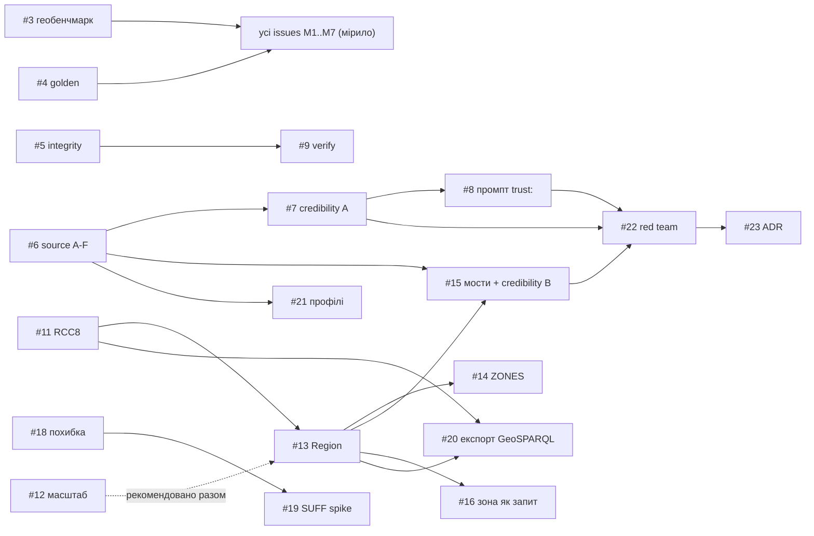
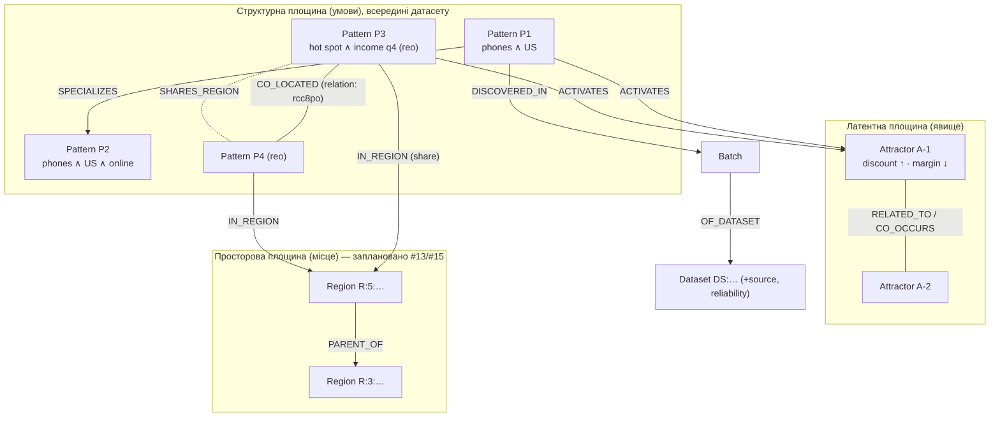
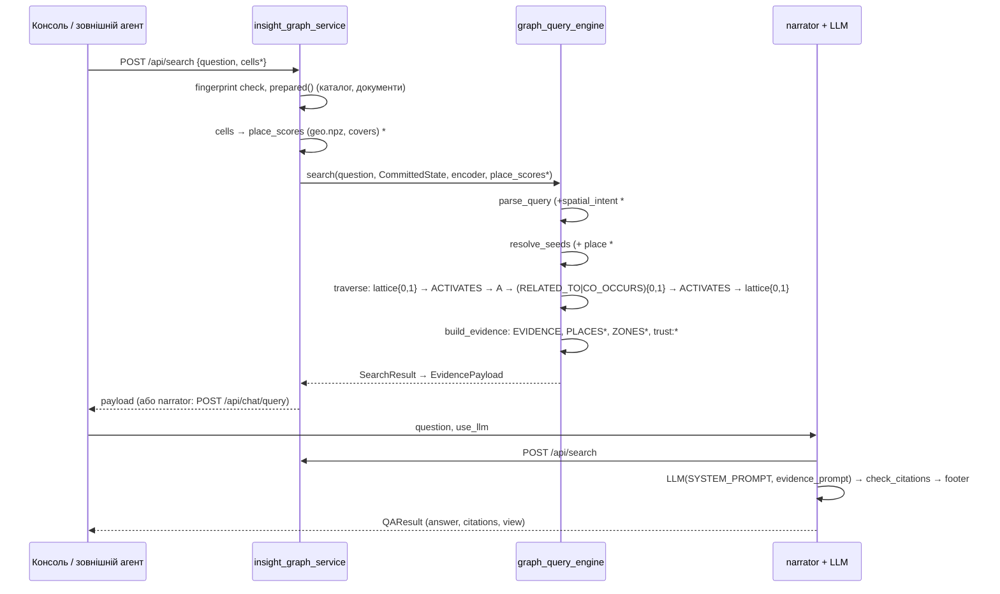
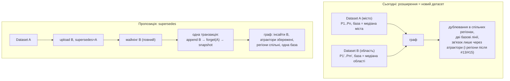

# Spatial Knowledge Graph над SIG: архітектурне дослідження та формалізація

**Статус документа:** дослідження й архітектурне обґрунтування, а не специфікація. Розділи `docs/01`–`docs/12` описують поточний код; цей документ описує, як наявна реалізація, відкриті issues і зовнішні підходи складаються в одну систему, де між ними прогалини та що потрібно вирішити. Дата: 2026-10-13. Стан коду: `master` після злиття PR #1 (`feat(geo)`).

**Для кого:** технічна команда, яка реалізовуватиме epic #2 і його підзадачі #3–#23.

**Як читати позначки.** У всьому тексті кожне твердження про систему має один із чотирьох статусів:

| Позначка | Значення |
|---|---|
| **[реалізовано]** | є в коді `master`, підтверджено читанням коду й тестів (посилання на файл) |
| **[заплановано #N]** | описано в issue #N як рішення; коду ще немає |
| **[відкрито]** | питання, яке жоден матеріал не вирішує |
| **[пропозиція]** | моя архітектурна пропозиція, не рішення проєкту |

Короткий супутній документ із відповідями на ключові питання і переліком рішень для командного обговорення: [`spatial_knowledge_graph_decisions.md`](spatial_knowledge_graph_decisions.md).

---

## 1. Executive summary

**Головне питання розділу:** що саме ми будуємо, як воно працює і які найважливіші висновки дослідження.

### 1.1 Що будуємо

SIG (Statistical Insight Graph) сьогодні перетворює таблицю на статистично перевірені **інсайти** (підгрупи з аномальними зсувами метрик), пов'язує їх двома способами — точною **структурною ґраткою** умов (вужча підгрупа уточнює ширшу, сусідні підгрупи, протилежні зсуви) і **латентними атракторами** (центроїди у векторному просторі, що збирають інсайти з однаковим *явищем* незалежно від того, де в даних вони трапилися) — і відповідає на запитання обходом цього дуального графа з цитованою відповіддю LLM. Гео-режим (PR #1) додає третю вісь: точкові дані агрегуються в комірки H3, і той самий майнер шукає інсайти вже по комірках, із виправленням статистики на просторову автокореляцію.

Epic #2 перетворює гео-режим на **Spatial Knowledge Graph**: місце стає сутністю графа (вузли `Region` над H3), між інсайтами з'являються просторові зв'язки з точною семантикою (RCC8, спільний регіон), ефект перевіряється на грубших сітках (мітка масштабу), зона на карті стає запитом, кілька джерел про одну територію підтверджують або спростовують одне одного, а кожен факт у відповіді отримує три незалежні осі довіри (надійність джерела, достовірність, цілісність запису) окремо від статистики.

Ключова ідея, яку варто тримати в голові під час читання: **інсайт (Pattern) — єдина одиниця знання, і він є вузлом-перехрестям трьох осей** — *що відбувається* (атрактор), *у якій підгрупі* (ґратка умов) і *де* (комірки → регіони). Атрактори не мають географії, регіони не мають явищ; їх з'єднує тільки інсайт. Довіра — це анотація інсайту і датасету, яка не змінює жодного зв'язку.

### 1.2 Головні висновки

1. **Issues утворюють узгоджену концепцію**, але вона дататсет-центрична: граф будується з файлів, а не з «області дослідження». Усе, що стосується місця, виводиться з одного датасету на одній роздільності H3. Це не суперечність, а межа, яку треба назвати (розділи 3.6, 8.3).
2. **Сутності визначені чітко** для всього, крім одного: `Region` — єдина нова сутність, і вона описана в #13 достатньо для реалізації. Невизначеними лишаються не сутності, а *операції*: оновлення датасету, розширення охоплення, повторна анотація без повторного завантаження (розділ 13).
3. **Два шляхи входу в граф підтримуються однією структурою** [реалізовано] для семантичного і [заплановано #16] для просторового. Різняться лише спосіб вибору стартових вузлів і один індекс (комірка → інсайт); обхід, evidence і відповідь спільні (розділ 6).
4. **Багатомасштабність — поки що мітка, а не навігація.** #12 дає чесну статистичну перевірку «локальний / районний», #13 — контейнери-регіони з ієрархією `PARENT_OF`, #14 — підсумки зон. Обхід графа по ієрархії вгору-вниз свідомо відкладено на окремий спайк (розділ 4.4). Вузлів «інсайт на грубшому рівні» не буде; буде один інсайт із числами на кожному рівні.
5. **Інкрементальність — на рівні датасету, не території.** Новий файл додається без повторного майнінгу, вектори й атрактори старих інсайтів не перераховуються, атрактори перевикористовуються або народжуються з «сиріт». Але знімок графа, зв'язки між атракторами, матриця векторів і дзеркало Neo4j перебудовуються повністю на кожному коміті [реалізовано], а сценарій «розширити область» не має механізму: це новий датасет з новим id, новим базовим рівнем статистики і дублюванням інсайтів на перетині (розділ 8).
6. **Стандарти.** Проєкт *використовує словник* GeoSPARQL (RCC8) і *експортує* в нього; *концептуально подібний* до KnowWhereGraph (DGGS як просторовий хребет) і Spatial-RAG (розріджений просторовий фільтр + щільна семантика); має *власне* інженерне рішення для масштабу (мітка замість спільнот Leiden). Жодне з тверджень про відповідність стандарту не перевірене валідацією і не повинно так формулюватися (розділ 9).
7. **Модель довіри виправдана, але відокремлювана.** Жодне з рішень побудови графа (атрактори, ґратка, регіони) від довіри не залежить; довіра читається лише в evidence і промпті. Тому безпечний варіант — поетапний (C): походження, цілісність і чесне формулювання — одразу; обчислення достовірності — після появи другого реального джерела, бо без нього воно не тестується (розділ 10).
8. **Мінімальна працездатна версія SKG** — #3/#4, #13 (+#12), #16, #11, #14 і дешева частина довіри #5/#6/#8. Усе інше (M6, M7, #7/#15/#22) можна додавати, не змінюючи модель даних (розділ 12).
9. **Головні ризики:** дублювання інсайтів між версіями одного датасету; екологічна хиба через `SHARES_REGION` без #12; квадратичне зростання `SHARES_REGION` у щільних регіонах; відносний рівень регіону (`r−2`) у датасетах різної роздільності; повторне завантаження як єдиний спосіб отримати нові поля `provenance` (розділ 11).
10. **Табличні дані без географії** працюють як і зараз: гео-режим вмикається опцією, регіони і просторові ребра виникають лише для гео-датасетів, а правило 0 epic (golden-тест #4) робить це перевірюваним.

---

## 2. Проблема та цілі проєкту

**Головне питання розділу:** яку функціональність має забезпечити система і чим вона відрізняється від того, що є.

### 2.1 Що є сьогодні [реалізовано]

Поточний SIG (`docs/01_overview.md`) — конвеєр із восьми стадій: завантаження файлу → виявлення підгруп вендорованим EDA-рушієм → відбір і зважування інсайтів → канонічний текст і тричастинний вектор (scope ; target ; signed phenomenon) → латентні атрактори (вендорований рушій lac) → дуальний граф у файловому workspace (+ дзеркало Neo4j) → відповідь на запитання обходом графа → веб-консоль. Гео-режим (`docs/02_discovery.md` §2.9) додає до першої стадії агрегацію точок у комірки H3 і до графа одне просторове ребро `CO_LOCATED`.

Що саме бракує для «просторового графа знань» сформульовано в epic #2 як розриви:

| Розрив (epic #2) | Суть | Підтверджено кодом |
|---|---|---|
| G1: місце не є сутністю графа | простір живе в `provenance.spatial` і файлі `geo.npz`, ідентифікатори комірок H3 не записані навіть у запис інсайту (лише кількість `cells`) | `subgroup_miner/discovery.py:389-396`, `insight_graph_service/core/engine.py:456-470` |
| `CO_LOCATED` діє лише всередині датасету | обчислюється при завантаженні над прийнятими інсайтами одного датасету | `insight_graph_service/core/engine.py:317`, `subgroup_miner/spatial.py:407-426` |
| G3: немає міждатасетних структурних зв'язків | `structural_edges` групує за `dataset_id`; між датасетами проходять лише латентні ребра через атрактори | `subgroup_miner/lattice.py:46-52`, `tests/test_lattice.py:36-38` |
| G4: зону не можна передати як запит | у `search()` входить лише текст; `ParsedQuery` не має просторових полів | `graph_query_engine/search.py:107`, `graph_query_engine/question.py:148-158` |
| G5: на «де?» приходять розрізнені факти | немає регіональних підсумків; evidence — до 10 інсайтів у порядку рангу | `graph_query_engine/evidence.py:193-307` |
| «verified» у заголовку evidence | промпт подає будь-який факт як перевірений | `graph_query_engine/evidence.py:107` |

### 2.2 Цілі (epic #2, таблиця «сьогодні → після плану»)

Epic формулює цілі через зміну відповіді для користувача:

- кожен факт відповіді каже, *наскільки* йому вірити і чому (три осі довіри + статистика окремо);
- «зум» від локальних осередків до районів з перевіркою, чи тримається ефект;
- кілька джерел про одну територію підтверджують або спростовують одне одного;
- зона на карті працює як запитання;
- точна просторова мова («всередині, біля краю», «межують») замість «поруч (0.42)»;
- попередження про похибку положення;
- сумісність назовні (RDF/GeoSPARQL, профілі APP-6 / JC3IEDM).

### 2.3 Що epic *не* ставить за мету (і що це означає)

Важливо для подальших розділів: epic не містить вимог щодо (а) розширення географічного охоплення вже побудованого графа, (б) оновлення або версіонування датасету, (в) запитів за довільною геометрією, відстанню чи перетином полігонів, (г) лінійних і полігональних геометрій на вході, (д) часової осі як окремої структури. Це або свідомо відкладене (PR #1 прямо виключає мультироздільність і лінії/полігони), або просто не описане. Розділи 3.6 і 8.3 розбирають, що з цього є прогалиною концепції, а що — допустимим обмеженням.

---

## 3. Зведення вимог

**Головне питання розділу:** як розрізнені issues складаються в групи вимог, де вони дублюються, залежать одна від одної, суперечать або мовчать.

### 3.1 Опрацьовані джерела та їхній статус

| Джерело | Тип | Статус для цього документа |
|---|---|---|
| GitHub issues `woldemarg/proj_sig` #2–#23 (22 issues; epic + 21 підзадач, усі OPEN, створені 2026-10-13) | вимоги і проєктні рішення | опрацьовано повністю, включно з DoD, залежностями, відкритими рішеннями користувача |
| PR #1 `feat(geo)` (MERGED, коміт `1dd06de`) | опис реалізації гео-режиму | опрацьовано; збігається з кодом |
| `docs/01`–`docs/12` | специфікація поточного коду | опрацьовано; розбіжність з кодом знайдено одну (нижче) |
| код `subgroup_miner/`, `attractor_topology/`, `graph_query_engine/`, `insight_graph_service/`, `insight_contracts/`, тести | реалізація | простежено з посиланнями на рядки |
| `docs/init_concepts/*.md` | теорія, з якої почався проєкт | використано як контекст (читати як «не специфікація», `docs/README.md`) |
| `proj_ontology` (https://github.com/woldemarg/proj_ontology, тека `docs/`): ADR 001–003, `latent-attractors/`, `graph-construction/`, `graph-retrieval/`, `graph-versions.md` | попередня реалізація Graph RAG з латентними атракторами | опрацьовано для розділів 4.3 і 8 |
| зовнішні першоджерела (OGC GeoSPARQL 1.1, H3, KnowWhereGraph, Spatial-RAG, SUFF, JC3IEDM, PROV-O, SHACL, Oracle Poisoning, GraphRAG) | стандарти й підходи | розділ 9 і розділ 15 |

**Недоступні матеріали.** Epic #2 посилається на «дослідження v1 (SKG / H3), v2 (стандарти, Oracle Poisoning)» і на слайд «На чому ми стоїмо». Цих документів у репозиторії і в робочій теці немає; їхній зміст відновлено лише настільки, наскільки він відображений в issues. Так само #21 сам зазначає, що атрибути довіри JC3IEDM REPORTING-DATA «описані з пам'яті, а не з перевіреного джерела». Нічого з цих матеріалів у цьому документі не цитується як прочитане.

**Знайдена розбіжність docs ↔ код.** `docs/07_question_answering.md` §7.8 наводить дефолт `TRAVERSAL_STRUCTURAL_EDGES = SPECIALIZES,GENERALIZES,CONTRASTS`, тоді як код (`graph_query_engine/config.py:25`) і §7.3 того ж розділу включають `CO_LOCATED`. Код правильний; рядок у §7.8 застарів.

### 3.2 Групи вимог

Вимоги перегруповано за механізмами, а не за milestones. Код групи використовується в матриці простежуваності (розділ 14).

**A. Вимірювання і нерегресія (M0).** A1 — golden-тест: без нових опцій pattern id, p-значення, ребра і промпт ідентичні (#4). A2 — синтетичний геобенчмарк із закладеною істиною і сім сценаріїв S-regional … S-noise (#3). A3 — наскрізні правила DoD epic: доменна незалежність ядра, `h3` лише в `subgroup_miner`, `graph_query_engine` не знає H3, один bump `SNAPSHOT_VERSION` на milestone, нові поля `provenance` лише після повторного завантаження. *Статус:* A1, A2 заплановано; A3 — частково реалізовано (`tests/test_architecture.py:28-43` вже фіксує `h3` лише в `subgroup_miner`).

**B. Просторові сутності й топологія.** B1 — `Region` як вузол із глобальним id `R:<res>:<h3>` (#13). B2 — `IN_REGION` (Pattern → Region на рівні `r−2`, частка ≥ 0.2) і `PARENT_OF` (ланцюг до ≤ 7 верхніх регіонів) (#13). B3 — `SHARES_REGION` між інсайтами одного датасету, обхідне структурне ребро (#13). B4 — те саме між датасетами (#15а). B5 — відношення RCC8 на парах `colocated` як властивість `CO_LOCATED` (#11). B6 — `CO_LOCATED` [реалізовано, PR #1]. *Один механізм:* B3 і B4 — одна функція `lattice.py` з різним групуванням; B1–B2 — передумова для B3, B4, C2, D2.

**C. Масштаб.** C1 — перевірка ефекту на `r−1`, `r−2`, мітка `scale ∈ {local, regional, scale-dependent, insufficient}`, числа в `provenance.spatial.scales` (#12). C2 — секція `ZONES`: 3–5 регіонів з детермінованими підсумками для запитань із просторовим наміром (#14). C3 — обхід по `PARENT_OF` («зум» у граматиці обходу) — у #13 відкладено на окремий спайк після вимірювань. *Залежність:* C1 рекомендовано робити разом з B1, бо без мітки масштабу регіони підштовхують до екологічної хиби (#12 «Навіщо»).

**D. Входи в граф.** D1 — семантичний вхід [реалізовано, `docs/07`]. D2 — зона з карти як запит: `cells: [h3…]` → `place_scores` → доданок у seed-оцінку з вагою `SEED_PLACE_WEIGHT` (#16). D3 — лексикон просторового наміру («де», «які зони») → `ParsedQuery.spatial_intent` (#14). D4 — інші геометрії запиту (полігон, bbox, радіус) — не описані.

**E. Довіра.** E1 — дайджест запису `record_digest` і `integrity: ok | mismatch | unverified` (#5). E2 — `source`, `reliability A–F`, `source_declared` на датасеті, `PATCH` без повторного майнінгу (#6). E3 — `credibility ∈ {1,2,5,6}` фаза A: незалежне підтвердження через спільний не-weak якір між задекларованими джерелами (#7). E4 — фаза B: достовірність за місцем через спільний регіон і косинус блоку явища; замінює фазу A для гео-інсайтів (#15б). E5 — рядок `trust:` і зміна заголовка evidence, правило 9 системного промпту (#8). E6 — перевірка інсайту перерахунком із сирих даних (#9). E7 — токен запису (#10). E8 — червона команда (#22). E9 — ADR і розділ `docs/13_trust.md` (#23). *Один механізм:* E3 і E4 — одне поле `credibility` з двома формулами; E2 — передумова E3, E4, профілів G2.

**F. Невизначеність положення.** F1 — синтаксис `±acc_col`, профіль `geo.positional`, запобіжник роздільності (#18). F2 — спайк м'якого призначення точок і ймовірнісного RCC8 (#19).

**G. Сумісність.** G1 — експорт у RDF/GeoSPARQL + PROV-O (#20). G2 — вхідні профілі APP-6 SIDC і JC3IEDM REPORTING-DATA (#21, спочатку спайк).

**H. Інтерфейс.** H1 — бейджі довіри, RCC8-фрази, Region у графовому виді, шар регіонів (#17). H2 — виділення гексів і кнопка «Запитати про цю зону» (#16).

**I. Життєвий цикл датасетів та інкрементальність.** I1 — додавання датасету батчем без перебудови [реалізовано]. I2 — видалення датасету з правилом сиріт для атракторів [реалізовано]. I3 — редагування метаданих джерела без повторного майнінгу (#6). I4 — обмеження «нові поля provenance лише після повторного upload» (epic DoD 6). I5 — розширення географічного охоплення — **не описано**. I6 — оновлення/версія датасету — **не описано**.

### 3.3 Залежності

Залежність `#11 → #13` в epic заявлена, але з опису #13 не випливає: Region-вузли не використовують RCC8. Фактична спільна частина — функція сусідства комірок у `SpatialContext` (CSR `nbr_ptr/nbr_idx`), яка вже є. Це м'яка, не жорстка залежність.

### 3.4 Що дублюється або є частинами одного механізму

| Механізм | Issues | Чому це одне |
|---|---|---|
| просторова анотація інсайту в `provenance.spatial` | PR #1 (`cells`, `compactness`, `colocated`), #11 (`relation`), #12 (`scales`, `scale`), #13 (`regions`, `ancestors`), #18 (`positional` у профілі) | усе пишеться в одному місці (`annotate_extents` / `build_insights`) і стає доступним графу лише через запис журналу, бо компілятор знімка не читає файлів (`insight_graph_service/core/snapshot.py:265-274`) |
| достовірність інсайту | #7 (фаза A), #15б (фаза B) | одне поле, два правила; B заміняє A для гео-інсайтів |
| міжінсайтні просторові ребра | PR #1 (`CO_LOCATED`), #13 (`SHARES_REGION` всередині датасету), #15а (між датасетами) | одна функція `lattice.py` поруч із `colocation_edges`; відмінність — групування за `dataset_id` |
| «зум» | #12 (мітка), #13 (ієрархія регіонів), #14 (підсумки) | три рівні одного продуктового обіцяння; жоден не є обходом ієрархії |
| нерегресія | #4 (golden), DoD 1 epic, критерії «без geo golden без змін» у #11, #13, #14, #16 | один тест, на який посилаються всі |

### 3.5 Суперечності та неоднозначності

1. **Рівень регіону відносний, id глобальний.** #13 визначає `IN_REGION` на рівні `r−2` *відносно роздільності датасету*; id `R:<res>:<h3>` глобальний. Два датасети, завантажені на `@7` і `@5`, матимуть регіони на абсолютних рівнях 5 і 3 і не поділять жодного вузла. #15 вирішує це «найглибшим спільним предком з `ancestors`», але це означає, що `SHARES_REGION` між датасетами може йти через регіон, якого в жодного з них немає як `IN_REGION`. Потрібно явно визначити, на якому рівні створюється ребро і чи створюється `Region` для цього рівня. [відкрито]
2. **Структурні ребра «одного датасету» vs `SHARES_REGION` між датасетами.** Інваріант `docs/06` §6.7 і тест: «structural edges connect patterns of one dataset». #15а його порушує свідомо. Правило площин (`docs/01` §1.3: «embeddings never create structural edges») не порушується — `SHARES_REGION` виводиться з метаданих, — але інваріант і тест треба переписати, а в #15 цього не сказано. [відкрито]
3. **Повторне завантаження vs ідемпотентність.** Epic DoD 6: нові поля `provenance` з'являються «лише після повторного upload». Але той самий файл з тими самими опціями дає той самий `dataset_id`, і батч стає `SKIPPED` (`engine.py:294-296`). Отже «повторний upload» фактично означає «видалити датасет і завантажити знову» — з втратою атракторів-сиріт, якщо вони не мали зв'язків. Це не описано. [відкрито]
4. **Фаза A і фаза B в одному workspace.** Якщо workspace має гео- і не-гео датасети, інсайти не-гео датасету отримують `credibility` за A (через якорі), гео-інсайти — за B (через регіони). Один і той самий атрактор може містити інсайти з обома правилами. Відповідь повинна знати, за яким правилом поставлено рівень (`credibility_basis` це вирішує, якщо він називає правило). [потребує уточнення]
5. **#11 рахує RCC8 лише для пар `colocated`.** Пара потрапляє в `colocated` тільки якщо перекриття *дилатованих* екстентів ≥ 0.3 і вона серед трьох найкращих партнерів. Отже `rcc8ec` («межують») майже ніколи не зафіксується: у двох великих сусідніх екстентів перекриття після дилатації на одне кільце мале. Таблиця #11 правильна для множин, але не для вибірки пар. [потребує уточнення]
6. **Залежність #11 → #13** заявлена без механізму (див. 3.3).
7. **«Зум» у епіку і «зум» у #13.** Epic обіцяє користувачу «зум від локальних осередків до районів»; #13 прямо каже, що розширення граматики обходу по `PARENT_OF` — окремий спайк. Обіцяння ширше за план.

### 3.6 Важливі аспекти, які не описані

| Аспект | Чому важливо | Де в документі |
|---|---|---|
| розширення географічного охоплення після побудови графа | головний сценарій цього дослідження; у issues відсутній | 8.3 |
| оновлення датасету (та сама «sourcе», нові рядки) | сьогодні — новий `dataset_id`, дублювання інсайтів на перетині | 8.3, 13 |
| базовий рівень статистики під час розширення | зсуви рахуються відносно *всіх* комірок датасету; злиття датасетів не є статистично коректним | 8.3 |
| запит довільною геометрією (bbox, полігон, радіус) | #16 приймає лише список комірок | 6.2 |
| повторна анотація без повторного завантаження | кожен milestone змінює `provenance.spatial` | 3.5 п.3, 13 |
| обмеження кількості `SHARES_REGION` | у регіоні з k інсайтами ребер O(k²) | 8.4 |
| лінії, полігони, мультиточки на вході | PR #1 виключає; `parse_points` приймає лише `Point`/`POINT` | 4.1 |
| часова вісь | лише похідні ознаки (`_active_days`, `_late_share`); жодної темпоральної структури | 13 |

### 3.7 Вимоги-результати без механізму

- «Відповідь каже, наскільки вірити кожному факту» — механізм є (#5–#8).
- «Кілька джерел підтверджують або спростовують» — механізм є (#7, #15), але **не тестується без другого реального джерела** (epic, відкрите рішення 4).
- «Зум» — механізм частковий (3.5 п.7).
- «Граф розширюється без повної побудови» (мета цього дослідження) — для датасетів механізм є; для території — немає (розділ 8).

---

## 4. Концептуальна модель

**Головне питання розділу:** які сутності існують, що з них є вузлами, атрибутами, ребрами чи лише поняттями, і як ця структура дає змогу знаходити й узагальнювати інсайти.

### 4.1 Основні сутності

Нижче — фактична модель (`insight_contracts/graph.py`, `docs/06` §6.2) і те, що додають issues. Для кожної сутності: предметне значення, роль в архітектурі, дані, створення/оновлення, зв'язки і для чого вони потрібні під час пошуку.

#### Dataset [реалізовано]

- **Значення.** Один завантажений файл з опціями (`bins`, `categories`, `geo`). Не «джерело» в сенсі організації, а конкретний вміст.
- **Роль.** Одиниця походження і одиниця інкрементальності: усе, що система робить, вона робить *з датасетом* — завантажує, майнить, видаляє.
- **Дані.** Вузол `DS:<dataset_id>`: `filename, rows, columns`, для гео — `glossary` (людські назви похідних колонок). `dataset_id = ds- + sha256(bytes ‖ bins ‖ categories ‖ geo)[:12]` (`subgroup_miner/ingestion.py:56-64`): **ім'я файлу не входить**, а рядок гео-опції входить дослівно (`auto` і `lat,lon` для тих самих комірок дають різні id).
- **Створення/оновлення.** Створюється батчем; оновлення немає — лише видалення і нове завантаження. Повторне завантаження того самого вмісту й опцій — `SKIPPED` (`engine.py:294-296`).
- **Зв'язки.** `Batch —OF_DATASET→ Dataset`, `Pattern —DISCOVERED_IN→ Batch`; `Dimension`/`Metric` мають дататсет-скоуплені id (`D:<ds>:<col>`, `M:<ds>:<col>`), бо різні датасети повторюють назви колонок у різних значеннях.
- **Під час пошуку** ці ребра не обходяться (площина provenance); датасет лише супроводжує evidence (`datasets[]`, рядок `DATASETS:` промпту).
- **Заплановано #6:** `source` (рядок), `reliability` (A–F), `source_declared` — метадані, що **не входять** у `dataset_id` і редагуються через `PATCH` з перебудовою знімка без майнінгу. Саме `source` стане першим поняттям «джерела» як організації.

#### Insight / Pattern [реалізовано]

- **Значення.** Статистично перевірений факт про підгрупу: *у рядках, де `category=phones ∧ region=US`, discount вищий на +2.21 sd, margin нижчий на −1.10 sd*. У гео-датасеті «рядок» — комірка H3, а умови — похідні колонки комірок (`lisa_points=hot spot`, `neighbours_points_band=q4`, `<col>_mode=…`).
- **Роль.** Єдина одиниця знання і перехрестя всіх осей. Все інше (атрактори, регіони, ґратка) існує, щоб інсайти можна було знайти не лише за словами.
- **Дані.** Вузол `P-<hash>` несе запис журналу без змін (`docs/03` §3.1): `conditions`, `expression`, `target`, `shifts`, `support`, `effect_size`, `stability`, `p_value`, `p_adjusted`, `weight`, `covariance`, `provenance`, плюс `row_id`, `canonical`, `embedding`. Id `P- + sha1(dataset_id, умови)[:12]` — детермінований, але **прив'язаний до датасету**: той самий інсайт у двох датасетах має два id.
- **Гео-інсайт** не є окремою сутністю: це Pattern із `provenance.spatial` (`resolution, cells (кількість), moran_i, n_eff, p_adjusted_iid, compactness, colocated`). Екстент (множина комірок) **не зберігається в записі**: він відновлюється з `covers.npz` (позиції рядків-комірок) і `geo.npz` (`cells` — H3-id за позицією) (`engine.py:456-470`). Це і є «місце не є сутністю графа» з epic.
- **Створення/оновлення.** Створюється в батчі (пошук → відбір → допуск → канонічний текст → вектор); після запису в журнал **ніколи не змінюється** (append-only). Видаляється лише разом із датасетом.
- **Зв'язки.** Структурні (ґратка, всередині датасету): `SPECIALIZES/GENERALIZES` (покривальне відношення множин умов), `SIBLING` (різниця в одній умові одного атрибута), `CONTRASTS` (перекриття ≥ 0.5 і протилежні зсуви), `CO_LOCATED` (гео; перекриття дилатованих екстентів ≥ 0.3). Міст: `ACTIVATES → Attractor`. Схема: `HAS_SCOPE → Dimension`, `TARGETS → Metric`.
- **Під час пошуку.** Інсайти — єдині кандидати на seed (`seeds.py:71-97`; атрактори seed-ами не бувають) і єдині елементи evidence. Структурні ребра дають «сусідів за умовами», `ACTIVATES` — вхід у латентну площину.
- **Заплановано:** `provenance.spatial.regions`, `ancestors` (#13), `scales`, `scale` (#12), `relation` у `colocated` (#11); `record_digest`, `integrity` (#5); `credibility`, `credibility_basis` (#7/#15). Усе — атрибути, не вузли.

#### Latent Attractor (латентний атрактор, якір; у UI «тема») [реалізовано]

Розібрано окремо в 4.3. Коротко: вузол `A-<k>`, живий одиничний центроїд у 1152-вимірному просторі інсайт-векторів, без тексту й без географії; збирає інсайти з однаковим *явищем*.

#### Region (регіон H3) [заплановано #13]

- **Значення.** Комірка H3 на грубшому рівні, ніж роздільність датасету, яку покриває хоча б один інсайт.
- **Роль.** Перша і єдина сутність «місця» в графі: контейнер, через який два інсайти без спільної межі (і без спільних умов) стають пов'язаними, бо лежать в одному районі; спільний ключ, порівнянний між датасетами будь-якої схеми.
- **Дані.** Id `R:<res>:<h3>` — глобальний, не залежить від датасету. Props: `resolution, cells_covered, patterns, points, bbox`.
- **Створення/оновлення.** Компілюється з `provenance.spatial.regions` і `ancestors` на кожному коміті знімка; створюються лише регіони, які покриває хоча б один інсайт; зникають, коли зникає останній інсайт (знімок похідний).
- **Зв'язки.** `Pattern —IN_REGION→ Region` (рівень `r−2`, вага = частка комірок екстенту в регіоні, ребро лише при частці ≥ `GEO_REGION_MIN_SHARE` 0.2); `Region —PARENT_OF→ Region` (на `r−4`, `r−6`… доки датасет не зведеться до ≤ 7 верхніх регіонів); `Pattern —SHARES_REGION— Pattern` (спільний регіон на `r−2`, ще не пов'язані іншим структурним ребром; вага `min(share_A, share_B)`).
- **Під час пошуку.** `IN_REGION` і `PARENT_OF` **не обходяться** (схема); обходиться лише `SHARES_REGION` як ще один структурний хоп. Регіони читаються evidence для секцій `PLACES:` (#13) і `ZONES:` (#14).
- **Важливо:** Region — контейнер, а не «інсайт на вищому рівні». Він не має явища, зсувів чи вектора.

#### Комірка H3 (cell) [реалізовано, не вузол]

Рядок таблиці комірок (`spatial.py:225-348`), зберігається в `geo.npz` і `cells.geojson`. У графі комірка не існує; інсайт посилається на комірки лише через позиції рядків у `covers.npz`. Комірки — одиниця статистики і карти, не одиниця знання. Це свідоме рішення: вузлів-комірок було б O(10⁴–10⁵) на датасет, а знань вони не несуть.

#### Dimension, Metric, Batch [реалізовано]

Схема і походження: які колонки й метрики є в датасеті, в якому батчі інсайт знайдено. Не обходяться. `Metric` важлива для парсингу запитання (каталог літералів, `question.py:123-138`).

#### Просторові відношення

| Відношення | Семантика | Статус |
|---|---|---|
| `CO_LOCATED` | екстенти після дилатації на одне кільце перекриваються на ≥ 0.3 (за меншим), до 3 партнерів на інсайт | [реалізовано] `spatial.py:407-426`, `lattice.py:112-123` |
| `relation` (RCC8) на `CO_LOCATED` | `ec / po / eq / tpp / tppi / ntpp / ntppi` на множинах комірок через кільце-1 | [заплановано #11]; власність ребра, не нове ребро |
| `IN_REGION` | інсайт лежить у регіоні на частку ≥ 0.2 | [заплановано #13] |
| `PARENT_OF` | ієрархія регіонів через два рівні H3 | [заплановано #13] |
| `SHARES_REGION` | два інсайти мають спільний регіон на `r−2` | [заплановано #13 всередині датасету, #15 між] |
| близькість за відстанню, перетин довільних геометрій | — | не передбачено |

Усі відношення — **дискретні, на множинах комірок H3**, а не на геометріях. Це визначає, які просторові запити можливі (розділ 6.2).

#### Ієрархія масштабів

Сьогодні [реалізовано] — лише один рівень на датасет плюс батьківські комірки `r−1` для блокового бутстрапу (`spatial.py:306`, не зберігаються). Заплановано — три різні речі: статистика інсайту на `r−1`, `r−2` (#12); регіони на `r−2`, `r−4`, … (#13); підсумки регіонів (#14). Розібрано в 4.4.

#### Джерело, provenance, довіра

Сьогодні [реалізовано]: `provenance = {dataset_id, filename, batch_id, engine, steps, expression, multiple_testing_family, rows_ref, spatial}` на кожному інсайті, сирий файл в `uploads/` до видалення датасету, `Batch`/`Dataset` вузли. Це повне *походження*; *довіри* немає. Заплановано (#5–#9): атрибути на `Dataset` і `Pattern`, обчислювані компілятором знімка. Розібрано в розділі 10.

### 4.2 Що є вузлом, атрибутом, ребром, поняттям

| Поняття | У графі | Сьогодні | Після плану |
|---|---|---|---|
| Dataset | вузол | ✔ | + `source`, `reliability` |
| Batch | вузол | ✔ | без змін |
| Insight / Pattern | вузол | ✔ | + атрибути масштабу, цілісності, достовірності |
| гео-інсайт | **атрибут** `provenance.spatial` вузла Pattern | ✔ | + `regions`, `ancestors`, `scales`, `scale` |
| Latent Attractor | вузол | ✔ | без змін |
| Region | вузол | — | ✔ (#13) |
| комірка H3 | **поза графом** (файли `geo.npz`, `cells.geojson`) | ✔ | без змін |
| екстент інсайту | **похідне** (позиції рядків → H3-id) | ✔ | H3-id регіонів у provenance; самі комірки — досі лише через `covers.npz` |
| просторовий зв'язок | ребро `CO_LOCATED` | ✔ | + властивість `relation`; ребра `IN_REGION`, `PARENT_OF`, `SHARES_REGION` |
| семантичний зв'язок | ребра `ACTIVATES`, `RELATED_TO`, `CO_OCCURS` | ✔ | без змін |
| масштаб | — | — | **атрибут** інсайту (`scale`) + ієрархія вузлів Region |
| джерело | — | — | **атрибут** датасету (не вузол) |
| довіра | — | — | **атрибути** інсайту (`integrity`, `credibility`) і датасету (`reliability`) |
| зона запиту | — | — | **вхідний параметр** (`cells`), не сутність |
| область дослідження / охоплення | **лише поняття**; у системі відсутнє | — | — [відкрито] |

Два спостереження. По-перше, план послідовно уникає нових вузлів: єдиний новий вузол — Region, решта — атрибути. Це тримає граф малим і зберігає інваріант «один інсайт — одна одиниця знання». По-друге, «джерело» стає атрибутом, а не вузлом; для #7/#15 цього досить (незалежність = різні рядки `source`), але вузол `Source` знадобиться, щойно два датасети одного джерела треба буде трактувати як версії одне одного (8.3) [пропозиція].

Діаграма показує принцип «інсайт — перехрестя трьох осей»: P3 одночасно член атрактора A-1 (явище), сусід P4 у ґратці/колокації (умови, місце на рівні комірок) і мешканець регіону R1 (місце на рівні району). Жодна з осей не з'єднана з іншою напряму.

### 4.3 Роль латентних атракторів

Цей підрозділ описує механіку, а не метафору. Джерела: `attractor_topology/ontology.py`, `attractor_topology/vendor/lac/{ontology_engine,storage}.py`, `insight_graph_service/core/snapshot.py`, `docs/05`.

**Що представляє атрактор.** Один одиничний вектор `c_j` у тому самому просторі, що й вектори інсайтів (1152 = 3 × 384: блоки *scope*, *target*, *signed phenomenon*; `encoder.py:176-202`). Косинус двох інсайт-векторів розкладається як `0.135·s·s′ + 0.201·t·t′ + 0.664·p·p′` (`docs/04` §4.3): дві третини подібності дає *знаковий* блок явища — сума ембедингів назв метрик, помножених на знакові robust-z. Тому атрактор — це напрямок «що саме зсувається і в який бік» (`discount ↑ · margin ↓`), майже байдужий до умов підгрупи. «X ↑» і «X ↓» — протилежні напрямки, отже різні атрактори (`tests/test_canonical_embedding.py:112-113`). Атрактор **не зберігає** ні тексту, ні списку членів, ні блочних векторів (`storage.py:21-35`); усе читабельне (ярлик, сигнатура, кількість членів, датасети) обчислюється зі списку членів на кожному коміті знімка (`snapshot.py:227-265`).

**Як створюється і з яких даних.**

1. Перший батч у порожньому workspace: словникове навчання OMP над векторами інсайтів (K-sweep з ліктем, `ontology_engine.py:277-351`) + знаковий ремонт (переворот антивирівняних атомів, злиття атомів з cos > 0.95, підлога вирівнювання 0.20; `:354-424`).
2. Кожен наступний батч: усі вектори порівнюються з наявними центроїдами (`assign_and_update`, `:46-88`). Інсайт із `max_j cos ≥ τ` (τ = 0.88, адаптивно до 0.92 при ≥ 10 атракторах) **приєднується** до своїх найкращих 1–2 атракторів (другий — якщо в межах 0.8 від першого) і зсуває їхні центроїди EMA-кроком, що зменшується з масою атрактора (`storage.py:41-55`). Інсайт нижче τ — **сирота**.
3. Сироти батчу: ≥ 2 → OMP лише над ними → нові атоми; атом із cos > 0.95 до наявного атрактора **поглинається** ним, решта стають новими атракторами (`:120-177`). 1 сирота → до найближчого атрактора.
4. Запобіжники: демпфування хаба (атрактор, що зібрав понад `3/N` маси, рухається повільніше), довірча область (центроїд не зміщується більше ніж на 0.10 за батч), інваріанти (кожен інсайт має ≥ 1 активацію).

Отже атрактор утворюється з *усіх* інсайтів, що на нього вказують, незалежно від датасету. Це і є «перевикористання атракторів новим датасетом»: не окремий механізм, а звичайна робота кроку 2.

**Які інсайти чи датасети він об'єднує.** Будь-які з тим самим явищем. Гео-датасет і табличний датасет можуть ділити атрактор, якщо назви метрик і знаки збігаються (`median_house_value ↓` у комірках і в рядках — одна й та сама назва). Зв'язки `RELATED_TO` між атракторами різних датасетів існують і є «мостами» за задумом (`docs/05` §5.10, вимірювання: чотири міждатасетні зв'язки на трьох датасетах). `CO_OCCURS` ніколи не перетинає датасети, бо виводиться зі спільних членів.

**Як формується зв'язок атрактора з географічним контекстом.** Ніяк напряму: у вузлі `Attractor` немає жодного гео-поля (перевірено: `attractor_topology/` не містить `h3`, `cell`, `region`; `snapshot.py:239-262`). Географічний контекст атрактора — це об'єднання екстентів його членів, яке ніде не матеріалізоване. Єдиний спосіб, у який географія потрапляє у вектор, — текст умов у блоці scope (`lisa_points = hot spot; neighbours_points_band = q4`), і він важить лише 13.5 % подібності. Тому атрактор відповідає на «*що* повторюється», а не «*де*». Це узгоджується з планом: #13 з'єднує місця з інсайтами, а не з атракторами. [пропозиція] Якщо колись знадобиться «які явища типові для регіону R», це агрегат `Region ←IN_REGION— Pattern —ACTIVATES→ Attractor`, обчислюваний у evidence (як `ZONES`), а не нове ребро.

**Чи можуть різні датасети підключатися до наявного атрактора.** Так [реалізовано], за правилом кроку 2. Виміряно (`docs/05` §5.10): той самий домен другим батчем — 12 % сиріт, решта приєднується; незв'язаний домен (`housing.csv` після retail) — 100 % сиріт, нові атрактори. Поріг 0.88 вибрано для чистоти атракторів і перевірено на бенчмарку з закладеними механізмами (`docs/10` §10.3: обхід над живими атракторами на рівні зі статичним k-means і +0.21 над векторними сусідами).

**За яких умов виникає новий атрактор.** Щонайменше два інсайти батчу нижче τ до всіх центроїдів, і їхній атом не ближчий за 0.95 до жодного наявного. Один самотній інсайт **ніколи** не створює атрактор. Мінімальної кількості членів у нового атрактора немає: два досить.

**Часткова відповідність кільком атракторам.** Жорсткий поріг, далі м'яке членство: до `TOP_K_ASSIGN = 2` атракторів, кожен ≥ τ і ≥ 0.8·найкращого (`:71-83`). Компілятор знімка додатково перераховує це правило проти *поточних* центроїдів для всіх інсайтів і додає «ко-членства» (`source: co_membership`, `snapshot.py:177-204`), з яких виводяться ребра `CO_OCCURS`. Членство з поточним вирівнюванням < 0.20 позначається `weak`: рахується для покриття, не обходиться.

**Оновлення, злиття, розділення, перевизначення.**

| Операція | Статус | Де |
|---|---|---|
| зсув центроїда новими членами (EMA з інерцією) | [реалізовано] | `storage.py:41-55` |
| злиття нового атома з наявним атрактором (cos > 0.95) | [реалізовано] | `ontology_engine.py:120-141` |
| злиття двох **наявних** атракторів | **немає** | — |
| розділення атрактора | **немає** | — |
| вихід з ужитку за віком | **немає** | — |
| видалення при видаленні датасету: маса перераховується, зсуваються лише ті, що втратили члена, зникають лише без членів *і* без `RELATED_TO` | [реалізовано] | `ontology.py:178-197` |
| глобальна перекластеризація | **немає, свідомо** | `docs/05` §5.1 |

Відсутність злиття/розділення наявних атракторів — відома межа, успадкована від lac («concepts are never removed», `proj_ontology`: `docs/v3-combined-graph/combined-graph.md` §5). Наслідок для SKG: два атрактори, що виникли з різних датасетів для одного явища, але далі 0.95 один від одного, залишаться окремими назавжди; їх з'єднає лише `RELATED_TO` (взаємні найближчі сусіди, cos > 0.30). Це не помилка, але це означає, що «один атрактор = одне явище» не гарантовано після кількох датасетів.

**Зв'язки між інсайтами на різних рівнях географічного узагальнення через атрактори.** Не існують і не плануються: атрактор не знає рівнів. Якщо той самий датасет завантажити на `@7` і на `@5`, це два датасети з різними id; їхні інсайти можуть потрапити в один атрактор (однакове явище), і це буде *єдиний* зв'язок між двома рівнями. Явний міжрівневий зв'язок дає лише #13 (`IN_REGION` + `PARENT_OF`) для регіонів, і лише в межах одного датасету на одній роздільності.

**Три трактування і яке правильне.**

| Трактування | Чи так у SIG |
|---|---|
| семантичний вузол («тема», яку можна назвати і показати) | так: вузол `A-k` з обчислюваним ярликом, у консолі «тема» |
| механізм пошуку (індекс) | ні: `LatentFrame.attractors` (центроїди) **не використовується** у `graph_query_engine` (перевірено grep); seed-и обчислюються лише по інсайтах; атрактор діє тільки як вузол, через який проходить обхід |
| проміжний навігаційний елемент | так, і це головна функція: граматика обходу `P0 —ACTIVATES→ A (RELATED_TO|CO_OCCURS){0,1} ←ACTIVATES— P1` (`traversal.py:108-212`) |

Отже атрактор у SIG — **семантичний вузол, що виконує роль навігаційного хаба між інсайтами з однаковим явищем**; він не є ні просторовим, ні індексним. Контраст із lac: там атрактори на тексті виявилися марними для пошуку (`proj_ontology`: `docs/latent-attractors/report.md`, 24 формулювання, жодне не краще за H4), а на інсайт-векторах — на рівні з k-means і значно краще за вектори. Тобто цінність атракторів у SIG доведена *для осі явища*; на вісь місця вона не поширюється і не повинна.

### 4.4 Багатомасштабна географічна структура

**Що передбачає концепція (з прочитання issues), а чого не передбачає.** Користувацький запит до цього документа припускає чотири шари: базові інсайти без географії, локалізовані інсайти, представлення на вищому рівні узагальнення, додаткові рівні. Фактична модель інакша:

1. **Інсайти без географії** — звичайні табличні інсайти (без `provenance.spatial`). Вони не є «базою» для гео-інсайтів; це паралельна множина, з'єднана з гео-інсайтами лише через атрактори (однакове явище).
2. **Локалізовані інсайти** — гео-інсайти на роздільності датасету `r` (єдиний рівень, де існують інсайти).
3. **«Представлення на більшому рівні»** — не інсайти, а (а) числа того самого інсайту на `r−1`, `r−2` (#12), (б) контейнери-регіони на `r−2`, `r−4`, … (#13), (в) детерміновані підсумки регіонів у відповіді (#14).
4. **Додаткові рівні** — ланцюг `PARENT_OF` доки датасет не зведеться до ≤ 7 верхніх регіонів (#13). Жорсткої таксономії «мікро → район → регіон → країна» немає; рівні — степені H3, відносні до `r`.

Отже це **поєднання трьох механізмів**: геометричне (точніше, логічне в індексі H3) вкладення множин комірок у регіони; перерахунок статистики того самого інсайту на грубшій сітці; агрегація інсайтів регіону при відповіді. Явної ієрархії *інсайтів* немає і не планується. Зв'язків «атрактор — атрактор на іншому рівні» немає.

**Ключові питання.**

*Як визначається належність інсайту до області?* Через частку комірок екстенту, що лежать у регіоні (`h3.cell_to_parent` на дві резолюції вгору), ребро при частці ≥ 0.2 (#13). Інсайт може належати кільком регіонам з різними вагами. Для перевірки масштабу (#12) одиниця грубого рівня «належить» інсайту, якщо > 50 % її точок лежать у комірках екстенту. Два різні критерії для двох різних цілей — варто зафіксувати в документації, щоб не плутати. [потребує уточнення]

*Як встановлюється зв'язок між інсайтами різного масштабу?* Інсайтів різного масштабу в одному датасеті немає. Між датасетами різної роздільності зв'язок — лише атрактор (явище) або, після #15, спільний предок-регіон.

*Як під час переходу до більшої області додаються нові інсайти?* У межах датасету — ніяк: множина інсайтів фіксована при майнінгу, «перехід до більшої області» — це перехід до регіону, який *агрегує* наявні інсайти (`ZONES`). Нові інсайти з'являються лише з новим датасетом (розділ 8).

*Чим відрізняється фактичний зв'язок між даними від виведеного з близькості?* У моделі є чіткий поділ: ребра ґратки (`SPECIALIZES`, `CONTRASTS`) виводяться з умов і зсувів — це зв'язок *за даними*; `CO_LOCATED` і `SHARES_REGION` виводяться лише з екстентів — це зв'язок *за місцем*, і він нічого не каже про схожість явищ. Саме тому #12 потрібен поруч із #13: «в одному районі» без «ефект тримається на рівні району» — запрошення до екологічної хиби, і #12 це прямо називає.

*Чи зберігається походження при переході між рівнями?* Так, тривіально: між рівнями ніщо не «переходить», інсайт лишається єдиним носієм `provenance`, регіон лише вказує на нього. Підсумок `ZONES` будується з властивостей вузлів Region і цитованих інсайтів, без LLM (#14).

*Як уникнути дублювання, втрати деталей, некоректного узагальнення?* Дублювання в межах датасету неможливе (один рівень інсайтів). Втрата деталей неможлива (регіон не замінює інсайт). Некоректне узагальнення — ризик, який закривається міткою `scale` і правилом «`insufficient`, а не «немає ефекту»» (#12). Між датасетами дублювання можливе (8.3).

**Чи потрібна жорстка ієрархія взагалі?** Ні. H3 дає детерміновану, стабільну між батчами ієрархію без обчислення спільнот; #14 прямо відмовляється від Leiden з цієї причини. Два застереження з першоджерел: (1) вкладення H3 **логічне, а не геометричне** — діти не покривають батька точно (H3 docs: «geographic containment is approximate, logical containment in the index is exact»), і #13 це документує; (2) будь-яка агрегація у фіксовані одиниці підлягає MAUP (ефект масштабу і зонування), тому мітка масштабу — не прикраса, а необхідна частина.

**Що лишається невизначеним.** Відносний рівень регіону (3.5 п.1); чи створювати `Region` для рівня спільного предка між датасетами; чи обходити `PARENT_OF` (спайк); як поводитися, коли частка < 0.2 у всіх регіонах (інсайт без `IN_REGION` — допустимо за #13, але тоді він не має `SHARES_REGION` і не входить у `ZONES`).

---

## 5. Архітектура системи

**Головне питання розділу:** які компоненти за що відповідають, як між ними течуть дані і де в наявну структуру лягають заплановані механізми.

### 5.1 Компоненти та відповідальність

Пакети й сервіси [реалізовано] описані в `docs/12`. Нижче — ті самі компоненти з погляду SKG: що робить кожен сьогодні і що в нього додають issues. Перелік не є розбиттям на нові сервіси: усі нові механізми лягають у наявні пакети, і жоден issue не пропонує нового сервісу.

| Компонент | Відповідальність сьогодні | Додає план | Межа (DoD epic) |
|---|---|---|---|
| `insight_contracts` (ядро, лише stdlib) | `Insight`, словник графа (`EdgeType`, площини, id вузлів, `SNAPSHOT_VERSION`), текст, `EvidencePayload` | типи ребер `IN_REGION`, `PARENT_OF`, `SHARES_REGION`, вузол `Region` (#13); `record_digest` поруч із `stable_hash` (#5) | без залежностей |
| `subgroup_miner` | завантаження, точки → комірки, похідні ознаки, LISA, майнінг, відбір, ґратка, `annotate_extents` (`colocated`, `compactness`) | RCC8 (#11), `scales`/`scale` (#12), `regions`/`ancestors` (#13), `SHARES_REGION` у `lattice.py` (#13/#15), `±acc_col` і `geo.positional` (#18), публічна обгортка медіанного тесту (#9/#12), WKT контуру для експорту (#20) | **єдиний** пакет, що імпортує `h3` |
| `attractor_topology` | канонічний текст, вектори, живі атрактори | **нічого**: жоден issue не торкається атракторів | — |
| `insight_graph_service/core` | життєвий цикл батчу, workspace, компілятор знімка, дзеркало Neo4j, `/api/geo` | вузли Region і ребра у `snapshot.py` (#13), `credibility` (#7/#15), `integrity` (#5), `PATCH` джерела (#6), `verify_pattern` (#9), `place_scores` з `geo.npz`/`covers` (#16), сьома мітка Neo4j (#13), експорт Turtle (#20), профілі до ingest (#21) | компілятор **не читає файлів** — усе через `provenance` |
| `graph_query_engine` | парсинг, seed-и, обхід, evidence, детермінований підсумок | `spatial_intent` (#14), `ZONES` з props Region (#14), `PLACES:` (#13), `SHARES_REGION` у списку обхідних ребер (#13), доданок `place` у seed-оцінці (#16), рядок `trust:` і новий заголовок (#8) | **не знає H3**; отримує готові `dict[pattern_id, float]` |
| `evidence_narrator_service` | промпт, LLM, перевірка цитат | правило 9 (#8) | — |
| `sig_web_console` | граф, сфера, таблиця, карта, чат | виділення гексів (#16), бейджі довіри, шар регіонів (#17) | — |
| `profiles/` | — | новий пакет: перетворення таблиці до ingest, імпортує лише pandas (#21) | ядро про профілі не знає |

Що тут важливо для оцінки складності: **весь SKG — це зміни у двох пакетах** (`subgroup_miner` пише просторові анотації, `insight_graph_service/core/snapshot.py` компілює їх у вузли й ребра) **плюс читання цих анотацій у `graph_query_engine`**. Атрактори, представлення і наратор майже не торкаються.

### 5.2 Потоки даних

```mermaid
flowchart LR
  F["файл + опції<br/>(bins, categories, geo, source*)"] --> ING["ingestion<br/>points → H3 cells"]
  ING --> CELLS["таблиця комірок + SpatialContext<br/>(cells, nbr CSR, blocks, derived_from)"]
  CELLS --> DISC["discovery (EDA)<br/>n_eff, tautology, block bootstrap"]
  DISC --> SEL["selection + admission<br/>weight"]
  SEL --> ANN["annotate_extents<br/>colocated, compactness<br/>+ regions, ancestors*, scales*, relation*"]
  ANN --> ENC["canonical + encoder<br/>1152-d вектор"]
  ENC --> ONT["LatentOntology.ingest<br/>assign / orphans / OMP"]
  ONT --> J["журнал (append)<br/>patterns.jsonl, activations.jsonl,<br/>embeddings.mmap, blocks/*.npz"]
  ANN --> GEO["geo.npz, cells.geojson, covers.npz"]
  J --> SNAP["build_snapshot (глобально)<br/>Pattern, Attractor, Region*, схема,<br/>lattice, CO_LOCATED, SHARES_REGION*,<br/>ACTIVATES, CO_OCCURS, RELATED_TO,<br/>integrity*, credibility*"]
  SNAP --> ST["CommittedState<br/>DualGraph + LatentFrame + catalog"]
  SNAP --> NEO["Neo4j mirror (повна публікація)"]
  Q["запитання<br/>+ cells*"] --> PQ["parse_query<br/>+ spatial_intent*"]
  GEO -. "place_scores*" .-> SEEDS
  PQ --> SEEDS["resolve_seeds"]
  ST --> SEEDS
  SEEDS --> WALK["traverse<br/>lattice{0,1} ACTIVATES A (latent){0,1} ACTIVATES lattice{0,1}"]
  WALK --> EV["build_evidence<br/>EVIDENCE, PLACES*, ZONES*, trust:*"]
  EV --> LLM["narrator → LLM → citation check"]
```

Зірочкою позначено заплановане. Два моменти, які діаграма робить видимими:

1. **Гео-файли не ведуть у граф.** Усе, що граф знає про місце, проходить через `ANN → J`: якщо анотації немає в записі журналу, компілятор її не побачить (`snapshot.py:265-274` не має файлового I/O). Тому кожен новий просторовий механізм (#11, #12, #13) вимагає нових полів у `provenance.spatial` і, за DoD 6, повторного завантаження гео-датасетів.
2. **`place_scores` — єдиний запланований місток між гео-файлами і запитом** (#16): сервіс читає `geo.npz`/`covers`, обчислює перекриття зони з екстентами і передає `graph_query_engine` словник, кешований на `CommittedState`.

### 5.3 Концептуальна модель vs фізичне зберігання

| Концептуально | Фізично сьогодні | Хто читає |
|---|---|---|
| інсайт | рядок `journal/patterns.jsonl` + рядок `embeddings.mmap` + вузол у `graph/snapshot.json` + вузол Neo4j | компілятор, обхід (знімок у пам'яті), консоль |
| атрактор | рядок `state/concepts.npz` (центроїд, маса) + вузол знімка (похідний) | онтологія, компілятор, обхід |
| екстент інсайту | `datasets/<ds>/covers.npz#<pid>` (позиції) + `geo.npz["cells"]` (H3-id) | `/api/geo`, карта; **не** компілятор |
| сусідство комірок | `geo.npz["nbr_ptr", "nbr_idx"]` (CSR) | `annotate_extents` при завантаженні; **не** запит |
| регіон (план) | поле `provenance.spatial.regions` у записі → вузол знімка | компілятор, evidence |
| сирі дані | `uploads/<id>_<name>` | `verify_pattern` (#9), повторне завантаження |
| знімок | `graph/snapshot.json`, перезаписується цілком на кожному коміті | `DualGraph` у пам'яті |

Джерело істини — файли workspace; Neo4j — дзеркало (`docs/06` §6.6). Для SKG це означає, що просторовий запит у Neo4j (`MATCH (r:Region)<-[:IN_REGION]-(p)`) можливий після #13, але **жодна відповідь системи його не використовує**: обхід іде над знімком у пам'яті (`graph_query_engine/graph.py:42-53`), і результати ідентичні з дзеркалом і без нього.

---

## 6. Два сценарії пошуку

**Головне питання розділу:** чи є семантичний вхід і просторовий вхід двома механізмами над однією графовою структурою, чи вони потребують різних моделей даних, індексів та алгоритмів.

### 6.1 Сценарій A: семантичний пошук із виходом на географічний контекст

Шлях нижче — [реалізовано], з позначеними доповненнями плану. Запитання для прикладу: *«Де частка нічних подій найвища?»* на гео-датасеті.

| Крок | Операція | Потрібні дані | Результат | Статус |
|---|---|---|---|---|
| 1. Запит | `POST /api/search {question}` → `parse_query` (`question.py:297-343`): токени, метрики за назвами `Metric`, умови за значеннями, напрямок за лексиконами, багатомовне заземлення літералів | каталог літералів з графа (`Metric`, значення умов, зокрема `hot spot`, `q4`); для гео — глосарій на вузлі Dataset | `ParsedQuery{targets, direction, conditions, covariance, grounding}` | реалізовано; `spatial_intent` — #14 |
| 2. Seed | `score_pattern` для **кожного** інсайту: `0.35·target + 0.25·scope + 0.15·direction + 0.15·semantic + 0.10·w` (лексичний запит) або `0.7·semantic + 0.3·w` (`seeds.py:26-68`); до 3 seed-ів ≥ max(0.25, 0.75·best) | вектори інсайтів (`LatentFrame.patterns`), вектор запитання тією самою композицією | 1–3 інсайти-seed | реалізовано; доданок `place` — #16 |
| 3. Проміжний механізм | обхід best-first за граматикою `P0 (lattice){0,1} —ACTIVATES→ A (RELATED_TO|CO_OCCURS){0,1} ←ACTIVATES— P1 (lattice){0,1}`; множник на кожному кроці ≤ 1 (`traversal.py:108-212`) | знімок (`DualGraph`): `ACTIVATES` з вагою-вирівнюванням і прапорцем `weak`, латентні ребра, структурні ребра | до 15 інсайтів з ранґом = добуток шляху × `weight`, маршрут `seed/structural/transversal` | реалізовано |
| 4. Географічні інсайти | у гео-датасеті «lattice-хоп» уже включає `CO_LOCATED` (у списку обхідних ребер, `config.py:25`; вага = перекриття × 0.85). Після #13 — ще `SHARES_REGION` | `provenance.spatial.colocated` → ребра | інсайти поруч або в тому самому районі, що й seed | `CO_LOCATED` реалізовано; `SHARES_REGION` — #13/#15 |
| 5. Рівні узагальнення | **немає обходу вгору/вниз.** Після #12 кожен інсайт несе `scale`; після #13 evidence збирає відвідані регіони у `PLACES:`; після #14 при просторовому намірі — `ZONES` з 3–5 регіонів з підсумками | props вузлів Region (`patterns`, `points`, `scale`) | рядки `scale: regional (holds at res 5: +1.4 sd)`, секції `PLACES`, `ZONES` | #12, #13, #14 |
| 6. Результат | `build_evidence` (перші 10 за ранґом, ключі `P1..Pn`), промпт із `PLAIN LANGUAGE` для гео, `trust:` (#8); наратор → LLM → перевірка цитат | глосарій, провенанс | відповідь українською з `[P#]`, карта підсвічує комірки цитованих інсайтів (`geo.js`) | реалізовано; `trust:` — #8 |

**Чи достатньо зв'язків графа для переходу «інсайт → ширший контекст»?** Для осі явища — так: `ACTIVATES → A ← ACTIVATES` доводить інсайт до будь-якого іншого з тим самим явищем за два хопи, в іншому датасеті включно. Для осі місця сьогодні — лише до трьох найближчих партнерів-екстентів (`CO_LOCATED`, `COLOCATED_TOP = 3`, `spatial.py:43`); осередки без спільної межі не досяжні (розрив G1). Після #13 — досяжні через `SHARES_REGION`, але тільки в тому самому регіоні `r−2`; «сусідній регіон» не досяжний без обходу `PARENT_OF`, який відкладено. Жодного додаткового пошуку подібності під час обходу немає: `LatentFrame.attractors` не читається, відстані не рахуються; все — ваги ребер знімка. Це ознака дизайну: граф *є* індексом.

**Як не втратити зв'язок із запитом.** Трьома способами [реалізовано]: кожен інсайт evidence несе `path_text` від seed-а (`P-… -ACTIVATES(0.98)-> A-1 <-ACTIVATES(0.99)- P-…`); `transversal_only` позначає інсайти без спільної умови з seed-ом, і промпт просить LLM назвати це «та сама картина в іншій частині даних»; `NOTE:` перелічує такі елементи. Після #13 `path_text` покаже `-SHARES_REGION(0.4)-`, а `PLACES:` — регіон, через який пройшов шлях.

### 6.2 Сценарій B: пошук за географічною областю [заплановано #16]

| Крок | Операція | Де виконується | Гео-операція чи граф? | Статус |
|---|---|---|---|---|
| 1. Отримання геометрії | консоль: shift-клік/ласо по гексах → `cells: [h3…]` у `POST /api/search` і `POST /api/chat/query` | консоль, сервіс | — | #16; **лише список комірок** H3 на роздільності датасету |
| 2. Просторові об'єкти | `Engine.search`: з `geo.npz` (`cells`) і `covers.npz` → `{pattern_id: overlap_share}` — частка комірок екстенту, що лежить у зоні; кешується на `CommittedState` | сервіс | гео-операція: перетин множин комірок | #16 |
| 3. Стартові вузли | `score_pattern` отримує `place_scores`; новий доданок `SEED_PLACE_WEIGHT · place`; без `cells` формула ідентична нинішній | `graph_query_engine` (без H3) | граф (ранжування) | #16 |
| 4. Обхід | той самий `traverse` | `graph_query_engine` | граф | реалізовано |
| 5. Рівні | ті самі `scale`/`PLACES`/`ZONES`; регіон зони можна визначити з її комірок (`cell_to_parent`) — **не описано**, але тривіально в сервісі | сервіс, evidence | гео (батько) + граф (props) | #12–#14; визначення регіону зони — [відкрито] |
| 6. Результат | evidence зважене перекриттям; seed-и з зони | як у A | — | #16 |

**Які просторові умови реально реалізовані або заплановані:**

| Умова | Механізм | Статус |
|---|---|---|
| належність до області | область задана як множина комірок H3 тієї самої роздільності; належність = перетин множин | #16; інша роздільність не передбачена |
| перетин геометрій | перетин множин комірок (частка) | #16 (зона × екстент); #11 (екстент × екстент, RCC8) |
| суміжність | кільце-1 H3 (`grid_ring`) | реалізовано для LISA/лагів; у RCC8 — `ec` |
| вкладеність | підмножина комірок + кільце | #11 (`tpp`, `ntpp`) |
| належність до регіону | `cell_to_parent` на `r−2`, частка ≥ 0.2 | #13 |
| відстань («у радіусі 5 км») | — | **немає**; еквівалент — `grid_disk(k)`, не описано |
| довільний полігон / bbox / точка з радіусом | — | **немає**; еквівалент — `polygon_to_cells` з подальшим перетином, не описано |
| газетир назв місць | свідомо **не робимо** (#16): місце з даних працює через `<col>_mode` і заземлення літералів | — |

Терміни не слід змішувати: «геопошук» у SIG — це завжди **операції над множинами комірок H3**, ніколи — над геометріями. Для продукту це означає, що будь-який вхід (полігон, коло, bbox) має бути спочатку перетворений на комірки **в сервісі** (`subgroup_miner.spatial` — єдине місце з `h3`), і лише потім потрапляє в ту саму точку, що й виділення на карті. [пропозиція] Варто зафіксувати це як одну функцію `geometry_to_cells(geojson, resolution) -> set[str]` в `subgroup_miner/spatial.py` і зробити `cells` єдиним контрактом API; тоді «зовнішній агент передає геометрію» (сценарій розділу 8.3) не потребує нічого іншого.

**Контроль напрямку, глибини, обсягу і релевантності.** Усе успадковано від обходу [реалізовано]: напрямок — граматикою (структурний хоп лише вздовж `SPECIALIZES/GENERALIZES`, в обидва боки для недирекційних); глибина — `STRUCTURAL_HOPS = 1`, `MAX_LATENT_HOPS = 1`, `TRAVERSAL_MAX_DEPTH = 5`; обсяг — `MAX_RETRIEVED = 12` (+ seed-и), `EVIDENCE_MAX_PATTERNS = 10`; релевантність — добуток множників ≤ 1 і `insight_weight`. Просторовий вхід додає лише ранжування seed-ів; **він не обмежує обхід зоною**: шлях через атрактор вільно виведе на інсайти далеко за межами зони, і це — задумана поведінка («схожа картина в інших зонах»). Якщо продукт захоче «лише в зоні», потрібен фільтр на виході (post-filter за `place_scores > 0`) — [відкрито], в #16 не описано.

### 6.3 Порівняння

| | A: семантичний вхід | B: просторовий вхід |
|---|---|---|
| точка входу | текст запитання | множина комірок H3 (+ необов'язковий текст) |
| стартові вузли | `score_pattern` за лексикою, напрямком, косинусом, вагою | та сама функція + доданок перекриття із зоною |
| роль атракторів | проміжний хаб: від seed-а до інсайтів із тим самим явищем | та сама; атрактор не знає про зону |
| роль геопошуку | немає на вході; `CO_LOCATED`/`SHARES_REGION` як хопи | перетин зони з екстентами — один раз, до обходу |
| перехід між масштабами | мітка `scale`, `PLACES`, `ZONES` (#12–#14) | те саме + регіон зони (не описано) |
| індекси | вектори інсайтів, каталог літералів | + обернений індекс комірка → інсайт (з `covers.npz`, кеш на `CommittedState`) |
| сильні сторони | працює на табличних і гео-датасетах однаково; багатомовне заземлення | доменно-незалежний, без газетира; природний для карти; Spatial-RAG показує перевагу гібриду на просторових питаннях |
| обмеження | «де?» без просторового наміру дає розрізнені факти (до #14) | лише комірки тієї самої роздільності; не обмежує обхід зоною; інша роздільність/геометрія не передбачені |
| спільне | обхід, evidence, промпт, наратор, перевірка цитат, карта | |
| відмінне | лише крок 1–3 (вибір seed-ів) і один індекс | |

**Відповідь на головне питання розділу.** Це **два механізми вибору стартових вузлів над однією графовою структурою**, одним обходом і одним evidence. Модель даних спільна (інсайти, атрактори, регіони), алгоритм обходу спільний, різниться один індекс (комірка → інсайт) і один доданок у формулі seed-ів. Це найдешевший із можливих дизайнів, і він узгоджується з KnowWhereGraph (спільні комірки як «фундаментальний механізм просторового запиту») і Spatial-RAG (розріджений просторовий фільтр + щільна семантика). Ціна: просторовий вхід ніколи не *обмежує*, а лише *зважує*, і не знає геометрій.

---

## 7. Наскрізний приклад

**Головне питання розділу:** як один інсайт проходить від датасету до навігації багатомасштабним графом і як змінюється результат при розширенні області запиту.

Приклад **умовний і ілюстративний**: назви колонок, числа і місця вигадані для пояснення механіки й не є результатами проєкту. Механізми позначено за статусом.

**Вихідні дані.** Датасет A: 180 000 замовлень кур'єрської служби в місті за квартал, колонки `geometry` (WKT POINT), `ordered_at`, `delivery_minutes`, `complaint` (так/ні), `zone_type` (житлова/ділова/промислова), `courier_hub`. Завантаження `geo=auto@8`, `source=ops-db`, `reliability=B` (поля `source`/`reliability` — #6).

**Крок 1. Датасет → інсайт** [реалізовано]. Точки падають у комірки H3 рівня 8 (~0.7 км²); з'являються колонки комірок `points`, `ordered_at_active_days`, `ordered_at_late_share`, `delivery_minutes_median`, `share_complaint_так`, `zone_type_mode`, `courier_hub_mode`, `neighbours_points_band`, `lisa_points`. Майнер знаходить, серед іншого:

> **P1:** `lisa_points = hot spot ∧ zone_type_mode = житлова` (46 комірок): `delivery_minutes_median` +1.6 sd, `share_complaint_так` +1.3 sd; `n_eff` 19 (Moran I підгрупи 0.42), `p_adj` 0.003, stability 0.81, weight 0.71.

`provenance.spatial = {resolution 8, cells 46, moran_i 0.42, n_eff 19, compactness 0.7, colocated [P5 (0.38), P9 (0.31)]}`. Комірки P1 — у `covers.npz`; H3-id — у `geo.npz`.

**Крок 2. Інсайт → атрактор** [реалізовано]. Вектор P1: scope-блок (`lisa_points = hot spot; zone_type_mode = житлова`), target-блок (`delivery minutes median`), блок явища (+1.6·E("delivery minutes median") + 1.3·E("share complaint")). Якщо workspace уже має атрактор `delivery minutes ↑ · complaint share ↑` (скажімо, з торішнього датасету), P1 приєднається до нього (cos ≥ 0.88); якщо ні — P1 разом із P5 (той самий напрямок у діловій зоні) стануть сиротами, і OMP створить новий атрактор A-7. Атрактор не знає, що це місто.

**Крок 3. Географічний контекст** [реалізовано частково]. Сьогодні: `CO_LOCATED(P1, P5, overlap 0.38)` — ребро в знімку і хоп обходу. Після #11: `relation: rcc8po` (перекриваються). Після #13: батьки комірок на рівні 6 → `provenance.spatial.regions = {"86…a": 0.72, "86…b": 0.28}`, `ancestors` до рівня 4 і 2; у знімку вузли `R:6:86…a`, `R:6:86…b`, `R:4:…`, ребра `IN_REGION`, `PARENT_OF`; `SHARES_REGION(P1, P12, 0.28)` з інсайтом P12 про промислову зону на іншому краю того самого району, з яким P1 не має ні спільної умови, ні спільної межі. Після #12: перерахунок на рівнях 7 і 6: `scales = {"8": {z 1.6, p 0.003, n 46}, "7": {z 1.1, p 0.02, n 9}, "6": {z 0.4, p 0.3, n 2}}` → `scale: insufficient` на рівні 6 (2 одиниці < `MIN_SCALE_UNITS`), тобто відповідь скаже «ефект локальний або рівень району не перевіряється», а не «районна тенденція».

**Крок 4. Зв'язки з іншими масштабами.** Інсайтів на інших рівнях немає. Є: той самий P1 із числами на трьох рівнях; регіон `R:6:86…a`, що агрегує P1, P5, P12 (props `patterns 3`, `points 61 %`); його батько `R:4:…`. Якщо завантажити другий датасет B — скарги з колл-центру (`source=crm`, `reliability=C`, `geo=lat,lon@8`), його інсайт P40 про ту саму частину міста отримає той самий `R:6:86…a` автоматично (глобальний id), і після #15 — `SHARES_REGION(P1, P40)` між датасетами та `credibility 1` для P1, якщо блок явища P40 має cos ≥ `CREDIBILITY_CONFIRM_COS` з P1 (підтвердження незалежним джерелом у тому самому регіоні), або `5`, якщо протилежний.

**Крок 5а. Користувач іде від семантики.** *«Чому скарг більше в житлових районах?»* → `parse_query`: умова `zone_type_mode = житлова` (заземлення літерала), метрика `share_complaint`, напрямок «більше» = +1 → seed P1 (0.35·0.7 + 0.25·1.0 + 0.15·1.0 + …) → `ACTIVATES → A-7 ← ACTIVATES` → P5 (ділова зона, той самий механізм), P23 з торішнього датасету (інше місто, той самий атрактор, `transversal_only`) → lattice-хоп `CO_LOCATED → P9`; після #13 — `SHARES_REGION → P12`. Evidence: `[P1] … place: 46 cells at H3 res 8 … scale: local (insufficient at res 6)`, `PLACES: R:6:86…a : 3 patterns (P1, P5, P12), 61 % of events`, `trust: source B | credibility 1 (confirmed by P40, source crm, same zone) | integrity ok`.

**Крок 5б. Користувач починає з карти** (#16). Виділяє 30 гексів навколо вокзалу → `cells` → `place_scores = {P1: 0.6, P5: 0.1, P9: 0.9, …}` → seed-и P9, P1 (доданок `place`) → той самий обхід → ті самі атрактори → у evidence додаються інсайти з інших міст через A-7, якщо їхній ранґ достатній. Без тексту запитання `parse_query` не має ні метрики, ні умов: seed = `0.7·semantic + 0.3·w + place` — тобто фактично зона + вага. [відкрито] #16 не каже, як формується `semantic` без тексту; найімовірніше, запитання за замовчуванням.

**Крок 6. Розширення області запиту.** Три різні речі:

- *Ширша зона на карті* (#16): більше комірок → більше інсайтів із `place > 0` → інші seed-и; граф не змінюється.
- *Просторовий намір без зони* (#14): «де найбільше скарг?» → `ZONES` ранжує регіони за Σ `insight_weight · share` → 3–5 районів з підсумками.
- *Ширша територія даних* (розділ 8.3): новий файл на всю область → **новий датасет** → нові інсайти з новими id, нова базова лінія зсувів (медіана по всіх комірках області, а не міста), ті самі регіони (глобальні id), ті самі або нові атрактори. Старий P1 і новий P1′ (та сама підгрупа міста, але відносно обласної медіани) співіснуватимуть як різні вузли одного регіону, обидва в evidence. Це не описано жодним issue.

Висновок прикладу: ланцюг «датасет → інсайт → атрактор → місце → регіон → відповідь» після #11–#16 замкнений для *одного датасету*; між датасетами замикається через регіони (#15) і атрактори; між *версіями* одного датасету не замикається.

---

## 8. Інкрементальне розширення

**Головне питання розділу:** чи підтримує архітектура додавання датасетів і розширення території без повної перебудови, і за рахунок чого саме.

Терміни тут розрізняються навмисно. **Інкрементальне оновлення** — новий матеріал змінює лише частину структур, решта перевикористовується без перерахунку. **Динамічна побудова** — структури будуються у міру надходження (streaming), але це не гарантує, що старе не перераховується. Онтологія атракторів є обома; знімок графа — лише другим.

### 8.1 Фактична модель інкрементальної побудови [реалізовано]

**Як датасет потрапляє в систему.** `POST /api/upload` → файл в `uploads/` → запис батчу `UPLOADED` → черга на одному робочому потоці → `Engine.process` (`engine.py:273-366`), стадії `VALIDATING → … → READY`. Один писар на workspace (OS-рівневий lock), батчі по одному (`docs/09` §9.1).

**Що перераховується, а що ні.** Простежено по коду (`engine.py`, `snapshot.py`, `chunk_journal.py`, `ontology.py`):

| Етап | Обсяг | Чому |
|---|---|---|
| завантаження, профіль, майнінг, відбір, допуск | **лише новий файл** | `engine.py:283-322` |
| канонічний текст + вектори (+ документні вектори) | лише нові інсайти | `engine.py:324-327` |
| перерахунок маси атракторів | читає *весь* журнал активацій (O(N)), але не змінює центроїдів | `ontology.py:172-176` |
| атрактори: призначення, сироти, OMP | **лише нові вектори**; OMP над сиротами батчу; центроїди зсуваються EMA | `ontology.py:270-299` |
| журнал записів/активацій | append | `chunk_journal.py:45-56` |
| матриця векторів `embeddings.mmap` | **повний перезапис** (vstack) | `chunk_journal.py:68-82` |
| `covers.npz`, `geo.npz`, `cells.geojson`, `blocks/<batch>.npz`, `profile.json` | лише для цього датасету/батчу | `engine.py:344-350` |
| `build_snapshot`: вузли, ґратка (по датасетах), `CO_LOCATED`, `ACTIVATES` (вирівнювання проти *поточних* центроїдів), ко-членства, `CO_OCCURS`, `RELATED_TO` (взаємні kNN над усіма центроїдами) | **глобально, з нуля, на кожному коміті** | `snapshot.py:265-296` |
| `LatentFrame` (усі вектори в пам'яті) | глобально | `engine.py:195-200` |
| Neo4j | **повна публікація** (MERGE усіх + видалення застарілих), не дельта | `neo4j_mirror.py:96-141` |
| каталог літералів | перебудова з графа; ембединг лише нових літералів | `engine.py:154-160` |

Тобто інкрементальність — **на рівні сирих даних, інсайтів, векторів і атракторів**; **не** на рівні знімка, латентних зв'язків між атракторами, просторових індексів (їх немає) і дзеркала. Для сотень інсайтів це не має значення (демо: 13 с на батч, з них 11 с — одноразове завантаження моделі). Для 10⁴–10⁵ інсайтів перезапис матриці, глобальна компіляція і повна публікація стануть помітними — це архітектурна властивість, не виміряна межа (8.4).

**Зв'язок із наявними атракторами / нові атрактори.** Розібрано в 4.3: крок 2 (призначення ≥ 0.88) і крок 3 (сироти → OMP → поглинання ≥ 0.95 або новий атрактор). Повної перекластеризації немає ніколи. Атрактор, що втратив усіх членів, але має `RELATED_TO`, лишається «порожнім» і може прийняти майбутні інсайти (`docs/05` §5.11) — свідома підтримка повторного завантаження.

**Географічні зв'язки і зв'язки між масштабами.** Сьогодні — `colocated` обчислюється при завантаженні **лише серед інсайтів цього датасету** (`engine.py:317`); отже між датасетами гео-зв'язків немає взагалі. Після #13 — `regions` обчислюються при завантаженні (лише для нового датасету), а вузли Region і ребра компілюються глобально у знімку; глобальність id робить спільні регіони між датасетами автоматичними без перерахунку старих анотацій (#15а). Це єдине місце, де план додає *міждатасетну* інкрементальність.

**Як визначаються зміни.** Через детерміновані id: `dataset_id` (вміст + опції) і `pattern_id` (датасет + умови). Той самий файл з тими самими опціями → `SKIPPED` (`engine.py:294-296`); той самий `pattern_id` в журналі → батч падає з `duplicate_patterns` (`engine.py:510-515`). Семантичного розпізнавання «це той самий датасет, але оновлений» немає.

**Дублікати, повторне завантаження, оновлення джерел.**

| Випадок | Поведінка |
|---|---|
| той самий файл, ті самі опції | `SKIPPED`, `duplicate_of` |
| той самий файл, інші опції (інша роздільність, інші bands) | новий датасет, повний майнінг, повний набір нових інсайтів; старий лишається |
| той самий файл після видалення | повний майнінг наново (ідемпотентно: ті самі id) |
| файл з новими рядками (оновлене джерело) | новий датасет; **нічого не пов'язує його зі старим**; інсайти дублюються з іншими id і іншою базовою лінією |
| інша назва файлу, той самий вміст | `SKIPPED` (ім'я не в хеші) |
| редагування `source`/`reliability` | #6: `PATCH` → перебудова знімка без майнінгу |

**Оновлення або видалення без повної перебудови.** Видалення — так [реалізовано, `docs/06` §6.8]: усе дататсет-специфічне зникає, журнал переписується, атрактори за правилом сиріт, знімок перекомпілюється (глобально, як завжди), без майнінгу й без ембедингу. Оновлення — немає; еквівалент = видалити + завантажити.

**Відновлення після часткового збою.** Транзакція з checkpoint-ом і маркером `pending.json`; точка коміту — запис `READY`; все до неї відкочується, зокрема при старті після краху (`workspace.py:358-432`, `engine.py:379-391`). Файли поза журналом/станом/знімком (`geo.npz`, `covers.npz`, перший запис `blocks`) **не атомарні й не відкочуються** — їх перезапише наступний інгест того ж датасету. Для читачів стан замінюється одним присвоєнням (`CommittedState`), тому запитання ніколи не бачать півкоміту.

### 8.2 Що план додає до інкрементальності

| Механізм | Issue | Інкрементально? |
|---|---|---|
| глобальні id регіонів → автоматичне ділення між датасетами | #13, #15 | так: старі датасети не перераховуються, спільність виникає при компіляції |
| `SHARES_REGION` між датасетами | #15 | компілюється глобально, як і вся ґратка |
| `credibility` | #7, #15 | компілюється глобально на кожному коміті: **новий датасет змінює достовірність старих інсайтів** (поява другого джерела переводить 6 → 1 або 5) — це задумано і правильно, але означає, що «факт» відповіді може змінитися від завантаження іншого файлу |
| `PATCH` метаданих без майнінгу | #6 | так |
| нові поля `provenance` лише після повторного завантаження | DoD 6 | **ні** — і це головне операційне тертя плану (3.5 п.3): кожен milestone M2–M4 вимагає delete + upload усіх гео-датасетів |
| `verify_pattern` з сирих даних | #9 | не торкається графа |

[пропозиція] **Повторна анотація як операція.** Усі просторові анотації (`colocated`, `relation`, `regions`, `ancestors`, `scales`, `compactness`) — детерміновані функції від `covers.npz`, `geo.npz` і сирого файлу, які вже зберігаються. Операція `POST /api/datasets/{id}/reannotate` (або автоматично при bump `SNAPSHOT_VERSION`), що перераховує `provenance.spatial` і переписує лише ці поля в журналі (журнал уже переписується цілком при видаленні, тож механізм є), прибрала б delete+upload із кожного milestone, зберегла б атрактори і `pattern_id` і не порушила б правила «компілятор не читає файлів» — читає сервіс, як при `annotate_extents`. Ціна: один новий шлях запису в журнал. Це варто вирішити до M2, бо далі тертя повторюється тричі.

### 8.3 Сценарій поступового розширення географічного охоплення

Сценарій: зовнішній агент будує граф для малої області; користувач розширює область; агент передає ширшу область; система дотягує дані, доповнює граф, перевикористовує збудоване; подальші запити йдуть по оновленому графу.

**Чи підтримує поточна архітектура цей сценарій?** **Частково, і не в тому сенсі, в якому його сформульовано.** Система не має поняття «область дослідження». Є поняття «датасет» = файл. Тому розширення області можливе лише як **завантаження ще одного файлу**. Далі — покроково.

| Питання | Відповідь |
|---|---|
| Який компонент отримує додаткові дані й оновлює граф? | Жоден усередині SIG нічого не «отримує»: SIG — пасивний приймач файлів (`POST /api/upload`). Отримання даних за областю — обов'язок зовнішнього агента. Оновлення графа — звичайний батч. |
| Як система визначає, що нове? | Лише за хешем вмісту файлу й опцій. Якщо агент надішле файл «мала область + приріст», це *новий* датасет, повністю перекритий зі старим. Якщо надішле лише приріст — новий датасет з іншою базовою лінією. |
| Чи перевикористовуються атрактори та інсайти? | Атрактори — так, автоматично (4.3). Інсайти старого датасету — лишаються, але **не перевикористовуються** новим: нові інсайти майняться з нуля з новими id. |
| Як узгоджуються зв'язки старої й нової області? | Через атрактори (явище) і, після #13/#15, через глобальні регіони та `SHARES_REGION`. Ґратка і `CO_LOCATED` — ніколи (по датасетах). |
| Що відбувається з контекстом наявних інсайтів? | Нічого — і це проблема. Зсув інсайту рахується відносно медіани *його* датасету (`baseline = global median`, `docs/03` §3.1). Інсайт «хот-спот міста на +1.6 sd» мірявся проти міста; у датасеті області той самий осередок може бути +0.4 sd проти області. Обидва інсайти правильні в своїх базах і обидва опиняться в одному регіоні як різні вузли. Статистика **не композиційна** між датасетами; перевірка масштабу (#12) працює лише всередині одного датасету. |
| Чи потрібна перебудова? | Знімок, латентні зв'язки, Neo4j — завжди (8.1). Майнінг і вектори старого датасету — ні. Якщо потрібна *єдина* базова лінія для області — так, повний майнінг об'єднаного файлу (нового датасету). |
| Як уникнути дублювання обчислень і вузлів? | Сьогодні — лише дисципліною агента: або завжди надсилати *повний* файл області і видаляти попередній датасет (повна перебудова одного датасету, атрактори лишаються), або надсилати лише *приріст* як окремий датасет (без дублювання, але з двома базовими лініями). Автоматичного «злиття» немає. |
| Нові дані є, але інтеграція не завершена? | Батч або `READY`, або відкочений; проміжних станів читачі не бачать. Але «частково завантажена область» = датасет, який уже READY і відповідає на запитання, поки агент готує наступний. Жодного маркера «охоплення неповне» немає. |

**Які механізми є, яких бракує, що формалізувати.**

Є: атомарний батч; ідемпотентність за вмістом; видалення без перебудови; перевикористання атракторів; (план) глобальні регіони, міждатасетні просторові ребра, достовірність за місцем, `PATCH` метаданих.

Бракує:

1. **Ідентичність джерела понад версіями.** `dataset_id` — хеш вмісту; `source` (#6) — вільний рядок-метадані. Немає правила «датасет B замінює датасет A». Наслідок — дублювання вузлів і суперечливі базові лінії. [відкрито]
2. **Область як параметр.** Ні `Dataset`, ні батч не знають, яку територію покривають (крім `bbox` у `cells.geojson`, який ніхто не читає в графі). Регіон (#13) знає, *які інсайти* в ньому є, але не знає, *чи область покрита даними* — лише #15 додає `geo.regions_covered` на профілі датасету для правила «2 = інше джерело покриває, суперечності немає». Це найближче до «охоплення» в плані. [відкрито]
3. **Семантика базової лінії при злитті.** Не описана ніде. Два варіанти: (а) датасет = фіксована область, розширення = новий датасет-надмножина, старий видаляється (просто, одна база, але повна перебудова датасету); (б) датасет = приріст (тайл), бази різні, інсайти порівнянні лише за знаком. Статистично коректний лише (а). [відкрито]
4. **Операція повторної анотації** (8.2, пропозиція).

[пропозиція] **Мінімальне формалізоване рішення для сценарію.** Ввести на датасеті поле `supersedes: dataset_id | null` (метадані, як `source`, не в хеші). Завантаження з `supersedes=A` після `READY` атомарно видаляє A тією самою транзакцією (механізм видалення є; атрактори зберігаються за правилом сиріт і одразу приймають нові інсайти). Агент при розширенні області завжди надсилає **повний** файл нової області з `supersedes` попереднього. Так: одна базова лінія, нуль дублювання, атрактори й регіони перевикористані, повна перебудова лише одного датасету (а не графа), а «подальші запити використовують оновлений граф» виконується буквально. Ціна: повторний майнінг області (хвилини на 10⁵ точок за вимірами PR #1: 322k точок → 26 інсайтів, час не наведено). Перевірити: на S-regional (#3) порівняти граф «місто → область через supersedes» з графом «область одразу»: множини `pattern_id` мають збігтися, атрактор-id — зберегтися.

### 8.4 Вимоги до масштабування

Розділяємо (1) архітектурну здатність, (2) потенційні вузькі місця, (3) виміряне. Виміряне — лише те, що є в `docs/`: демо 28 інсайтів / 4 атрактори / 281 ребро за 13 с; California 20 640 точок @5 → 884 комірки → 18 інсайтів; `epoints` 322k точок @7 → 26 інсайтів (PR #1, без часу); запит ~0.1 с з моделлю в пам'яті, перший після коміту — секунди (каталог літералів). Нічого з цього не вимірює зростання до тисяч інсайтів або десятків датасетів.

| Аспект | Здатність (архітектура) | Потенційне вузьке місце | Виміряно |
|---|---|---|---|
| повторне використання обчислень | майнінг, вектори, атрактори — ніколи не повторюються для старих датасетів | повторне завантаження при bump версії (DoD 6); відсутність `supersedes` | — |
| локальне оновлення графа | журнал append; видалення точкове | знімок, `RELATED_TO`, ко-членства, `CO_OCCURS`, Neo4j — O(усього графу) на кожен коміт; `embeddings.mmap` переписується цілком | — |
| геопросторова індексація | немає індексу: екстент → `covers.npz`; зона → перетин множин (#16) з кешем на `CommittedState` | перший запит після коміту: обчислення `place_scores` для всіх гео-інсайтів; без оберненого індексу комірка → інсайт | — |
| обмеження обходу | жорсткі бюджети (1 + 1 хоп, глибина 5, 12 результатів) | ріст ступеня вузла (атрактор із сотнями членів → сотні кандидатів за один хоп); best-first без відсікання за ступенем | 67 станів на демо-запит |
| вибух кількості зв'язків | `RELATED_TO` ≤ 3N/2; `CO_LOCATED` ≤ 3 на інсайт; `CONTRASTS` обмежено перекриттям | **`SHARES_REGION`**: у регіоні з k інсайтами — до k(k−1)/2 ребер; #13 не задає ліміту (лише «ще не пов'язані іншим ребром»). Міждатасетний варіант (#15) множить на кількість датасетів. [відкрито: cap на інсайт, як `COLOCATED_TOP`] | — |
| паралельне/фонове обчислення | один робочий потік, один писар; `verify_pattern` (#9) і `scales` (#12, ≤ +30 % часу інгесту) — синхронно в батчі | великі області (#12 множить майнінг на 3 рівні комірок) | — |
| консистентність | транзакція з checkpoint, точка коміту READY, читачі бачать цілий стан | не атомарні `geo.npz`/`covers.npz` (перезапис наступним інгестом) | тести `test_persistence.py` |
| відновлення після збою | rollback при старті; `rollback_pending` блокує запис до ручного втручання | — | тести |
| Neo4j | повна публікація, ідемпотентна | O(графу) на коміт; семь міток після #13 | 5000 на батч |

Висновок: архітектура **масштабується за кількістю датасетів лінійно по майнінгу** (найдорожча частина не повторюється) і **квадратично-в-гіршому по знімку** лише через `SHARES_REGION`; усе інше — O(N) на коміт, що для proof-of-concept прийнятно і явно задекларовано як межа (`docs/12` §12.6: один репліка, один робочий потік). Жодне з цих тверджень не підкріплене вимірюванням на великому графі; #3 (геобенчмарк) мав би додати хоча б один сценарій розміру.

---

## 9. Сучасні підходи та стандарти

**Головне питання розділу:** які проблеми розв'язує кожен релевантний стандарт чи підхід, чи є ця проблема в нашій архітектурі, і що з цього варто (не) брати. Для кожного пункту розрізнено: *фактична відповідність стандарту* / *концептуальна подібність* / *власне рішення*. Усі зовнішні твердження перевірено за першоджерелами, наведеними в розділі 15; де перевірити не вдалося, це сказано.

### 9.1 OGC GeoSPARQL 1.1 (OGC 22-047r1)

**Що формалізує.** Модель `geo:Feature` / `geo:Geometry` (`hasGeometry`, `hasDefaultGeometry`), три родини топологічних відношень — Simple Features (`sfWithin`, `sfTouches`, …), Egenhofer, RCC8 (`rcc8ec`, `rcc8ntpp`, …) — усі визначені через шаблони DE-9IM над геометріями (Clause 9); літерали геометрій WKT, GML, GeoJSON, KML і `geo:dggsLiteral`. Для DGGS специфікація вимагає IRI конкретної DGGS і прямо каже, що форма даних «специфічна для окремих реалізацій», а приклад AusPIX «не визначений формально в GeoSPARQL»; H3 у тексті не згадується. Додаток D описує SHACL-шейпи для перевірки правильного вжитку класів і властивостей.

**Чи використовує проєкт.** Сьогодні — ні. План: #11 використовує **словник** RCC8 як значення властивості `relation`; #20 експортує граф у Turtle з `geo:Feature`, `geo:asWKT` (контур екстенту як MULTIPOLYGON), `geo:sf*`/`geo:rcc8*` і H3-id як власне `sig:h3Cells`.

**Оцінка.** Це *використання словника* і *концептуальна подібність*, не відповідність. Два застереження, які варто записати в #11 і #20: (1) RCC8 у GeoSPARQL визначено через DE-9IM на геометріях; #11 обчислює відношення на *множинах комірок через кільце-1* — для `ec` («межують») це означає «мають спільну межу комірки», що для гексагонів збігається з DE-9IM touches, але для `tpp`/`ntpp` критерій «кільце всередині» є апроксимацією; при експорті це варто подати як `sig:rcc8OnCells` або задокументувати як апроксимацію, а не стверджувати DE-9IM-еквівалентність; (2) оскільки `dggsLiteral` — фактично плейсхолдер, рішення #20 «пишемо і WKT, і H3» правильне; SHACL-валідація експорту — дешевий і корисний тест (`rdflib` + `pyshacl` у dev), який #20 не згадує. [пропозиція] Включити GeoSPARQL SHACL-шейпи в тест #20.

### 9.2 H3 і DGGS (OGC Topic 21)

**Що формалізує.** H3 — ієрархічна гексагональна DGGS з апертурою 7; офіційна документація: «geographic containment is approximate, logical containment in the index is exact» — діти не покривають батька точно, межі комірок на одній роздільності точні. OGC Topic 21 (абстрактна специфікація, не стандарт) визначає DGGS як просторову систему відліку з ієрархічною тесселяцією.

**Чи використовує проєкт.** Так [реалізовано]: `h3.latlng_to_cell`, `grid_ring`, `cell_to_parent`, `cells_to_h3shape`, лише в `subgroup_miner/spatial.py`. #13 документує логічне-а-не-геометричне вкладення.

**Оцінка.** *Фактичне використання* бібліотеки; жодної «відповідності стандарту DGGS» заявляти не слід (Topic 21 не є стандартом, H3 йому не сертифікована). Наслідок для архітектури: `IN_REGION` через `cell_to_parent` — точне в індексі, тому регіон — надійний *ключ*, але неточний *полігон*; `bbox` регіону і карта регіонів (#17) мають показувати контур об'єднання дітей, а не батьківський гексагон. Середні довжини ребер: res 5 ≈ 9.85 км, 6 ≈ 3.72 км, 7 ≈ 1.41 км — саме ці числа використовує #18 для запобіжника похибки.

### 9.3 KnowWhereGraph (arXiv 2502.13874, онтологія 2410.13948)

**Принцип.** DGGS (Google S2, рівні 8–13) як просторовий хребет графа знань: комірки — вузли (`kwg-ont:S2Cell`), регіони й інші features пов'язані з комірками попередньо матеріалізованими відношеннями (`sfWithin`, `sfContains`, `sfTouches`, `sfOverlaps`, кожне зі зворотним); «запити спостереження-до-спостереження через спільні комірки — фундаментальний механізм просторового запиту». Багатомасштабність — перехід від великої комірки до дрібніших; батьківство закодовано в S2CellID.

**Чи використовує проєкт.** *Концептуальна подібність* — і #13 прямо називає KWG прецедентом. Відмінності принципові: у KWG комірки — вузли (мільйони), у SIG комірки поза графом, вузли — лише регіони з інсайтами (сотні); у KWG features — спостереження й об'єкти, у SIG — статистичні інсайти. Спільне: глобальний id комірки як інтегратор між джерелами (#15 «H3 — єдиний ключ, порівнянний між будь-якими джерелами»).

**Оцінка.** Підхід перевірений у великому масштабі (KWG — десятки мільярдів триплетів), тож «регіон як ключ-інтегратор» — обґрунтований вибір. Чого варто повчитися: KWG зберігає відношення *з інверсіями* і матеріалізує `sfWithin`/`sfContains` між комірками рівнів — тобто саме те, що #13 відкладає як «спайк обходу по `PARENT_OF`». Не брати: комірки як вузли (не потрібно — немає спостережень на рівні комірки, лише інсайти).

### 9.4 Spatial-RAG (arXiv 2502.18470)

**Принцип.** Гібридний пошук: *розріджений просторовий* (LLM парсить питання у просторовий SQL; релевантність 1 при перетині, 1/(1+d) інакше) + *щільний семантичний* (косинус ембедингів), об'єднані зваженою сумою з Парето-фронтом. Абляція: вилучення просторового модуля — найбільше падіння (P@1 0.57 → 0.38). Без довірчих інтервалів.

**Чи використовує проєкт.** *Концептуальна подібність* у #16: просторовий доданок у seed-оцінці поруч із семантичним. Відмінність: SIG не парсить геометрію з тексту (зона приходить з карти як комірки) і не використовує відстань (лише перетин).

**Оцінка.** Підтверджує напрямок #16, але не його параметри: вага `SEED_PLACE_WEIGHT` має бути виміряна на S-regional (#3), а не взята з іншої задачі. Парето-фронт замість суми — можлива альтернатива, якщо виявиться, що зона «забиває» семантику; поки не потрібно.

### 9.5 Microsoft GraphRAG: ієрархічні спільноти (Leiden) і звіти

**Принцип.** Рекурсивний Leiden до порогу розміру → ієрархія спільнот → LLM-звіт на кожну → відповідь на «глобальні» питання з рівня C0–C3.

**Чи використовує проєкт.** Ні, і #14 аргументує відмову: на просторовій осі ієрархія H3 дає спільноти детерміновано і стабільно між батчами; підсумки `ZONES` — без LLM. *Власне рішення*.

**Оцінка.** Аргумент правильний для осі місця. Але GraphRAG розв'язує ще й проблему *інкрементального оновлення спільнот* (`graphrag update` рахує дельти і визнає, що новий вміст може перебудувати структуру спільнот; динамічні варіанти Leiden — HIT-Leiden, LD-Leiden — існують саме через це). У SIG цієї проблеми немає *за побудовою*: H3-ієрархія не змінюється від нових даних. Це реальна перевага дизайну, яку варто назвати в ADR.

### 9.6 UrbanKGent (arXiv 2402.06861)

**Принцип.** LLM-агент для *побудови* міського графа знань: витяг трійок і доповнення графа з тексту, POI, AOI, доріг; геопросторові відношення (DC, EC, EQ, PO, IN) обчислюються з координат і вставляються в промпт. Без багатомасштабності.

**Чи релевантно.** Мінімально. UrbanKGent — про витяг сутностей і відношень з тексту; SIG не витягує нічого з тексту і не має LLM у побудові графа. Єдиний збіг — RCC-подібний словник відношень із координат. *Не застосовувати*; у списку джерел epic він радше для контексту «міські KG».

### 9.7 CARAG (ISPRS IJGI 15(2):78, 2026)

**Що це.** «Context-Aware RAG for Railway O&M QA over Spatial Knowledge Graph»: дворівневий просторовий KG (концептуальний і екземплярний рівні на основі просторової організації залізничної мережі); LLM у багатоходовому режимі навігує концептуальним графом до релевантних регіонів, потім векторний пошук і екземплярний графовий пошук усередині них. Повний текст недоступний (403); деталі — з метаданих Crossref і анотації. **Словник просторових відношень у CARAG не перевірено.**

**Чи релевантно.** *Концептуальна подібність* до ідеї «спочатку регіон, потім пошук усередині» — тобто до сценарію B з `ZONES` як першим кроком. Відмінність: у CARAG навігацію регіонами веде LLM, у SIG — детерміноване ранжування. Враховуючи недоступність тексту, не варто посилатися на CARAG як на обґрунтування конкретних рішень.

### 9.8 SUFF (CEUR Vol-3743, paper 4)

**Що це.** Коротка стаття (GeoLD 2024) з **розширенням-онтологією до GeoSPARQL**, не стандарт OGC: кілька нових предикатів (`certainty` з рівнями вимірювання), кілька геометрій на один feature з різною впевненістю, ймовірнісні топологічні функції над родиною Simple Features (Within з імовірністю 0.25, якщо A всередині одного з чотирьох полігонів). Ймовірнісного RCC8 не визначає.

**Чи використовує проєкт.** #18 (похибка положення) — *власне рішення*, SUFF лише мотивація; #19 — спайк «чи варто», з явною умовою старту (реальні дані з колонкою похибки). #23 правильно виправляє слайд: SUFF — розширення, не стандарт.

**Оцінка.** #18 — дешевий і корисний запобіжник (попередження, коли похибка > ребра комірки). #19 — відкладати до появи даних; якщо робити, то не «ймовірнісний RCC8 як у SUFF» (його там немає), а дробове членство комірок в екстенті, що є власним рішенням.

### 9.9 JC3IEDM / MIP і APP-6

**Що це.** JC3IEDM (NATO STANAG 5525, MIP Baseline 3.1.4; наступник — MIM) моделює OBJECT-ITEM / OBJECT-TYPE / ACTION / CONTEXT тощо; «REPORTING-DATA визначено як специфікацію джерела, якості й часу, що стосується повідомлених даних» (Overview Ed. 3.1a, §3.16.2.1). Назва атрибута `reporting-data-timing-category-code` підтверджена; **назви `reporting-data-reliability-code`, `-credibility-code`, `-accuracy-code` не підтверджені** (словник даних недоступний; TNO-критика згадує лише «якісні атрибути (source, reporting time, accuracy)»). APP-6 — символіка; у Overview згадано як підтримку символіки.

**Чи використовує проєкт.** #21 — вхідні профілі (перетворення таблиці *до* ingest), ядро про них не знає. *Власне рішення* з інтерфейсом до стандарту; #21 сам каже, що спершу потрібен спайк, бо поля описані з пам'яті. Це дослідження підтверджує: спайк необхідний.

### 9.10 Admiralty / NATO STANAG 2511 (AJP-2.1)

**Що це.** Дві незалежні шкали: надійність джерела A–F (Completely reliable … Cannot be judged) і достовірність інформації 1–6 (1 Confirmed/Completely credible, 2 Probably true, 3 Possibly true, **4 Doubtful**, 5 Improbable, 6 Cannot be judged). Підтверджено за двома статтями, що відтворюють таблиці STANAG 2511 (Blasch et al. 2013; Kelly et al. 2025); офіційний PDF NATO недоступний.

**Чи використовує проєкт.** #6 (A–F) і #7/#15 (1, 2, 5, 6; 3–4 зарезервовано для ручної оцінки/профілів). *Фактичне використання шкали* з власними правилами обчислення: 1 = підтверджено іншим *задекларованим* джерелом (спільний якір / спільний регіон + cos явища), 5 = протилежне явище, 2 = інше джерело є і не суперечить, 6 — інакше.

**Оцінка.** Шкала застосована коректно за духом (достовірність ≠ сила статистики; #7 прямо тестує, що `credibility` не залежить від p). Два уточнення: (1) у #7 правило 2 — «є інше джерело з патерном на тій самій метриці, суперечності немає» — це слабша умова, ніж «probably true»; варто в ADR (#23) назвати, що рівні 1/2/5/6 — *операціоналізація*, а не NATO-визначення; (2) рівень 4 — «Doubtful», не «doubtfully true» (дрібниця для документації).

### 9.11 W3C PROV-O і SHACL

**PROV-O** — стандартний словник походження (`prov:Entity`, `prov:Activity`, `prov:wasDerivedFrom`). Проєкт має *власну* модель походження (`provenance` на інсайті, вузли Batch/Dataset, `rows_ref`, сирий файл) і планує *відобразити* її в PROV-O лише при експорті (#20). Для внутрішніх потреб цього достатньо; перехід на PROV-O всередині — необов'язкова альтернатива без переваг для файлового workspace.

**SHACL** — валідація RDF-графів шейпами. Внутрішня цілісність у SIG забезпечується інакше: типізовані контракти (`Insight.from_record`), інваріанти онтології, тести знімка, Neo4j-констрейнти унікальності; #5 додає криптографічний дайджест запису. SHACL релевантний лише для експорту (9.1). Не проблема, що його немає.

### 9.12 MAUP, екологічна хиба, ефективний розмір вибірки

**Що формалізує.** MAUP (Openshaw 1984): результати агрегації точок у ареальні одиниці залежать від масштабу і зонування; тісно пов'язаний з екологічною хибою (Robinson 1950: кореляції на рівні груп ≠ індивідуальні). Clifford–Richardson–Hémon 1989: поправка ефективного розміру вибірки для автокорельованих просторових процесів.

**Чи використовує проєкт.** Так, і це сильна сторона: `n_eff = n(1−ρ)/(1+ρ)` — однопараметрична апроксимація CRH [реалізовано, `spatial.py:435-440`]; блоковий бутстрап по батьківських комірках; #12 — пряма відповідь на MAUP (ефект на трьох рівнях + мітка); #12 «Навіщо» прямо згадує екологічну хибу як ризик Region-вузлів. *Власне рішення на основі літератури*. Застереження з PR #1: однопараметрична апроксимація — «груба», не Dutilleul 1993.

### 9.13 Інкрементальне оновлення графових структур

Проблема відома: динамічні Leiden (HIT-Leiden 2026, LD-Leiden 2025), `graphrag update` з дельтами. У SIG вона стоїть *інакше*: спільноти явища (атрактори) оновлюються стрімінгово з самого початку (lac), просторові спільноти (регіони) — детерміновані; інкрементальності не вистачає лише *компіляції знімка* (8.1), що є інженерною, а не алгоритмічною задачею (інкрементальна компіляція по датасетах + дельта в Neo4j). Відкладати до вимірювання.

### 9.14 Зведення

| Підхід / стандарт | Проблема, яку розв'язує | Є в нашій архітектурі? | Статус у проєкті | Варто включати? |
|---|---|---|---|---|
| GeoSPARQL 1.1 | спільний словник геометрій і топології | словник так, геометрії ні | словник (#11), експорт (#20) | так, як словник + SHACL-тест експорту; не заявляти відповідність |
| H3 / DGGS | дискретний, ієрархічний, глобальний ключ місця | так | реалізовано | так (ядро дизайну) |
| KnowWhereGraph | DGGS як інтегратор джерел у KG | так, на рівні регіонів | прецедент #13 | так; взяти інверсії та матеріалізацію між рівнями |
| Spatial-RAG | гібрид просторового і семантичного пошуку | так | прецедент #16 | так; виміряти вагу |
| GraphRAG communities | багатомасштабні підсумки | замінено H3-ієрархією | #14 | ні (Leiden не потрібен) |
| UrbanKGent | побудова KG з тексту/POI агентом | ні | джерело epic | ні |
| CARAG | регіон-спершу навігація LLM | частково (ZONES) | не згадано | ні (недоступний текст) |
| SUFF | невизначеність положення в RDF | ні | мотивація #18/#19 | лише #18; #19 за умови даних |
| JC3IEDM / APP-6 | модель обстановки / символіка | ні (профілі над ядром) | #21 спайк | лише після спайку з реальними полями |
| Admiralty A–F / 1–6 | дві незалежні шкали довіри | так | #6, #7, #15 | так, як операціоналізація |
| PROV-O | стандартне походження | власна модель | експорт #20 | лише в експорті |
| SHACL | обмеження цілісності RDF | власні інваріанти + дайджест | — | лише для експорту |
| MAUP / CRH 1989 | коректність агрегованої статистики | так | реалізовано + #12 | так (уже є) |
| інкрементальні спільноти | оновлення без перебудови | не потрібно для атракторів/регіонів; потрібно для знімка | — | після вимірювань |

### 9.15 Чи є архітектура надмірно складною?

Оцінка не «спростити за будь-яку ціну», а «що необхідне для якої мети».

**Необхідне для працездатної базової версії SKG** (без цього немає «просторового графа знань»): #3/#4 (мірило і нерегресія), #13 (Region, `IN_REGION`, `SHARES_REGION`), #12 (мітка масштабу — без неї #13 шкідливий), #16 (зона як запит), #14 (`ZONES`), #11 (RCC8 — S-розмір, дешево, читабельність). Це 6 issues, два пакети, один bump `SNAPSHOT_VERSION`.

**Важливе для масштабування і довіри, але не для базової логіки:** #5, #6, #8 (дешева «чесність»: походження + цілісність + заголовок), #9 (перевірка з сирих даних; незалежно цінне), #15 (мости між джерелами — потребує другого реального джерела), #7 (достовірність фаза A — так само), #22, #23.

**Можна додати пізніше без зміни моделі даних:** #10 (токен — лише перед зовнішнім розгортанням, сам epic так каже), #17 (UI), #18/#19 (невизначеність), #20/#21 (сумісність).

Чи намагається дизайн розв'язати забагато одночасно? **Ні на рівні моделі даних** — усі 21 issues додають один вузол, три ребра і атрибути; **так на рівні плану**, якщо виконувати M1 (шість issues довіри) перед M3 (просторове ядро), як рекомендує epic: тоді перший видимий результат SKG з'явиться після ~10 issues. Розділ 12 пропонує інший порядок.

Чи можна спочатку реалізувати й перевірити базову логіку просторового графа, а потім шари довіри? **Так, безпечно**, з одним застереженням: `record_digest` (#5) і `source` (#6) — це поля запису журналу й датасету; що раніше вони з'являться, то менше записів буде `unverified`/`source_declared=false`. Обидва — S/M-розміру і не залежать від SKG. Решту довіри (#7, #15, #8, #22) можна і варто відкласти (розділ 10).

---

## 10. Модель довіри до даних

**Головне питання розділу:** що саме означає «довіра» в проєкті, які рішення від неї залежать, і чи можна безпечно розділити її реалізацію на етапи.

### 10.1 Сім різних характеристик і що з них є в плані

| Характеристика | Є в SIG сьогодні | У плані | Одним показником? |
|---|---|---|---|
| походження (provenance) | **так**: `provenance{dataset_id, batch_id, engine, steps, expression, rows_ref, spatial}`, вузли Batch/Dataset, сирий файл в `uploads/` | + `prov:wasDerivedFrom` при експорті (#20) | — |
| якість і повнота джерела | ні | `reliability A–F`, задекларована людиною (#6); `geo.positional` (#18); `geo.regions_covered` (#15) | ні: три окремі поля |
| достовірність факту | ні (усе «verified») | `credibility 1–6` з незалежного підтвердження (#7/#15) | окреме поле |
| впевненість у результаті обчислення | **так**: `p_adjusted`, `stability`, `n_eff`, `weight`; `scale` (#12) | + `integrity` (цілісність запису, #5) + `verify` (#9) | окремо від довіри — і #7 тестує, що `credibility` від p не залежить |
| відповідність інсайту атрактору | **так**: `alignment`, `strength`, `weak` на `ACTIVATES` | — | окремо |
| впевненість у зв'язку між інсайтами | **так**: ваги ребер (`overlap`, `alignment`, cos) | + `relation` (RCC8), `share` на `IN_REGION`/`SHARES_REGION` | окремо |
| релевантність результату пошуку | **так**: seed score, path score, rank | + `place` (#16) | окремо |

Отже план **не змішує** ці характеристики: він додає три нові поля (`reliability`, `credibility`, `integrity`) до чотирьох наявних і прямо (у #7, #8, #23) вимагає не виводити одне з іншого. Це правильне рішення, і воно відповідає Admiralty (дві незалежні осі) та висновку Oracle Poisoning (структурний сигнал працює, інструкція в промпті — ні).

### 10.2 Чи потрібні ці механізми, і що від них залежить

| Рішення системи | Залежить від довіри? | Доказ |
|---|---|---|
| створення/призначення атракторів | **ні** — `attractor_topology` жоден issue не торкається; вхід — вектор і `insight_weight` | 5.1 |
| структурні й просторові ребра (ґратка, `CO_LOCATED`, `SHARES_REGION`, RCC8) | **ні** — з умов і екстентів | 4.1 |
| вузли Region, мітка масштабу | **ні** | #12, #13 |
| вибір seed-ів, обхід | **ні** в плані (жоден issue не додає довіру в `score_pattern` чи у множники обходу) | #16 — лише `place` |
| evidence / промпт | **так**: рядок `trust:`, виключення `integrity: mismatch`, секція `ZONES` показує «найслабшу достовірність» | #5, #8, #14 |
| відповідь LLM | **так**: правило 9 | #8 |
| UI | **так**: бейджі | #17 |

Висновок: **довіра не змінює структуру графа — лише анотує вузли і впливає на те, що бачить LLM і людина.** Єдиний випадок, коли вона змінює *вміст* evidence, — `integrity: mismatch` виключає інсайт (#5). Жодне з рішень побудови не залежить від неї.

**Чи можна зберігати походження і технічні метадані без оцінювання довіри?** Так — це вже так: повне походження є, довіри немає. `source`/`reliability` (#6) — метадані, що не вимагають обчислення.

**Які помилки, якщо відкласти?** (1) Відповідь і далі називає будь-який факт «verified» — вразливість формулювання, яку Oracle Poisoning вимірює як 100 % сліпої довіри при спрямованих запитах; лікується одним рядком (#8, частина «заголовок») без решти механізму. (2) Підробка числа в журналі непомітна — лікується #5 (S-розмір). (3) Два джерела про одну територію не підтверджують одне одного — але **без другого реального джерела цього й не перевірити** (epic, відкрите рішення 4), тож відкладення нічого не втрачає.

**Чи є сценарії, де механізм обов'язковий?** Так: будь-яке розгортання, де файли завантажують кілька осіб або зовнішні системи (P2 Oracle Poisoning: запис без RBAC). Тоді обов'язкові #10 (токен) і #5 (цілісність), а не достовірність.

### 10.3 Три варіанти

| Критерій | A. Повна інтеграція з v1 | B. Розділення побудови й оцінювання | C. Поетапно |
|---|---|---|---|
| суть | довіра бере участь у побудові графа (наприклад, `reliability` зважує `insight_weight`, а отже EMA, OMP і ранґ; `credibility` фільтрує ребра) | граф будується незалежно; довіра — окремий компонент, що анотує і впливає на ранжування/вибір | спершу граф + походження + цілісність + чесний заголовок; обчислювана достовірність — після перевірки базової логіки і появи другого джерела |
| складність | найвища: довіра входить у фінгерпринт представлення (вага → вектор), будь-яка зміна `reliability` → повторний майнінг або хоча б перерахунок ваг і атракторів | середня: три поля + одна функція в компіляторі + рядок промпту | найнижча на старті; та сама кінцева складність, що й B |
| ризики | змішування осей (саме те, чого Admiralty і #7 уникають); невідтворюваність golden; `PATCH reliability` стає мутацією графа | достовірність змінюється від завантаження іншого датасету (6 → 1) — задумано, але треба пояснити користувачу | ті самі, що B, плюс період, коли відповіді не мають `trust:` |
| тестованість | низька: кожен тест довіри — тест статистики | висока: `credibility` тестується на знімку без майнінгу (#7 критерії) | висока |
| незалежний розвиток | ні | так: `attractor_topology`, `subgroup_miner` не знають про довіру | так |
| втрати від відкладення | — | — | «verified» у промпті до #8; `unverified` для старих записів до #5 |
| майбутня інтеграція | — | модель даних готова | **чи доведеться переробляти модель даних?** Ні: `record_digest` — поле запису (старі — `unverified`, передбачено); `source` — метадані поза хешем; `credibility` — обчислюване в компіляторі. Жодне не торкається `pattern_id`, фінгерпринту чи журналу векторів. |

План epic уже є варіантом **B за структурою** (довіра обчислюється в `snapshot.py` і читається в `evidence.py`) і варіантом **A за календарем** (M1 перед M3). Варіант A за структурою в issues відсутній і не рекомендований.

### 10.4 Рекомендація

**Обов'язково в базовій версії:** `record_digest` + `integrity` (#5) — дешево, закриває найефективнішу атаку (модифікація властивостей, 96–100 % довіри навіть зі знімками графа); `source`/`reliability`/`source_declared` (#6) — метадані, що потрібні всьому іншому; зміна заголовка evidence з «verified» на нейтральний (частина #8, одна константа `evidence.py:107`, golden оновлюється явно).

**Передбачити в моделі даних одразу:** поле `credibility`/`credibility_basis` як *необов'язкове* в props Pattern (щоб `EvidencePayload`, консоль і експорт не змінювали контракт двічі); `source` на `Dataset` як **кандидат на вузол** `Source`, якщо з'явиться `supersedes` (8.3).

**Окремим компонентом:** обчислення `credibility` (#7 фаза A, #15 фаза B) у `snapshot.py` поруч із `co_occurrence_edges`, як і планується; `verify_pattern` (#9) — незалежний ендпоінт, що не торкається графа.

**Безпечно відкласти:** #7, #15б, #22 — до появи другого реального джерела з географією; #10 — до зовнішнього розгортання; правило 9 промпту і `Evidence.summary` маркери — разом з #7.

**Ризики після такого рішення:** (1) до #7 відповідь чесно каже «джерело B» і «integrity ok», але не каже «не підтверджено іншим джерелом» — тобто рівень 6 мається на увазі, а не пишеться; (2) якщо друге джерело так і не з'явиться, фаза A/B лишиться перевіреною лише на синтетиці S-two-sources (#3) — епік це визнає.

**Експеримент замість остаточного висновку.** Детермінована частина #22 на S-poison і S-two-sources (без LLM) виконується вже після #5/#6/#8 + #13 — без #7: вона покаже, чи рядок `trust: source E | integrity ok` без `credibility` достатній, щоб evidence *розрізняв* джерела. Якщо LLM-частина (за погодженням) покаже, що модель і далі подає факт з джерела E як встановлений без явного `credibility 5/6`, — це доказ необхідності #7 раніше, ніж з'явиться реальне друге джерело.

---

## 11. Оцінка архітектури

**Головне питання розділу:** які сильні сторони, обмеження і ризики має ця архітектура, і за яких умов її заявлені переваги справді досягаються.

### 11.1 Сильні сторони

1. **Одна одиниця знання, три незалежні осі.** Інсайт з'єднує явище, умови й місце; осі не змішуються (правило площин, `docs/01` §1.3, розширене на місце). Це робить кожен новий механізм локальним: регіони не торкаються атракторів, довіра не торкається ребер.
2. **Детерміновані id і похідний знімок.** `dataset_id`, `pattern_id`, глобальний `R:<res>:<h3>`, знімок, що компілюється з журналу, — усе відтворюване; будь-яку зміну можна перевірити golden-тестом (#4), а bump версії не потребує міграції.
3. **Чесна просторова статистика.** `n_eff`, блоковий бутстрап, правило тавтології, FDR на LISA — уже реалізовано; #12 додає мітку масштабу. Це рідкість для «просторових RAG» і головна відмінність від підходів, де LLM читає карту.
4. **Місце як глобальний ключ.** Регіон H3 — єдиний порівнянний ключ між датасетами різних схем (#15); підтверджено практикою KWG.
5. **Доменна незалежність.** Жодної назви колонки в ядрі; гео-ознаки з dtype; газетира немає; профілі (#21) — поза ядром. Табличні дані працюють без змін.
6. **Обмежений обхід.** Бюджети хопів і результатів тримають evidence у розмірі промпту незалежно від розміру графа.
7. **Малі прирости.** Увесь SKG — один новий вузол, три ребра, кілька атрибутів; два пакети.

### 11.2 Обмеження (за дизайном)

- Лише точкові геометрії; одна роздільність на датасет; просторові відношення — на множинах комірок, не на геометріях; запит — лише комірками.
- Інсайти лише на роздільності датасету; «вищі рівні» — мітки й контейнери, не інсайти; обхід ієрархії відкладено.
- Датасет-центричність: немає області, джерела-як-сутності, версій датасету.
- Один писар, один потік, повна компіляція знімка і повна публікація Neo4j на коміт.
- Атрактори не зливаються і не діляться після створення.
- Один embedder; усі пороги (0.88, 0.30, `GROUNDING_MIN_COSINE`) — калібровані під Qwen3 → 384.

### 11.3 Масштабованість і підтримуваність

Масштабованість — 8.4. Підтримуваність: висока завдяки AGENTS.md (документація в тому самому PR, один канонічний дім на тему, тест імпортів, golden), але з двома тягарями, які план збільшує: (1) кожен milestone — bump `SNAPSHOT_VERSION` і повторне завантаження гео-датасетів; (2) розростання `provenance.spatial` як єдиного каналу в граф — поля `cells`, `compactness`, `colocated[{pattern_id, overlap, relation}]`, `regions`, `ancestors`, `scales`, `scale`, `positional` — без схеми (це plain dict). [пропозиція] Виділити `SpatialProvenance` як типізований контракт в `insight_contracts` з версією, як `EmbeddingSpec`, щоб компілятор і evidence читали його через одну функцію.

### 11.4 Ризики

| # | Ризик | Наслідок | Імовірність | Пом'якшення |
|---|---|---|---|---|
| R1 | дублювання інсайтів між версіями/перекриттями датасетів | подвійні вузли в регіоні, суперечливі бази, подвійне цитування | висока при будь-якому сценарії розширення | `supersedes` (8.3); дисципліна «повний файл + видалення» |
| R2 | екологічна хиба через `SHARES_REGION` без мітки масштабу | LLM: «в одному районі → одна причина» | висока, якщо #13 без #12 | робити #12 разом з #13 (epic це рекомендує) |
| R3 | вибух `SHARES_REGION` у щільних регіонах, особливо між датасетами | зростання знімка, ступеня вузлів, кандидатів обходу | середня | cap на інсайт (як `COLOCATED_TOP`), відсікання за `min(share)` |
| R4 | відносний рівень регіону між датасетами різної роздільності | немає спільних регіонів там, де мали б бути | середня | визначити абсолютну політику (3.5 п.1) |
| R5 | повторне завантаження як єдиний спосіб нових полів | втрата атракторів-сиріт без зв'язків, час, ручна операція тричі | висока | `reannotate` (8.2) |
| R6 | `credibility` змінюється від завантаження іншого файлу | «факт» відповіді нестабільний між сесіями | за дизайном | показувати `credibility_basis`; журнал змін у відповіді |
| R7 | RCC8 на комірках видається за DE-9IM при експорті | некоректна сумісність | низька | власний предикат або примітка в #20 |
| R8 | `place` не обмежує обхід | «запит про зону» повертає інсайти поза зоною | середня (UX) | post-filter за погодженням |
| R9 | компіляція знімка O(графу) | повільні коміти при тисячах інсайтів | низька на горизонті PoC | виміряти в #3 (сценарій розміру) |
| R10 | два критерії належності (0.2 частка vs 50 % точок) | плутанина в документації і тестах | низька | один розділ docs з обома визначеннями |

---

## 12. Рекомендована послідовність реалізації

**Головне питання розділу:** що реалізовувати й перевіряти першим, щоб якнайшвидше отримати перевірюваний просторовий граф без переробок.

Epic рекомендує M0 → M1 → M2 → M3 → M4 → M5. Нижче — інший порядок із тією самою множиною issues; відмінність лише в тому, що просторове ядро йде перед обчислюваною довірою. Причини: (1) цінність SKG видно лише після #13/#16; (2) #7/#15/#22 не тестуються без другого реального джерела, якого (відкрите рішення 4 epic) може не бути; (3) дешева частина довіри (#5, #6, заголовок #8) не залежить від порядку.

| Етап | Issues | Що перевіряє (мірило) | Bump |
|---|---|---|---|
| 0. Мірило | #4 golden, #3 геобенчмарк (+ один сценарій розміру: 10⁴ комірок, 3 датасети) | нерегресія; baseline метрик | — |
| 1. Чесність і походження (S/M) | #5 integrity, #6 source/reliability, заголовок evidence з #8 | golden змінюється лише полями `integrity` і props Dataset | один (M1) |
| 2. Просторове ядро | #12 масштаб + #13 Region/`IN_REGION`/`PARENT_OF`/`SHARES_REGION` (разом), #11 RCC8 | S-regional recall@k ↑; S-control без `SHARES_REGION`; S-nested → `ntpp`; S-local/S-regional → мітки | один (M2+M3) |
| 2a. Рішення до етапу 2 | політика абсолютного рівня регіону; cap `SHARES_REGION`; операція `reannotate` (або прийняти delete+upload) | — | — |
| 3. Запит простором | #16 зона як запит, #14 ZONES | зона на S-regional → seed-и з зони; «де найбільше X?» → правильний регіон перший | — |
| 4. Між джерелами | #15 мости + credibility B, #7 credibility A, решта #8 (рядок `trust:`, правило 9) | S-two-sources → 1/5/6; S-poison → ніколи 1 | один (M4) |
| 5. Доказ | #22 (детермінована частина в `check.py`; LLM-частина за погодженням), #23 ADR + `docs/13_trust.md` | частка кваліфікованих відповідей до/після | — |
| 6. За потребою | #9 verify (будь-коли після 1), #10 токен (перед зовнішнім розгортанням), #17 UI (після 3), #18 → #19 (за наявності даних), #20, #21 (спайк) | — | — |

Якщо друге реальне джерело з географією відоме вже зараз — етапи 3 і 4 можна поміняти місцями без шкоди.

**Що перевіряти першим усередині етапу 2.** Перед кодом #13 — один експеримент на S-regional без Region-вузлів: скільки з трьох осередків одного `r5` досягає обхід сьогодні (recall@k з `CO_LOCATED` і атракторами)? Якщо вже високий (атрактори з'єднують однакове явище в різних осередках), цінність `SHARES_REGION` — у *інших* явищах того самого району, і метрику #3 треба сформулювати саме так.

---

## 13. Відкриті архітектурні питання

**Головне питання розділу:** які конкретні рішення потрібно ухвалити і як перевірити кожне, перш ніж вважати концепцію формалізованою.

| # | Питання | Варіанти | Рекомендація | Як перевірити |
|---|---|---|---|---|
| Q1 | Рівень регіону: відносний (`r−2`) чи абсолютний (наприклад, завжди 5 і 3)? Чи створювати Region для рівня спільного предка між датасетами? | (а) відносний, як у #13; (б) абсолютна політика у Settings (`GEO_REGION_LEVELS = 5,3`), датасети з `r` ≤ рівня — без регіонів; (в) відносний + Region для найглибшого спільного предка при #15 | (б): простіше, детерміновано, спільність між датасетами без `ancestors` | S-two-sources з `@7` і `@6`: кількість `SHARES_REGION` між датасетами > 0 |
| Q2 | Cap на `SHARES_REGION` | без cap; cap k на інсайт за `min(share)`; cap за регіон | cap на інсайт, як `COLOCATED_TOP` | розмір знімка на сценарії розміру #3 |
| Q3 | Повторна анотація без повторного завантаження | delete+upload (план); `reannotate` операція; авто при bump | `reannotate` | після bump: pattern_id і A-id незмінні, нові поля є |
| Q4 | Ідентичність джерела понад версіями і розширення області | нічого; `supersedes`; вузол `Source` | `supersedes` як метадані (8.3) | «місто → область через supersedes» ≡ «область одразу» за множиною pattern_id |
| Q5 | Чи обмежує зона обхід? | лише зважує (#16); post-filter; окремий режим | зважує за замовчуванням + опційний фільтр | UX-перевірка на S-regional |
| Q6 | Геометрія запиту | лише `cells`; `geometry_to_cells` у сервісі | додати перетворення полігон/коло → комірки в `spatial.py` | тест: полігон = об'єднання комірок → ті самі seed-и |
| Q7 | Обхід по `PARENT_OF` («зум» у граматиці) | не обходити (план); хоп `IN_REGION → PARENT_OF → IN_REGION` з декеєм | спайк після #13 з мірилом «recall сусіднього регіону» | S-regional з осередками у двох сусідніх `r5` |
| Q8 | Критерій належності: 0.2 частка (#13) vs 50 % точок (#12) | уніфікувати; лишити два | лишити два, задокументувати як різні питання | — |
| Q9 | RCC8 лише для `colocated`, `ec` майже недосяжне | рахувати для всіх пар з `ring1` перетином; лишити | рахувати `ec` окремо, для пар із `|ring1(A) ∩ B| > 0` | S-nested + сценарій «дві суміжні зони» |
| Q10 | `credibility` у змішаному workspace (A для табличних, B для гео) | одне поле + `credibility_basis` називає правило | так | тест: обидва правила в одному знімку |
| Q11 | Інваріант «структурні ребра — один датасет» після #15 | переписати на «ґратка — один датасет; просторові ребра — будь-які» | ввести площину `spatial` для `CO_LOCATED`, `SHARES_REGION`, `IN_REGION`, `PARENT_OF` [пропозиція] | `test_lattice.py` оновлюється явно |
| Q12 | Темпоральна вісь | немає; похідні ознаки; окрема структура | поза межами epic; зафіксувати як не-мету | — |
| Q13 | Другий реальний геодатасет з іншого джерела | є / немає | визначає порядок етапів 3–4 | — (рішення користувача, epic п.4) |

---

## 14. Додаток: простежуваність вимог

Статуси: **П** — підтверджено реалізацією; **З** — заплановано (issue); **В** — випливає з кількох вимог; **У** — потребує уточнення; **Пр** — моя пропозиція.

| Код | Вимога | Джерело | Цільова частина архітектури | Статус |
|---|---|---|---|---|
| A1 | golden-регресія без нових опцій | #4, epic DoD 1 | `tests/golden/`, `Evidence.to_prompt` | З |
| A2 | синтетичний геобенчмарк, 7 сценаріїв | #3 | `scripts/geo_benchmark.py` | З |
| A3 | `h3` лише в `subgroup_miner`; `graph_query_engine` без H3 | epic DoD 3 | `tests/test_architecture.py:28-43` | П (частково: друге — конвенція, не тест) |
| A4 | доменна незалежність ядра | epic DoD 2 | `spatial.py` (ролі за dtype), #21 профілі поза ядром | П |
| B1 | Region як вузол з глобальним id | #13 | `insight_contracts/graph.py`, `snapshot.py` | З |
| B2 | `IN_REGION`, `PARENT_OF` | #13 | те саме; `annotate_extents` | З |
| B3 | `SHARES_REGION` всередині датасету, обхідне | #13 | `lattice.py`, `traversal.py`, `config.py` | З |
| B4 | `SHARES_REGION` між датасетами | #15а | `lattice.py` без групування | З; У (Q1, Q11) |
| B5 | RCC8 як властивість `CO_LOCATED` | #11 | `spatial.rcc8`, `lattice.colocation_edges` | З; У (Q9) |
| B6 | `CO_LOCATED` | PR #1 | `spatial.py:407-426`, `lattice.py:112-123` | П |
| B7 | екстент інсайту як множина комірок, доступна графу | epic G1 | сьогодні `covers.npz`+`geo.npz`; після #13 — `regions` у provenance | У (самі комірки й далі поза графом) |
| C1 | перевірка масштабу `r−1`, `r−2`, мітка `scale` | #12 | `spatial.py`, `engine.process` | З |
| C2 | `ZONES` для просторового наміру | #14 | `question.py`, `evidence.py` | З |
| C3 | обхід ієрархії («зум» у граматиці) | epic §2 (обіцяння) vs #13 (спайк) | `traversal.py` | У (Q7) |
| C4 | ≤ 7 верхніх регіонів | #13 | `PARENT_OF` ланцюг | З |
| D1 | семантичний вхід, багатомовне заземлення | docs/07 | `graph_query_engine` | П |
| D2 | зона (комірки) як запит, `place_scores` | #16 | `Engine.search`, `seeds.py` | З |
| D3 | лексикон просторового наміру | #14 | `question.py` | З |
| D4 | запит геометрією / відстанню | — | `spatial.geometry_to_cells` | Пр (Q6) |
| D5 | зона обмежує обхід | — | post-filter | У (Q5) |
| E1 | `record_digest`, `integrity` | #5 | `insight.py`, `engine.py`, `snapshot.py`, `evidence.py` | З |
| E2 | `source`, `reliability`, `PATCH` | #6 | `app.py`, `Engine.submit`, Dataset props | З |
| E3 | `credibility` фаза A | #7 | `snapshot.py` | З |
| E4 | `credibility` фаза B (за місцем) | #15б | `snapshot.py`, `geo.regions_covered` | З; У (Q10) |
| E5 | `trust:`, заголовок, правило 9 | #8 | `evidence.py:107`, `narration.py:18` | З |
| E6 | `verify` з сирих даних | #9 | `engine.verify_pattern`, публічна обгортка тесту | З |
| E7 | токен запису | #10 | `app.py` | З (за умовою) |
| E8 | червона команда | #22 | `scripts/poisoning_eval.py` | З |
| E9 | ADR довіри, `docs/13_trust.md` | #23 | docs | З |
| E10 | повне походження інсайту | docs/03 §3.1, docs/06 §6.3 | `provenance`, Batch/Dataset, `uploads/` | П |
| F1 | похибка положення, запобіжник роздільності | #18 | `spatial.parse_geo`, `build_cells` | З |
| F2 | м'яке призначення, нечіткі екстенти | #19 | спайк | З (умовно) |
| G1 | експорт RDF/GeoSPARQL + PROV-O | #20 | `scripts/export_geosparql.py` | З; Пр (SHACL-тест, власний предикат для RCC8 на комірках) |
| G2 | профілі APP-6 / JC3IEDM | #21 | `profiles/` | З (спайк першим) |
| H1 | довіра/топологія/масштаб у консолі | #17 | `app.js`, `geo.js` | З |
| H2 | виділення гексів | #16 | `geo.js` | З |
| I1 | додавання датасету без повторного майнінгу | docs/09 | `Engine.process` | П |
| I2 | видалення датасету з правилом сиріт | docs/06 §6.8 | `Engine.delete_dataset` | П |
| I3 | редагування метаданих без майнінгу | #6 | `PATCH` | З |
| I4 | нові поля provenance лише після повторного upload | epic DoD 6 | — | У (суперечить SKIPPED; Q3) |
| I5 | розширення географічного охоплення з перевикористанням | запит цього дослідження | `supersedes`, повний файл області | **не описано**; Пр (Q4) |
| I6 | оновлення/версія датасету | — | те саме | **не описано**; Пр |
| I7 | атрактори перевикористовуються новими датасетами | docs/05 §5.4, §5.10 | `LatentOntology._stream` | П |
| I8 | атомарність і відновлення | docs/06 §6.4 | `Workspace.transaction` | П |
| J1 | табличні дані без географії працюють як раніше | epic DoD 1, PR #1 «Without geo nothing changes» | гілка `if geo` в `ingestion.py:139-151`, golden | П (тест golden — З) |

---

## 15. Джерела та документація

**Внутрішні (репозиторій `sig/`, стан `master` після `1dd06de`):**

- Issues: https://github.com/woldemarg/proj_sig/issues — epic #2; #3–#23 (створені 2026-10-13); PR #1 `feat(geo)`.
- `docs/README.md`, `docs/01_overview.md`, `docs/02_discovery.md` (§2.9), `docs/03_insights.md`, `docs/04_representation.md` (§4.3, §4.6), `docs/05_latent_anchors.md`, `docs/06_graph_and_storage.md`, `docs/07_question_answering.md`, `docs/08_interface.md` (§8.1, §8.7), `docs/09_operations.md`, `docs/10_verification.md` (§10.2, §10.3, §10.6), `docs/11_reference.md` (§11.1–11.3), `docs/12_architecture.md`, `AGENTS.md`.
- Код (посилання на рядки в тексті): `subgroup_miner/spatial.py`, `ingestion.py`, `discovery.py`, `lattice.py`, `config.py`; `attractor_topology/ontology.py`, `encoder.py`, `canonical.py`, `models.py`, `vendor/lac/ontology_engine.py`, `storage.py`; `graph_query_engine/question.py`, `seeds.py`, `traversal.py`, `evidence.py`, `search.py`, `config.py`; `insight_graph_service/core/engine.py`, `snapshot.py`, `workspace.py`, `chunk_journal.py`, `neo4j_mirror.py`, `server/app.py`; `insight_contracts/graph.py`, `insight.py`; `tests/test_architecture.py`, `test_spatial.py`, `test_lattice.py`, `test_persistence.py`, `test_traversal.py`, `test_ontology.py`.
- Попередня реалізація (`proj_ontology`: https://github.com/woldemarg/proj_ontology/tree/main/docs): `README.md`, `graph-versions.md`, `evaluation-summary.md`, `experiment-register.md`, `latent-attractors/{README,report,experiments}.md`, `architecture-decisions/` (ADR 001–003), `v3-combined-graph/combined-graph.md`, `v4-entity-bridges/dual-graph.md`, `graph-construction/`, `graph-retrieval/`.
- Теорія: `docs/init_concepts/latent_insight_graph_architecture.md` (контекст, не специфікація).

**Зовнішні першоджерела (перевірені 2026-10-13):**

- OGC GeoSPARQL 1.1, OGC 22-047r1: https://docs.ogc.org/is/22-047r1/22-047r1.html (Clause 8–10, Annex C, D); SHACL-шейпи: https://github.com/opengeospatial/ogc-geosparql-shapes
- H3: https://h3geo.org/docs/highlights/indexing ; https://h3geo.org/docs/core-library/restable ; https://h3geo.org/docs/api/hierarchy
- OGC Topic 21 DGGS: https://docs.ogc.org/as/15-104r5/15-104r5.html ; https://docs.ogc.org/as/20-040r3/20-040r3.html
- KnowWhereGraph: https://arxiv.org/abs/2502.13874 ; онтологія https://arxiv.org/abs/2410.13948
- Spatial-RAG: https://arxiv.org/abs/2502.18470
- UrbanKGent: https://arxiv.org/abs/2402.06861
- CARAG (Zheng et al., ISPRS IJGI 15(2):78, 2026): DOI 10.3390/ijgi15020078 (лише метадані; повний текст недоступний)
- SUFF (Car, GeoLD 2024): https://ceur-ws.org/Vol-3743/paper4.pdf
- JC3IEDM Overview Ed. 3.1a (MIP, 2007); STANAG 5525 / MIP 3.1.4: https://nisp.nw3.dk/standard/nato-jc3iedm-3.1.4.html ; критика TNO: RTO-MP-IST-042 paper 9. Назви атрибутів REPORTING-DATA щодо надійності/достовірності — не підтверджені.
- Admiralty / STANAG 2511: Blasch et al., Fusion 2013 (URREF reliability), Table 1; Kelly, Budescu, Dhami, Mandel, Judgment and Decision Making 20:e36 (2025); https://en.wikipedia.org/wiki/Admiralty_code (вторинне)
- W3C PROV-O: https://www.w3.org/TR/prov-o/ ; W3C SHACL: https://www.w3.org/TR/shacl/
- Oracle Poisoning (Kereopa-Yorke et al., 2026): https://arxiv.org/abs/2605.09822
- Microsoft GraphRAG: https://microsoft.github.io/graphrag/index/default_dataflow/ ; https://microsoft.github.io/graphrag/cli/ ; Edge et al. https://arxiv.org/abs/2404.16130
- MAUP: Openshaw 1984 (CATMOG 38); екологічна хиба: Robinson 1950, DOI 10.2307/2087176; Clifford, Richardson, Hémon 1989, Biometrics 45(1), DOI 10.2307/2532039
- Інкрементальні спільноти: HIT-Leiden https://arxiv.org/abs/2601.08554 ; LD-Leiden https://arxiv.org/abs/2502.18497
